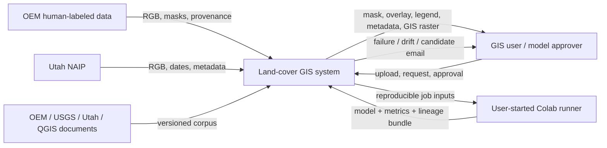
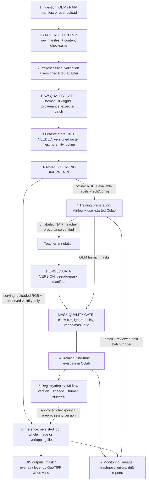
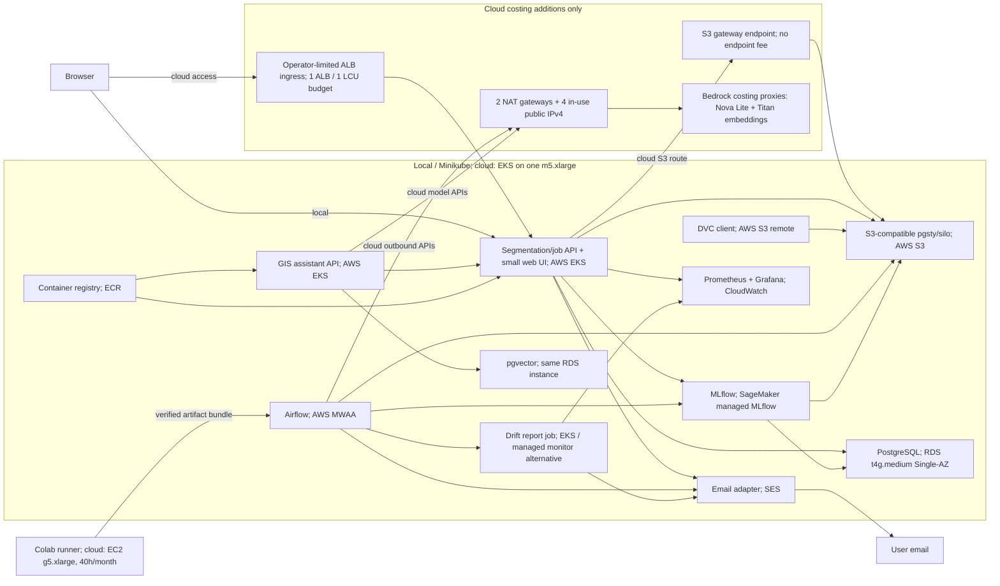

# Land-cover segmentation system design

Requirements source: [Lab 1](lab-1.pdf), pages 2–5 and appendices 2–3. This document distinguishes agreed decisions, assumptions, and unmeasured characteristics. Lab 1 delivers the design and reproducible repository foundation; runtime components belong to later labs.

## 1 Overview

A GIS specialist needs an initial thematic land-cover map from an overhead image. The system accepts RGB images of different sizes and returns an eight-class OpenEarthMap pixel mask, a color visualization, an overlay, and a legend. For GeoTIFF input with usable georeferencing, it also produces a georeferenced raster layer. New explicitly defined data batches pass validation, automatic annotation, continual fine-tuning from the current approved model, and evaluation before a person approves activation. The course project aims to make GIS delivery and model updates reproducible, integrated, and observable.

## 2 Motivation

The primary consumer is a GIS specialist or cartographer who receives a new image and prepares thematic raster layers. Use is on demand; the initial assumption is one user and one active inference job. Incorrect classes may require manual correction or make the map unsuitable for a particular task, so outputs must identify the taxonomy, model version, and limitations.

A possible secondary application is using masks to prepare simulator terrain. Heights, materials, traversability, 3D, and engine integration cannot be inferred from a semantic class alone and are outside the initial deliverable.

## 3 Success metrics

| Level | Metric / rule | Status and verification |
|---|---|---|
| Decision/workflow | At least 9 of 10 predefined valid inputs produce a complete package that opens in GIS without correcting format, grid, or georeferencing | Agreed preliminary target; not measured. Cases cover PNG/JPEG, affine GeoTIFF, and different dimensions; pixel-only inputs do not require a CRS |
| Model | Initial candidate mIoU exceeds the trivial baseline; after fine-tuning, mIoU on fixed independent OEM validation is no lower than the current version | Agreed relative target, conditional on the provenance gate. Report IoU and support for each of the 8 classes |
| System | Completion/failure rate, end-to-end p50/p95, queue wait, peak RAM, and throughput with 1 active job | Numerical latency/RAM targets are unknown until benchmarking; assumption: asynchronous operation on a recorded local configuration |
| New-domain diagnostic | Agreement with NAIP pseudo-masks and up to 5 previews per candidate | Diagnoses teacher agreement and obvious errors; not independent temporal accuracy |

For the defense, mIoU is the optimization metric; format validity, resource limits, and completion are satisficing checks. The 9/10 target does not establish sufficient cartographic accuracy or measured working-time savings.

## 4 Requirements and constraints

**Functional requirements:**

- A GIS user uploads one file and receives a persisted job with status.
- Return the original image, class-ID mask, color mask, overlay, legend, and metadata.
- Use whole-image inference or overlapping tiles according to the image size and memory budget, and reconstruct the original pixel grid.
- Produce a georeferenced raster export when valid CRS and affine metadata are available.
- Maintain a separate batch lifecycle for training data and continual fine-tuning.
- Require human model promotion and support rollback to a previous approved version.
- Provide a GIS assistant for requests, validation explanations, and export preparation.

| NFR category | Decision, number, or explicit assumption |
|---|---|
| Freshness | Each explicitly added batch is checked against the expected raw manifest/version. Receiving an old version with 0 new source scenes in expected-new mode causes a stale-input failure. NAIP does not require daily acquisition freshness |
| Latency / throughput | 1 user, 1 active inference job; other jobs queue. p95 and throughput are not measured; the benchmark method is in 6.3. Queue wait and computation time are recorded separately |
| Availability / fallback | Available when the environment is running; no 24/7 SLA. A failed job has a terminal reason and can be retried. An unavailable model causes readiness failure rather than a fabricated mask |
| Reproducibility | Record training data version, code commit, config/preprocessing/taxonomy versions, checkpoint digest, and seeds per run. Replaying a batch does not duplicate data. Replaying an expired inference input requires uploading the same file again; metadata cannot restore bytes. Byte-identical GPU weights across different hardware are not promised |
| Adaptability | Initial OEM model followed by fine-tuning from the latest approved checkpoint on each new defined batch; the old-data replay proportion remains an experimental parameter. Human promotion only |
| Observability without GT | Errors, durations, watermark, channel/GSD metadata, image statistics, and predicted class fractions. Drift is not evidence of an IoU change. Reports identify the reference/version and threshold policy |
| Cost / resource ceilings | Actual paid-service budget: $0. Host RAM of 24 GiB is not a service quota. Upload bytes, decoded pixels, tile/batch size, timeout, and Docker/Minikube RAM must be bounded configuration; values follow a resource probe before runtime launch |

**Input assumption:** the initial adapter supports 8-bit RGB PNG/JPEG and GeoTIFF with an explicit RGB band mapping. Other bit depths or unidentified bands receive an explained rejection until an explicit adapter is added. This is an initial compatibility contract, not a verified property of all external images. Arbitrary aspect ratios are supported; benchmark dimensions of 1024/4096 and internal tile sizes are not user-facing limits.

In scope: semantic land-cover rasters, the initial GIS package, reproducible model updates, and the stated roadmap. Out of scope: detection/instances, building counting, automatic separation of adjacent buildings, guaranteed quality in another geography, inventing georeferencing, areas in square meters without a valid scale/method, 3D, and permanent production cloud operation.

Conflict priorities: the correct source grid and a valid result take priority over a fast but incorrect export; the $0 budget and on-demand operation take priority over 24/7 availability. Retaining training artifacts supports training reproducibility, while one-day retention of private inference inputs deliberately limits their later replay.

## 5.1 Problem statement

Multiclass semantic segmentation assigns each valid RGB pixel one of eight mutually exclusive OEM classes. Building-only segmentation was rejected because it provides fewer meaningful land-cover types than the desired GIS map.

## 5.2 Data

**Agreed timeline:**

| Data | Role |
|---|---|
| OEM | Initial supervised training and human-labeled development control, conditional on weight independence |
| Utah NAIP 2018 | First external batch for pseudo-labeling and fine-tuning |
| Utah NAIP 2021 | Next update from the latest approved model |
| Utah NAIP 2024 | Final comparison; excluded from training, threshold tuning, and regular promotion |

OEM provides 8 classes, RGB, and approximately 0.25–0.5 m GSD; the standard split is within regions. Utah NAIP from 2018 onward is documented at 0.6 m, introducing a scale shift as well. Primary sources: [OEM paper, 2.2/S1](https://arxiv.org/html/2210.10732), [Utah NAIP](https://gis.utah.gov/products/sgid/aerial-photography/naip/). Specific AOIs, tile bytes, class coverage, and scene overlap have not been verified; start with a small urban/rural subset. The OEM ZIP is not guaranteed to contain all RGB imagery: xBD imagery may require separate retrieval.

**Four Lab 1 checklist items:**

1. **Time axis:** use real NAIP acquisition years/dates/intervals and separately replay archived batch ingestion; OEM-2022+ with NAIP-2018 is retrospective arrival replay, not a historical backtest of a model available in 2018.
2. **History/holdout:** use 2018/2021 for updates and development, keeping 2024 closed until final comparison. Check scene/AOI groups and spatial overlap before cropping; distinguish temporal from geographical transfer.
3. **Labels/delay:** OEM labels arrive with the dataset release; NAIP pseudo-labels become available after the annotation job, without an invented fixed delay. Routine independent human ground truth for new NAIP imagery is not planned; its operational arrival delay is “never.”
4. **Text corpus:** section 6.8 identifies the OEM paper/code mapping, USGS NAIP dictionary, Utah flight-date documentation, QGIS 3.44 raster documentation, and the project export contract. Snapshotting/versioning is a later step; the corpus is not yet indexed.

Lab 1 compensation: explicitly document the lack of independent temporal masks and evaluate teacher agreement together with independent OEM control if its independence is established. This does not establish temporal generalization or guarantee compliance with the unavailable full Lab 2 requirements.

**Time fields:** `acquisition_start/end`, `date_precision`, nullable `source_published_at`, `ingested_at`, `processed_at`, and `pseudo_labeled_at`. An unknown date stays unknown; a year does not become an invented January 1 date. USGS distinguishes Acquisition Date from Date Entered; Utah indices use SrcImgDate for 2018/2021 and DATE for 2024. [USGS dictionary](https://www.usgs.gov/centers/eros/science/national-agriculture-imagery-program-naip-data-dictionary).

**Version/freshness:** a stable raw manifest includes source IDs, checksums, acquisition metadata, and adapter version, excluding variable ingestion/run timestamps from its content digest. Derived annotation/training manifests also reference teacher/checkpoint/config/split versions. Expected-new mode checks the expected source period/scene set and raw content; an old batch causes freshness failure. Intentional replay of the same version produces a no-op or reproducible result without duplication. The watermark advances after committing a valid dataset, not after any successful DAG execution.

**Formats and storage:**

| Layer | Format / storage |
|---|---|
| Raw | Immutable source PNG/JPEG/GeoTIFF in object storage, versioned through DVC |
| Clean / labels | Canonical RGB and integer-mask PNG/GeoTIFF with a manifest; crop/tile artifacts are reproducible from config after splitting |
| Features | RGB/normalization tensors during the run; no separate persisted feature table |
| Manifests / metadata | Versioned JSON/JSONL in stable order; PostgreSQL holds operational job/run state |
| Models / reports | Checkpoint, manifest, and JSON metrics/previews in artifact storage, referenced by MLflow |
| Corpus in Lab 3 | Source snapshots and extraction config/digests; the index refers to the exact doc_version |

Git stores code, configuration, documentation, the lockfile, and DVC pointers/manifests; large raster/checkpoint bytes stay in DVC/object storage. Git LFS is not introduced because the selected DVC remote already fills this role. CSV/Parquet do not replace raster images; JSON is sufficient for the small manifest.

## 5.3 Techniques

**Baseline:** predict the most frequent class at every pixel, determining that class exclusively from training labels after filtering ignored pixels. This is a comparison point, not a usable map.

**Candidate:** U-Net / ResNet18 with an ImageNet-pretrained encoder and 8 output classes through segmentation_models_pytorch. This is an initial candidate, not a claim of the best model. Initial OEM training creates the working version; later NAIP runs start from the latest approved checkpoint. [SMP Unet](https://smp.readthedocs.io/en/latest/models.html), [encoder weights](https://smp.readthedocs.io/en/latest/encoders.html).

**Annotator:** a separate ready-made model with a compatible taxonomy; its checkpoint is not yet approved. Every pseudo-dataset requires a teacher source, digest, training splits, mapping, and annotation config. Official lightweight OEM weights saw train and validation; creating a new split from those same images does not restore independence. [OEM code](https://open-earth-map.org/code.html). GeoSeg-OV publishes another ready-made option, but its repacked split IDs and compatibility still need checking; it is a research candidate, not a verified teacher. [GeoSeg-OV](https://github.com/zzaiyan/GeoSeg-OV).

| Input / property | Train-time source | Serving-time source / rule |
|---|---|---|
| RGB pixels | OEM / NAIP adapter | Uploaded file; the same channel order and versioned normalization |
| Masks | OEM human labels / versioned teacher output | Absent and not required for inference |
| GSD | Source metadata, if available | File metadata or an explicitly supplied parameter; do not guess unknown values |
| CRS / affine / validity | Source raster metadata | Input raster metadata; not a hidden label-derived feature |
| Preprocessing | Config accompanying the checkpoint | Exact corresponding version from the model manifest |
| Augmentation | Training only, synchronized for image/mask | Random training augmentation is not applied |

For NAIP RGBNIR, an adapter selects known RGB bands; the model must not start using NIR implicitly. Resize class masks with nearest-neighbor interpolation. Whole/tiled inference and stitching use the same model/preprocessing versions.

## 5.4 Experimentation and validation

- Reserve OEM train/validation groups before crops/augmentation; check source-scene overlap, neighboring tiles, and reused benchmark imagery.
- Before incorporating pretrained weights, verify that the model/teacher did not train on the reserved control. Unknown provenance blocks an independence claim; a train+val teacher does not pass this gate.
- If independence cannot be established, do not use that teacher for this promotion protocol; continue searching for a compatible checkpoint. Lab 1 records this dependency openly rather than claiming completion.
- Separate development scene groups from update groups in 2018/2021 in advance; open 2024 for final comparison after freezing configuration.
- Class IoU = TP/(TP+FP+FN). Compute an aggregate confusion matrix over valid GT pixels rather than averaging patch IoU, and report support. Mark a zero-denominator class undefined with an explicit averaging policy rather than substituting IoU=1.
- Compare candidate/current on the same independent control and configuration. The mIoU ≥ current gate does not replace per-class review; explain meaningful class regression before a human decision.
- NAIP-2024 measures agreement when pseudo-labels are the reference; up to 5 previews are a sanity check, not proof of true IoU.
- Do not assume official OEM test labels or a functioning evaluation server are available without checking.

## 5.5 Human in the loop

The user receives email about pipeline failure/drift and a ready candidate, reviews metrics, lineage, and up to 5 previews, and explicitly approves activation. Promotion is not automatic. A rejected candidate remains a run artifact; the current alias is unchanged. Override/rollback returns the alias to a specific previously approved version; every job records the actual loaded checkpoint digest.

Lifecycle artifacts: experiment config/run → candidate checkpoint and data/code lineage → registered model version → approved serving alias → monitoring report → next update candidate. Retired versions remain available for audit/rollback throughout the project.

A person starts Colab; repository commands/configuration perform all steps inside the session. Exchange with the local stack uses a verifiable artifact bundle: model, metrics, config, source/data versions, commit, and checksums; import registers the run/model in local MLflow. Colab does not require exposing PostgreSQL or MLflow to the internet. Colab resource availability is not guaranteed. [Colab FAQ](https://research.google.com/colaboratory/faq.html).

## 6.1 High-level design

The diagrams describe the target evolution of the system; launching these components is outside Lab 1 scope.

**Context:**

**Seven-layer data flow:**

Versioned files provide offline artifacts without a separate feature store. The raw gate does not require masks for inference or new NAIP data: mask checks are conditional on available labels, and fine-tuning requires a separate mask gate after annotation. Teacher provenance is checked before annotation; derived masks have their own version point. GT masks do not enter the serving branch. Uploads also have an input digest and job metadata; they are not automatically added to training data.

**Deployment draft:**

## 6.2 Infra

Agreed local stack: DVC, S3-compatible storage, Airflow, MLflow, and PostgreSQL. Local inference and user-started Colab remain the actual execution plan. The cloud column is a separate full-cloud costing scenario; additional framework/monitoring choices are assumptions for later labs.

| Function | Local / external | Hypothetical cloud equivalent | Stage |
|---|---|---|---|
| Raw data, masks, models, reports | MinIO-compatible pgsty/silo from the reference PDF; ARM image compatibility is pending | [Amazon S3](https://docs.aws.amazon.com/AmazonS3/latest/userguide/Welcome.html) | Lab 2 |
| Raster artifact versions | DVC + S3 remote | The same DVC, with an S3 remote | Lab 2 |
| Batch orchestration | Airflow | [Amazon MWAA](https://docs.aws.amazon.com/mwaa/latest/userguide/what-is-mwaa.html) | Lab 2 |
| Jobs / metadata | PostgreSQL | [RDS PostgreSQL](https://docs.aws.amazon.com/AmazonRDS/latest/UserGuide/CHAP_PostgreSQL.html), one t4g.medium Single-AZ instance shared with the retrieval index | Labs 2/4 |
| Tracking / registry | MLflow + PostgreSQL backend + S3 artifacts | [SageMaker managed MLflow](https://docs.aws.amazon.com/sagemaker/latest/dg/mlflow.html), with its own managed backend and an S3 artifact bucket | Lab 2 |
| Training / annotation | User-started Colab | On-demand [EC2 g5.xlarge](https://aws.amazon.com/ec2/instance-types/g5/) GPU runner, 40 h/month assumed for annotation/fine-tuning/evaluation; an alternative to Colab, not an additional local requirement | Lab 2 |
| Segmentation/job API + UI | Proposed FastAPI, a small HTML page, and model worker | EKS containers on the shared CPU worker | Lab 4 |
| GIS assistant API | Separate service, provisionally FastAPI | EKS containers; cloud model API usage costed separately | Labs 3/4 |
| Runtime deployment | Docker / Minikube | [Amazon EKS](https://docs.aws.amazon.com/eks/latest/userguide/what-is-eks.html), with one m5.xlarge CPU worker for the two APIs and scheduled jobs | Lab 4 |
| Container registry | Minikube registry | ECR | Lab 4 |
| Drift reports | Proposed Evidently job | Costed as an EKS job; managed alternative: SageMaker Model Monitor, not a separately included service | Lab 4 |
| Metrics / dashboard | Proposed Prometheus/Grafana | CloudWatch | Lab 4 |
| Retrieval index | Proposed pgvector in the same PostgreSQL | pgvector on the same RDS t4g.medium instance; course-table managed alternative: OpenSearch Serverless vector search, excluded from the estimate | Lab 3 |
| LLM / embedding backend | Actual local model/backend remains undecided | [Amazon Bedrock](https://aws.amazon.com/bedrock/pricing/), Nova Lite and Titan Text Embeddings V2 as explicit costing proxies only | Lab 3 |
| User ingress | Loopback access to the local API/UI | [Application Load Balancer](https://aws.amazon.com/elasticloadbalancing/pricing/), one ALB with a 1-LCU costing envelope; access limited to the operator | Lab 4 |
| Outbound networking / addresses | Local host networking | [Amazon VPC](https://aws.amazon.com/vpc/pricing/), two zonal NAT gateways and four in-use public IPv4 addresses, assumed two for NAT and two for the ALB | Cloud costing only |
| S3 route | Local S3-compatible endpoint | [S3 gateway endpoint](https://docs.aws.amazon.com/vpc/latest/privatelink/vpc-endpoints-s3.html); no endpoint charge | Cloud costing only |
| Email adapter | SMTP credentials in local secrets | SES | Lab 4 |
| Feature store | Not needed: raster artifacts without online entity features | No separate managed feature store | All |

The two containerized application services are the segmentation/job API and GIS assistant API. Each has its own readiness contract: segmentation requires a valid checkpoint/preprocessing manifest; the assistant requires model-backend/embedding configuration and an available corpus index. Missing required model artifacts must fail probes. HTTP liveness alone does not establish readiness.

The cloud scenario is deliberately small: one CPU worker and Single-AZ RDS do not provide application high availability, and their capacity is not benchmarked. The 40 GPU hours are a costing allowance, not a claim that a particular teacher or training run fits. Bedrock proxy names establish priced model inputs without selecting the actual project models. In the cloud alternative, the GPU runner returns the same checked artifact bundle as Colab; the approved local/Colab workflow is unchanged.

Cloud administrative access remains restricted; MLflow is not exposed as a public user endpoint. AWS service APIs use IAM-authenticated public endpoints over the modeled outbound route. The S3 gateway endpoint supplies the S3 route; paid interface endpoints are not silently included. Public ALB access is operator-limited and does not introduce a public multi-user product or a new SLA. The cloud labels and network additions are hypothetical deployment/cost inputs, not components already running locally.

[FastAPI](https://fastapi.tiangolo.com/) is a proposed framework, not an installed dependency. Reference-stack versions in the PDF are course requirements/guidance; ARM/Python compatibility is unverified, so runtime dependencies are not added in Lab 1.

Lab 1 verification: local checks on 2026-10-22 passed in a clean temporary copy with Python 3.12.13, Ruff 0.17.2, and pre-commit 4.7.0. A subsequent genuine clean clone of published commit `934858b` passed setup/lint and pre-commit checks; lint CI was green on branch `lab1`. This does not satisfy the separate green-default-branch gate for `main`. All three diagrams, including the updated cloud labels, rendered successfully and passed visual review during apply.

## 6.3 Performance

Actual hardware/tooling snapshot, 2026-10-22:

| Parameter | Value / verification boundary |
|---|---|
| Host / CPU | Apple M4 Pro, Mac16,7, arm64, 14 CPU cores |
| Host RAM | 24 GiB; Docker/Minikube allocation has not been checked |
| OS | macOS 26.6.2, build 25G83 |
| Available volume space | Approximately 204.18 GiB at inspection time; not a project quota |
| Tooling | uv 0.11.21; Docker CLI 29.5.2; daemon not checked |
| System Python | 3.14.6; .python-version sets a separate project Python pin |
| Verified project tooling | Python 3.12.13, Ruff 0.17.2, pre-commit 4.7.0 installed in the project environment |
| Minikube | Command not found in PATH; no cluster launch |

The snapshot used read-only sysctl, uname, sw_vers, df, and version commands. No checkpoints or raster archives were downloaded; mIoU, inference latency, peak RAM, and GPU time have not been measured.

Agreed execution uses asynchronous jobs with persisted status. Async does not accelerate the model; whole-image versus tiling is a separate choice based on dimensions and memory. The initial benchmark reference is CPU serving within recorded Docker/Minikube allocations on this host; container acceleration is not assumed.

**Measurement plan, not results:** record commit/data/model/preprocessing versions, CPU/RAM limits, dtype, and threads. Measure cold start separately, then run 5 warm-ups and 30 measured runs each for 1024×1024, 4096×4096, and one selected large raster case. Measure decode/preprocess/inference/stitch/export, peak RSS, p50/p95 completion from the end of upload with an empty queue, queue wait, and images/hour. Test dimensions are not upload limits.

Before runtime launch, configure maximum upload bytes, decoded pixels, in-flight jobs, tile/batch memory, job deadline, and temporary disk. These are explicitly unknown in Lab 1 until a resource probe; host RAM cannot substitute for these limits, and unlimited uploads must not be promised. If a candidate misses the budget, adjust internal tile/batch size or the candidate after measurement.

## 6.4 Security

Local single-user access: publish host ports on loopback; an internal container bind does not authorize public ingress. Authentication/public multi-user service is not implemented in this stage. Secrets use environment variables or ignored local configuration; the existing .gitignore excludes .env/.env.*. Logs and corpus content must not contain credentials.

At trust boundaries, validate decoded format, channels/dtype, positive dimensions, bounded decoded size, corrupt/TIFF expansion, class domain, and grid. The server generates object names, forbids client-controlled paths, and does not unpack arbitrary archives through the upload API. Verify download/data-bundle checksums. Retrieved documents and user requests are data: embedded instructions cannot change agent permissions or initiate promotion. Tool calls use the same deterministic validators.

## 6.5 Data privacy

Agreed inference input/result retention is 1 day. **Exact-clock assumption:** expires_at = accepted_at + 24h; after expiry, access is denied, queued jobs do not start, and cleanup deletes bytes. Running-job deadlines cannot exceed expires_at: expired execution is canceled, late outputs are not published, and those outputs are deleted too. If the local environment is off, physical deletion occurs at next startup; this on-demand-service limitation is disclosed to the user.

**New assumption:** technical logs and aggregate metrics are retained for up to 30 days without image bytes, full filenames, exact coordinates, or secrets. Training manifests, permitted dataset versions, model artifacts, and experiment lineage remain throughout the project. Uploads do not automatically become training data. Overhead imagery is not assumed to be free of personal or sensitive information. Record explicit license restrictions and source attribution briefly; dataset redistribution is not a Lab 1 deliverable.

## 6.6 Monitoring and alarms

| Signal | Threshold / rule | Response |
|---|---|---|
| Invalid training batch | ≥1 blocking format/mask/grid/checksum/class error | Failed gate, report, and email; no new training-data commit |
| Expected-new freshness | Wrong expected raw version/period, or 0 new scenes when an old dataset repeats | Stale-input failure/email; do not advance watermark |
| Intentional replay | Same manifest/config/seed with explicit replay mode | No-op or reproducible output; no false stale alert |
| Runtime job failure / required model missing | ≥1 terminal failure; model readiness=false | User-facing reason; deduplicated email event; current version unchanged |
| Input/prediction drift | New assumption: alert when the selected statistic exceeds the 95th percentile of reference-versus-reference window comparisons | Daily report/email and human review; record reference/version and sample sufficiency |
| Insufficient monitoring sample | Below a calibrated minimum window size; size still unknown | Insufficient-data status; do not claim “no drift” |
| Performance/resources | Configured limit/deadline exceeded; numbers follow benchmarking | Failure/report; expose p50/p95 and peak RAM |

The 95th percentile is a new calibration assumption, not proven detector quality. Determine the method, sampling unit, and multiple-signal correction using reference windows. An event key prevents repeated email for the same event; do not email per pixel or metric. Monitoring runs daily when the environment is running. Lab 4 must show a dashboard covering at least 2 windows and injected drift whose email actually reaches the user.

Inference class fractions use only the observed-valid input domain. Without GT, do not compute “current IoU” or use a hidden GT ignore mask.

## 6.7 Cost

The actual paid-service budget remains **$0**: local serving and available Colab are the implementation plan. The estimate below prices a complete, small AWS alternative, including recurring GPU model work and an LLM backend. It does not authorize deployment or change the actual model/backend choice.

**Saved provider estimate:** [AWS Pricing Calculator: KSE MLOps GIS](https://calculator.aws/#/estimate?id=52dedcbc1a8747f5028990e050593d9dab6c4ac1), ID `52dedcbc1a8747f5028990e050593d9dab6c4ac1`. Calculated and verified on **2026-10-23, Europe/Kyiv**; the estimate metadata timestamp is `2026-10-22T21:03:48.822Z` in UTC. Region: **US East (N. Virginia), us-east-1**. Currency: USD before taxes. The result is **$1,229.81/month**, **$0 upfront**, or **$14,757.72 for 12 identical months**. No reservation commitments, promotional credits, or paid support plan are selected.

**Workload and capacity assumptions, not measurements:**

- 1,000 GIS images/month, one active segmentation job; average 50 MB input and 50 MB output per job. With 24h retention this gives about 3.3 GB average temporary storage, rounded up to 4 GB, plus 250 GB persistent datasets/models/reports: 254 GB S3 Standard total.
- One Linux/shared `m5.xlarge` CPU worker, 4 vCPU/16 GiB, for the two APIs and scheduled monitoring; one EKS standard-support cluster. One worker and Single-AZ RDS do not provide an HA guarantee. Capacity and latency remain unbenchmarked.
- One Linux/shared `g5.xlarge` GPU worker for a total budget of 40 hours/month, provisionally 8 hours annotation and 32 hours training/evaluation. Initial training and subsequent updates consume this budget; extra experiments or longer runs increase it. The 100 GB GPU scratch volume is deleted after runs; the CPU worker retains 50 GB gp3.
- 1,000 assistant tasks/month, with 3,000 model calls including tool turns/retries/evaluation. The calculator's integer request-rate inputs are represented conservatively by 3,600 calls/month, 20% headroom: 1 request/minute for 2 hours/day over 30 days, with 4,000 input and 800 output tokens/call. This is 14.4M input and 2.88M output tokens. Amazon Nova Lite is a **costing proxy**, not the approved project model. Titan Text Embeddings V2 is a separate proxy for 1.1M text tokens/month. Images are not sent to these text-backend proxies.
- 10,000 S3 PUT and 100,000 GET requests/month; 50 GB S3 Internet result downloads, counted once. 5 GB ECR images; 5 GB standard log ingestion with one-month retention, 10 custom metrics, one dashboard, three standard-resolution alarm metrics, and 100 plain alert emails/month.
- Always-on infrastructure uses the calculator's 730-hour month. The MLflow form uses 24 hours/day and 30.42 days/month, giving 730.08 hours after its rounding. These are billing inputs, not an availability commitment for the actual local service.

| Component | Selected calculator inputs | USD/month |
|---|---|---:|
| EKS control plane | 1 standard-support cluster, 730h | 73.00 |
| CPU serving/operations | 1 m5.xlarge, Linux/shared On-Demand, 730h | 140.16 |
| GPU annotation/training/evaluation | 1 g5.xlarge, Linux/shared On-Demand, 40h | 40.24 |
| EBS gp3 | 50 GB for 730h + 100 GB for 40h; baseline IOPS/throughput | 4.40 |
| MWAA | Small, included worker/schedulers/web servers, 10 GB metadata; no extra scale-out hours | 358.70 |
| Managed MLflow | 1 Small tracking server, 730.08h, 1 GB metadata | 438.15 |
| RDS PostgreSQL jobs/index | 1 db.t4g.medium, Single-AZ, On-Demand, full-month utilization; 20 GB gp3 | 49.75 |
| S3 storage and requests | 254 GB Standard, 10k PUT, 100k GET | 5.93 |
| S3 Internet transfer | 50 GB outbound; no duplicate EC2/ECR egress | 4.50 |
| ECR | 5 GB private images, same-region pulls | 0.50 |
| CloudWatch | Logs, retention, metrics, dashboard and alarms specified above | 5.82 |
| SES | 100 outbound emails, no attachments or add-ons | 0.01 |
| LLM and embeddings | Nova Lite $1.56 + Titan Embeddings V2 $0.02, on-demand text workloads | 1.58 |
| Application Load Balancer | 1 ALB, 730h, 1 average LCU costing envelope | 22.27 |
| NAT gateways | 2 zonal gateways, 730h each, 50 GB processed per gateway = 100 GB total | 70.20 |
| Public IPv4 | 4 in-use addresses, 730h each: 2 NAT + assumed 2 ALB addresses | 14.60 |
| **Total** | **18 calculator entries, grouped above; $0 upfront** | **1,229.81** |

**Topology and accounting:** two private/public subnet pairs support MWAA across two AZs; zonal NAT routes stay in the corresponding AZ. A free S3 gateway endpoint carries same-region S3 traffic. The ALB is the user ingress, restricted to the operator network; administrative services remain private. Standard public AWS service APIs use IAM-authorized access through the costed NAT path, rather than additional PrivateLink endpoints. The 100 GB NAT budget includes external imagery/checkpoint retrieval and AWS API traffic. ALB capacity assumes 1 GB/hour processed by EC2/IP targets, equivalent to a conservative average 1 LCU; it is not a measured traffic forecast. Four public IPv4 addresses are an explicit allocation assumption, not a guarantee of the ALB's future address count.

Managed MLflow pays for its own metadata backend. The RDS instance stores jobs/retrieval and is not charged again for MLflow metadata. The CPU worker handles API/monitoring work; Bedrock pays for LLM/embedding compute, so no second GPU LLM server is included. RDS assumes no burst CPU-credit overage; sustained load requires a new estimate or a different instance. Existing DNS is assumed; new domain registration, separately managed identity services, cross-AZ data transfer, extra backups/snapshots, extra endpoints, premium monitoring, support and taxes are outside this scenario. Uploads can go directly to S3; S3 result egress is not added again to EC2 or NAT as Internet output. No resource or throughput benchmark establishes that these capacities meet a production SLA.

**Calculator behavior retained:** the GPU EBS entry rounds 40/730 instance-months to 0.05 and returns $0.40; MLflow rounds its day input as noted above. CloudWatch applies its stored-log compression factor and dashboard allowance. The S3 transfer calculation charges $4.50 for 50 GB; no additional shared 100 GB account allowance is manually subtracted. The table preserves the calculator's figures and per-entry rounding rather than replacing them with hand-adjusted totals.

**Verification method:** interactive browser access was canceled. The estimate was instead calculated with the official calculator's published JavaScript calculation engine and current official regional pricing assets, serialized using its export converter, and saved through its public estimate service. The saved estimate was fetched back from AWS and independently recalculated from all 18 saved input configurations: no required-input/read-only errors, every individual cost unchanged, total $1,229.81 and upfront $0. Browser rendering was not visually verified. Saved links are public and remain valid for one year under the [AWS sharing policy](https://docs.aws.amazon.com/pricing-calculator/latest/userguide/save-share-estimate.html); the workload and table above preserve the essential inputs.

For sensitivity analysis, use `monthly cost = fixed managed services + CPU/GPU runtime + storage/requests + network + monitoring/email + LLM/embedding usage`. Incremental GPU compute is $1.006/hour at the selected rate, plus scratch storage; token rates, processing hours and data volumes must be recalculated when the workload changes. MWAA and managed MLflow together account for $796.85/month, about 65% of this scenario. The old $1,109.94 manual subtotal is superseded by this saved, broader scenario.

## 6.8 Integration points

**Upstream:** OEM authors/source imagery and Utah UGRC/NAIP. Retain source URL/entity ID, license note, scene/AOI ID, acquisition metadata, checksums, and adapter version. Reject an invalid training batch as a whole with a report; an inference upload without labels is a valid input.

**Project mask contract — taxonomy v1:**

| Internal ID | OEM raw ID | Canonical class |
|---:|---:|---|
| 0 | 1 | bareland |
| 1 | 2 | rangeland |
| 2 | 3 | developed space |
| 3 | 4 | road |
| 4 | 5 | tree |
| 5 | 6 | water |
| 6 | 7 | agriculture land |
| 7 | 8 | building |
| 255 | 0 | Training ignore/unknown; observed export NoData under a separate policy |

The raw mapping was checked in [OEM utils.py](https://raw.githubusercontent.com/bao18/open_earth_map/main/open_earth_map/utils.py). Align the code aliases Grass/Pavement/Cropland with the paper taxonomy rather than adding classes. The official [dataset loader](https://raw.githubusercontent.com/bao18/open_earth_map/main/open_earth_map/dataset.py) does not implement our remap: explicitly convert 1–8→0–7 and 0→255; unsigned underflow from mask−1 is forbidden.

Exclude ignore=255 from loss/confusion matrices. At inference, 255 is allowed only for observed alpha/NoData/validity; trim padding, and do not turn low confidence alone into NoData. Every valid RGB pixel receives ID 0–7.

**Downstream GIS:** source-grid class-ID mask, palette/legend, color preview/overlay, and JSON metadata. GeoTIFF output is uint8, single band, with the original width/height, CRS, and affine when valid. Missing affine or RPC/GCP-only input produces a pixel mask and diagnostics without invented georeferencing. A QGIS round trip checks grid, class domain, NoData, and palette. [QGIS 3.44 Raster Properties](https://docs.qgis.org/3.44/en/docs/user_manual/working_with_raster/raster_properties.html). The initial scope does not require areas in square meters.

**Job/result contract:** server-generated job_id, input digest, accepted_at/expires_at, status `queued/running/succeeded/failed/expired`, versioned model/preprocessing/taxonomy, actual checkpoint digest, pixel dimensions, CRS/affine availability, valid-domain policy, file references, and machine-readable validation reasons. Retrying a failure creates a linked new run; promotion during a job does not change its already selected checkpoint.

**Colab bundle:** dataset-manifest digest, code commit, config/seed/environment, teacher/current-model IDs, checkpoint digest, metrics, preview references, and validation report. The bundle contains no SMTP/cloud secrets; import checks hashes/schema/target dataset version before logging to local MLflow.

**Concrete retrieval corpus:**

| doc_id | Document / selected sections | Version / status |
|---|---|---|
| oem-paper | [OpenEarthMap paper](https://arxiv.org/html/2210.10732): 2.2, S1 class definitions, S5 attribution | arXiv 2210.10732v1; metadata checked 2026-10-22 |
| oem-mask-codes | [OEM utils.py](https://raw.githubusercontent.com/bao18/open_earth_map/main/open_earth_map/utils.py): class dictionaries | Mutable main; exact commit and byte hash pending |
| naip-dictionary | [USGS NAIP Data Dictionary](https://www.usgs.gov/centers/eros/science/national-agriculture-imagery-program-naip-data-dictionary): Acquisition Date, Date Entered, bands, resolution, datum/projection | Published 2021-07-19; direct access unstable, text checked through search |
| utah-naip | [UGRC NAIP](https://gis.utah.gov/products/sgid/aerial-photography/naip/): RGB/NIR, resolution, Finding flight dates | Last update 2024; metadata checked 2026-10-22 |
| qgis-raster | [QGIS 3.44](https://docs.qgis.org/3.44/en/docs/user_manual/working_with_raster/raster_properties.html): 13.1.1, 13.1.2, 13.1.3.1, 13.1.4 | Documented version 3.44 |
| project-export-contract | Section 6.8 of docs/design.md | Working document; capture commit/digest when snapshotting in Lab 3 |

Corpus-manifest fields: doc_id/title/publisher/source_url/source_revision/accessed_at/selected_sections/snapshot_path/snapshot_sha256/extraction_version/doc_version/reuse_note. Chunks reference doc_id, doc_version, and section/page/line locator; answers cite specific sources. Compute SHA256 from actual snapshot bytes; current values remain null/pending rather than fabricated hashes. Lab 1 names the corpus; ingestion/indexing and versioned prompts belong to Lab 3.

LLM scenario: a request such as “prepare a GeoTIFF for QGIS,” together with metadata/validation, produces a grounded plan, an explanation of missing information, and permitted export steps. Lab 3 compares plain LLM and retrieval. Lab 5 adds inspect/segment/validate/export tools; code handles numerical/CRS checks, and model activation remains a user decision.

## 6.9 Risks and uncertainties

| Risk | Mitigation / gate |
|---|---|
| Teacher saw OEM control | Check training scene IDs/checkpoint provenance before pseudo-labeling; claim independence only after verification |
| NAIP pseudo-labels repeat teacher errors | Call agreement agreement; ≤5 previews are a sanity check, not independent temporal IoU |
| Utah 0.6 m / other regions shift the domain | Small pilot, GSD metadata, per-class diagnostics; no guaranteed transfer to Ukraine |
| NAIP tiles / class coverage unverified | Before Lab 2, select a small specific urban/rural AOI and check dates, access, overlap, and class support |
| OEM forgetting after updates | Fixed independent development control, old-data replay as an experimental parameter, human gate, rollback |
| Colab reset / GPU shortage | Reproducible commands/config, saved bundles/checkpoints, retry; the session is not a production worker |
| Large/corrupt upload exhausts RAM/disk | Bounded decoding, limits before runtime, tiling/streaming, failure reason |
| Train/serve skew | Shared versioned RGB preprocessing, checkpoint manifest, and identical channel/grid rules |
| Incorrect GIS coordinates | Validated CRS/affine only, round trip; pixel result if georeferencing is absent |
| LLM errors / obeying document instructions | Retrieval citations, deterministic tool validators, restricted tools, evaluation; no delegated promotion |
| Email delivery failure / false drift | Deduplication, explicit insufficient-data state, Lab 4 injected shift with actual email receipt |
| Estimate becomes stale / capacity assumptions fail | Preserve inputs, refresh the saved estimate when usage changes, benchmark before deployment; retain $0 actual expenditure |
| Reused source imagery / licensing | Provenance/attribution and overlap audit; briefly record explicit restrictions and do not redistribute data without permission |

## 7.1 Alternatives

| Alternative | Pros | Cons | Decision |
|---|---|---|---|
| Building-only segmentation | Simpler taxonomy; focus on buildings | Loses roads, vegetation, water, and other desired cover types | Rejected in favor of 8 OEM classes |
| Synchronous HTTP request until completion | Less job-state logic | Long jobs, timeouts, weak progress visibility | Rejected; one file produces a persisted asynchronous job |
| Resize every image to one fixed input | Simple memory profile | Loses small objects in large rasters | Rejected as the sole strategy; whole/tiled inference follows the budget |
| Fully managed cloud 24/7 | Managed services and cloud topology | Hundreds/roughly a thousand USD for a small academic workload; conflicts with the $0 actual budget | Calculated equivalent only; actual execution local/Colab |
| Separate feature store | Online entity-feature lookups | No established need for current raster inputs | Not needed, explained in layer 3 |

## 7.2 Placeholder

Placeholder required by Lab 1; fill using the full Lab 2 instructions. Do not invent an official section name.

## 7.3 Placeholder

Placeholder required by Lab 1; fill using the full Lab 4 instructions. Do not invent an official section name.

## 7.4 Milestones

- **Lab 2:** add versioned data pull, idempotent interval replay, a deliberately failing bad-batch gate, baseline/candidate, and MLflow run/model lineage with data version and commit.
- **Lab 3:** add versioned corpus/prompts and plain-versus-retrieval evaluation with retrieval/answer metrics, tokens/compute/cost, and p50/p95.
- **Lab 4:** add two commit-tagged containerized services in Minikube with health contracts, scheduled reports/dashboard for ≥2 windows, injected drift with an actually received email, and one-command startup/smoke.
- **Lab 5:** add a GIS agent with inspect/segment/validate/export tools, persisted traces, and ten evaluation tasks executed twice.

Full Labs 2–5 instructions are unavailable; milestones rely only on the Lab 1 overview/scorecard. Read the complete instructions before implementing each lab.
