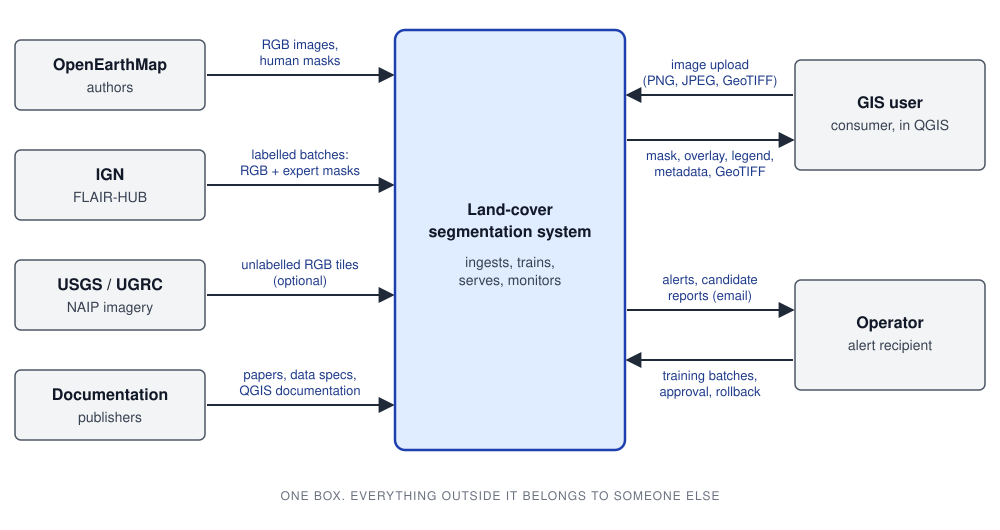
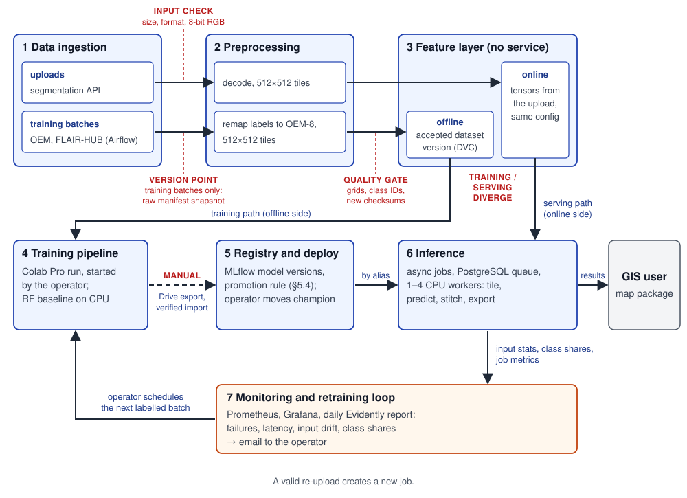
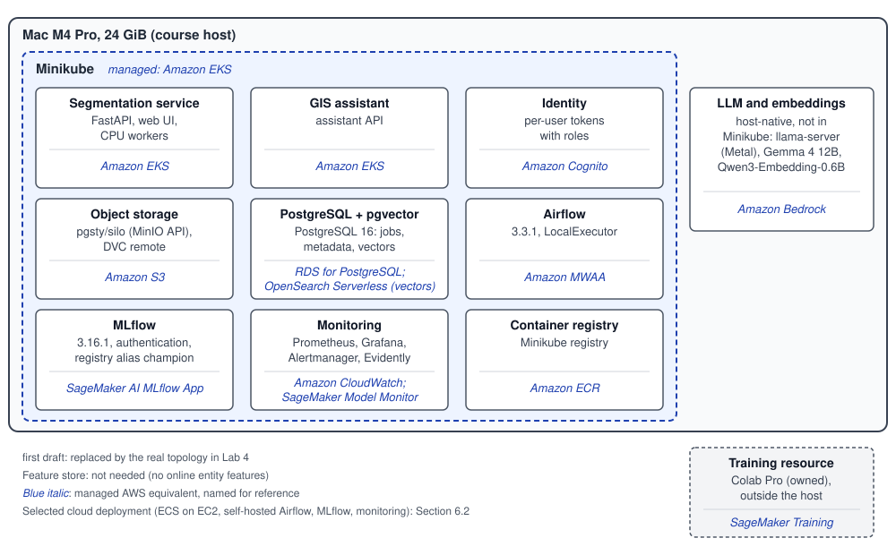

# Land-cover segmentation system design

This is the design of the KSE MLOps course project, written against [Lab 1](../labs/lab-1.pdf).

## 1 Overview

GIS specialists need a first land-cover layer for new aerial imagery, which they then check and edit in QGIS. The service turns an 8-bit RGB aerial image into an eight-class OpenEarthMap (OEM) mask and returns a colour overlay and legend; for a georeferenced GeoTIFF, it also creates a GeoTIFF mask on the same pixel grid as the input image. Authenticated users submit images of different sizes, within fixed upload limits, as asynchronous jobs, and CPU workers scale with the queue. The model is trained on OEM and fine-tuned on expert-labelled batches in acquisition-year order; an operator approves each new version before it serves. The desired outcome is GIS exports that open without manual repair, and model updates that are reproducible, monitored and reversible.
## 2 Motivation

A GIS specialist needs a land-cover layer when preparing a map from new aerial imagery. Creating this layer by hand means marking areas and assigning classes such as roads, buildings, water and vegetation. The project provides a starting layer: the user uploads an image, receives a segmentation mask and supporting files, then checks and edits the layer in QGIS. The aim is to make these results usable in the specialist's mapping workflow.

The system has two roles:

- **GIS user** (consumer): a cartographer or GIS specialist who uploads new imagery of a project area, waits for the result, imports the package into QGIS and edits the layer there.
- **Operator**: the ML engineer responsible for the system. They add training batches, review alerts and candidate models, approve or block model versions, and roll back to an earlier approved version when needed. In the course, the project author is the operator. Operator and GIS-user permissions remain separate.

The GIS assistant lets the user request image processing in plain language. For example: "Check this GeoTIFF, create a land-cover mask and prepare it for QGIS." It uses the same segmentation service as a direct upload.

- `inspect` reads the image's format, size and georeferencing.
- `segment` submits an asynchronous segmentation job.
- `validate` checks the mask and its grid.
- `export` prepares the mask, overlay, legend and metadata for download.

Assumption: 20 active GIS users together submit 1000 images and run 1000 assistant tasks a month. The product scenario assumes that the service runs in AWS. For the course, the same components run locally under the constraints in Sections 4 and 6.2. A shared service gives users a common way to submit work and receive results, while the operator can track jobs and manage model updates.

Errors affect the usefulness of the map. A wrong class takes time to correct in QGIS. A wrong grid or invented georeferencing makes the export unusable. If a new model stops recognising a class, such as roads, the error can appear in every later map created with that model.

The service therefore records the model version in each result's metadata, so the operator can identify which model produced the mask. Before an update, the operator compares the candidate with the approved model on the same labelled control data and reviews the results before approving it. This comparison can be repeated using the recorded data and training settings. User uploads have no reference masks, so the service monitors failures, processing time, input statistics and predicted class shares. These signals help the operator notice changes that need investigation; model accuracy is measured separately on labelled data.

## 3 Success metrics

We check success at three levels: the GIS user's workflow, model quality and system operation.

IoU measures overlap between the predicted and reference areas of one class. It divides the shared pixel count by the number of pixels in either area, counting each pixel once. mIoU is the mean IoU across the classes being evaluated. Higher values mean better overlap.

| Level | Metric and target | How it is checked |
|---|---|---|
| Decision / workflow | At least 9 of 10 predefined valid test images produce a complete package. The package opens in QGIS on the correct grid without manual format or georeferencing repair | A fixed test set includes PNG, JPEG, georeferenced GeoTIFF and three image sizes. This checks whether the export is usable; it does not measure cartographic accuracy |
| Model | The first neural model exceeds the random-forest baseline in OEM-8 mIoU. Each later update must meet the promotion rule (Section 5.4) | Control sets for development; final holdouts are evaluated once |
| System | Job acknowledgement p95 ≤ 1 s after upload; completion p95 ≤ 5 min for a 4096×4096 image at the assumed load. At most 1% of valid jobs fail for system reasons per week | Load test (Section 6.3) and monitoring (Section 6.6) |

Here, p95 is a time limit met by at least 95% of the relevant measurements. Acknowledgement means that the service returns a job ID after upload. Completion means that the result is ready.

mIoU is the **optimization** metric: the score we try to improve. Export validity, p95 latency and resource limits are **satisficing** metrics: each has a required limit that the system must meet. A higher mIoU does not replace meeting these limits.
## 4 Requirements and constraints

**Functional requirements:**

- An authenticated GIS user uploads one 8-bit RGB PNG, JPEG or GeoTIFF and immediately receives a job ID; uploading an image again creates a new job.
- The GIS user reads the status of their own jobs (`queued`, `running`, `succeeded`, `failed`, `expired`) and downloads their own results: a uint8 class mask (0–7, 255 for invalid input pixels), a colour overlay, a legend and JSON metadata with model and taxonomy versions.
- A GeoTIFF with a valid CRS and affine transform also yields a GeoTIFF mask on the same grid; otherwise the mask uses the pixel grid. Coordinates are never invented.
- Images of different sizes and aspect ratios, within the ceilings below, are processed in overlapping tiles and stitched back to the source pixel grid.
- The operator ingests a labelled batch, trains a candidate from the approved model, compares them, approves or blocks the candidate, and rolls back to an earlier approved version.
- The GIS assistant answers questions about the export from the project documentation with cited sources, and calls the same validated inspect, segment, validate and export functions.

**Non-functional requirements:**

| Category | Requirement |
|---|---|
| Freshness | This requirement concerns new training data. Before training, the system compares the batch file checksums with the data already stored. If there are no new files, normal batch ingestion fails (Section 5.2). A separate assumption about frequency: at most one labelled batch a month, because an operator reviews each update |
| Latency and throughput | This requirement concerns the speed of processing user uploads. The API returns a job ID with p95 ≤ 1 s after upload. For a 4096×4096 image, the result is ready with p95 ≤ 5 min at the assumed load (Section 6.3). Jobs run on 1–4 workers; queue wait is also measured separately |
| Availability and fallback | The cloud service runs continuously. Job state is stored in PostgreSQL and files in object storage, so this data survives a host failure. A lease is the period during which a worker has the right to run a job. Once it expires, an interrupted job is retried, with up to 3 attempts in total. If the approved model cannot be loaded, jobs remain in the queue and the service does not produce a mask without a model. If the LLM provider fails, the service returns an error and keeps the task for a retry |
| Reproducibility | This covers two requirements: repeating training and ingesting a batch again without duplicate data. Every training run records data version, code commit, configuration, preprocessing, taxonomy version, parent model and seeds. The target is to repeat the build of any registered model version with one command from a clean clone, using those data and settings. Ingesting the same batch again does not create duplicate dataset records. Bit-identical GPU weights are not required. For user images, uploading again creates a new job; files are deleted after 24 hours. This requirement does not promise to return a saved mask |
| Adaptability | This requirement concerns how model updates are tested. For a new batch, the operator trains a candidate model from the approved model (Section 5.3). A new architecture is also tested as a candidate first. Assumption: old OEM training tiles make up 50% of the training mix in the first experiments. This keeps either source from dominating. The operator chooses the final share based on results on the development controls |
| Observability without ground truth | This requirement concerns monitoring user uploads. They have no reference masks, so there is nothing to compare the prediction with and IoU cannot be computed for them. The service monitors failures and latency. Each day, it checks input image statistics and predicted class shares (Section 6.6). These signals help detect changes but do not prove a change in accuracy by themselves. IoU is computed only for labelled batches, when the system receives images together with reference masks |
| Cost and resource ceilings | The cloud service estimate at listed rates is about $302/month, or $338 in a training month (Section 6.7). For one job, the uploaded file is limited to 128 MiB and the decoded image to 64 megapixels. One worker with 1 vCPU and 4 GiB RAM runs the job. The job has a 15-minute deadline, which must not run past the upload's expiry. These limits bound disk space, decoding memory and work time |

**Course constraint:** the same components run on one Mac (Apple M4 Pro, 24 GiB) under Minikube with one operator. The author's existing Colab Pro subscription supplies training GPUs, and the course adds no paid spend.

**In scope:** eight-class land-cover rasters, the GIS package, supervised model updates with operator approval, monitoring and the GIS assistant. **Out of scope:** object detection and building counting, guaranteed accuracy in other geographies, area statistics in square metres, simulator terrain, high availability or an uptime percentage, and training on user uploads.

**Conflicts:** a correct grid wins over a faster export. The cost ceiling wins over burst latency: beyond four workers, jobs wait in the queue. The 24-hour privacy limit wins over inference reproducibility: an expired upload must be uploaded again.

## 5.1 Problem statement

The task is multiclass semantic segmentation: each valid RGB pixel receives one of the eight OEM classes. The taxonomy below is product-contract version 1; ID 255 marks pixels ignored in training and invalid input pixels in the output.

| ID | OEM raw ID | Class |
|---:|---:|---|
| 0 | 1 | bareland |
| 1 | 2 | rangeland |
| 2 | 3 | developed space |
| 3 | 4 | road |
| 4 | 5 | tree |
| 5 | 6 | water |
| 6 | 7 | agriculture land |
| 7 | 8 | building |
| 255 | 0 | ignore / invalid |

Examples of `developed space` are sidewalks and parking lots. OEM labels the lanes between parking lots as `road` ([class definitions](https://openaccess.thecvf.com/content/WACV2023/supplemental/Xia_OpenEarthMap_A_Benchmark_WACV_2023_supplemental.pdf)).

**Rejected framing:** building-only (binary) segmentation. It is simpler and well studied, but the GIS layer must also separate roads, vegetation, water and agricultural land.

## 5.2 Data

**Image resolution.** Ground sampling distance (GSD) is the size of the ground area represented by one image pixel. A GSD of 0.25–0.5 m means that one pixel covers roughly 25–50 cm on each side; it does not describe height.

| Source | Content | Role |
|---|---|---|
| [OpenEarthMap](https://arxiv.org/html/2210.10732) ([release](https://zenodo.org/records/7223446)) | RGB aerial images with GSD 0.25–0.5 m and masks for the eight classes, annotated by people; 9.1 GB, plus separately downloaded xBD images | Initial training; development and final controls |
| [FLAIR-HUB](https://huggingface.co/datasets/IGNF/FLAIR-HUB) ([paper](https://arxiv.org/html/2506.07080v1)), IGN France | Aerial RGB and NIR images with GSD 0.2 m and CoSIA masks drawn by expert photo-interpreters; one archive per département and year | Supervised update batches; regional controls |
| [Utah NAIP](https://gis.utah.gov/products/sgid/aerial-photography/naip/) 2018, 2021, 2024 | Public-domain images with GSD 0.6 m, without masks | Optional drift-monitoring stream |
| GIS user uploads | RGB images without masks | Serving only |

We also considered NAIP images for Utah back to 2003 (with coarser resolution before 2018) and the Chesapeake states for 2010–2023 ([Planetary Computer](https://planetarycomputer.microsoft.com/api/stac/v1/collections/naip)). None of these datasets has OEM-8 masks annotated by people, so NAIP supplies no training update batches. We keep only the Utah images with GSD 0.6 m for optional drift monitoring, because their resolution is closest to OEM's.

**Update timeline.** We use six FLAIR-HUB datasets, each for a different département (an administrative region of France) and acquisition year. FLAIR-HUB calls such a dataset a domain. We download only the RGB images and CoSIA masks: 4.88 GB of compressed archives in total. Each whole domain has one role: model updates, development checks or final evaluation. This prevents the same region from being used for both training updates and controls.

| Order | Data | Role |
|---|---|---|
| 0 | OEM training regions | Initial training |
| 1 | D080-2017 | Update |
| 2 | D033-2018 | Update |
| 3 | D065-2019 | Update |
| 4 | D045-2020 | Update |
| — | OEM development regions; D017-2021 | Development controls (Section 5.4) |
| — | OEM final regions; D073-2022 | Final holdouts (Section 5.4) |

**Lab 1 data checklist:**

1. **Time axis.** The operator downloads one FLAIR-HUB domain per batch into the training pipeline, in order of the actual acquisition years. OEM is used for initial training and has no usable time axis.
2. **History and holdout.** The 2017–2020 batches provide four successive updates; the 2021 dataset is used only to choose settings and check candidates. The 2022 dataset is reserved for a single final evaluation (table above).
3. **Labels and delay.** When the operator downloads a FLAIR-HUB batch into the pipeline, its reference masks are already available with the images, so there is no wait between image availability and mask availability for that run. This zero delay does not apply to user uploads, which have no reference masks.
4. **Corpus.** The GIS assistant uses a retrieval corpus of saved copies of the OEM and FLAIR-HUB papers, the NAIP dictionary, QGIS documentation and sections of this design. The exact sources are listed below.

The FLAIR sequence changes both year and region, so its scores measure transfer to later images of other places. They do not measure change at one place or what a model available in 2017 could have achieved: OEM and the ImageNet encoder were published later. The zero label delay above describes access to an existing image-and-mask pair, not the time from image acquisition or the time needed to create a mask. A Lab 4 exercise may withhold one batch's labels as a declared simulation.

**Label mapping.** Before training, we replace the numeric IDs of pixels in each original OEM mask with the service's internal IDs: 1–8 → 0–7 and 0 → 255 ([OEM class codes](https://raw.githubusercontent.com/bao18/open_earth_map/main/open_earth_map/utils.py)). For example, OEM ID `1` (bareland) becomes internal ID `0`; the class itself stays the same. The code `255` means `ignore`: these pixels are excluded from training and evaluation. In service outputs, `255` also marks invalid input pixels (Section 5.1).

FLAIR-HUB uses its own IDs 0–18, which differ from FLAIR-1/2 ([label configuration](https://github.com/IGNF/FLAIR-HUB/blob/main/configs/train/config_supervision.yaml)). Crosswalk version 1 replaces these with the corresponding internal OEM-8 IDs only for unambiguous classes:

| FLAIR-HUB class (ID) | Internal OEM-8 ID |
|---|---:|
| building (0) | 7 |
| bare soil (5) | 0 |
| water (6), swimming pool (2) | 5 |
| coniferous (13), deciduous (12) | 4 |
| herbaceous vegetation (8) | 1 |
| agricultural land (9), vineyard (11) | 6 |
| all other IDs, including pervious and impervious surfaces, brushwood and plowed land | 255 |

FLAIR masks therefore provide training labels for six classes: 0, 1, 4, 5, 6 and 7. The FLAIR impervious class combines roads, parking and construction, so road (3) and developed space (2) are learned and checked only on OEM. The model always keeps eight outputs.

**Dates.** The fields `acquisition_start`, `acquisition_end`, `date_precision`, `label_reference_period`, `source_published_at` and `ingested_at` may be null. A missing date stays null and processing continues. If only a year is known, we do not use 1 January in place of the unknown exact date. Inference needs no date.

**Manifest and freshness, by example.** The pipeline needs to know which files make up a training batch and whether any are new. The manifest provides this record: it is a JSON list of the files, with each file's SHA-256 checksum, size, source ID and any known acquisition dates. Its digest is a checksum that depends only on the manifest's content, so it identifies the same batch when it is submitted again.

The watermark points to the last successfully added batch and its dataset version. The next run compares its input with the data already accepted at that point. Dataset versions preserve the history; the watermark identifies where processing should continue.

1. The operator uploads D065-2019 to the pipeline. The pipeline validates the batch and saves dataset version 3; only after that succeeds does it set the watermark to 3. Here, 3 is the version ID, not a file count.
2. The next scheduled run reads the same folder. Every file checksum in the manifest is already present in version 3, so this ordinary run fails before training with a stale-input alert. The watermark stays at 3.
3. The operator sets `replay=true` to rerun the accepted batch D065-2019. The pipeline reuses the saved version 3 without adding duplicate data records.

If validation or storage of a new batch fails, the watermark stays at the last successful version. Updating it only after a successful save prevents the pipeline from treating a failed batch as accepted.

**Storage and versioning:**

| Artifact | Format | Local | Cloud | Versioned by |
|---|---|---|---|---|
| Raw archives, images and masks | Original ZIP, TIFF, PNG | Floci (S3 API) | Amazon S3 | DVC content hashes |
| Clean tiles and remapped masks | GeoTIFF or PNG; uint8 masks | Object storage | S3 | DVC; one `.dvc` pointer per dataset version |
| Manifests, splits, taxonomy, crosswalk | JSON | Git | Git | Git commit |
| Jobs, users, batches, watermark, monitoring statistics | PostgreSQL tables | PostgreSQL 16 | RDS | Migrations in Git |
| Runs, metrics, model versions, alias | MLflow: metadata in PostgreSQL, files in object storage | MLflow | MLflow on EC2 with RDS and S3 | MLflow model versions |
| Uploads and results | Original file; GeoTIFF, PNG, JSON | Temporary bucket | Temporary S3 bucket, no versioning | Not versioned; expire after 24 h (Section 6.5) |
| Retrieval corpus | Saved document copies; chunks with pgvector embeddings | Object storage, PostgreSQL | S3, RDS | Copy SHA-256, `doc_version`, index version |

Images and masks stay in raster formats. Converting them to CSV or Parquet would add an unnecessary step.

**Git, DVC and Git LFS.** Git stores code, configuration, documentation, `uv.lock`, JSON manifests and DVC pointers.

DVC stores rasters and checkpoints under content hashes in object storage; `dvc pull` restores the data version a commit names.

Git LFS only stores and fetches large files. DVC also tracks pipeline stages and rebuilds stale derived data, so Git LFS is not used. Manifests use JSON because it is small, readable and diffable.

**Retrieval corpus:**

| `doc_id` | Document |
|---|---|
| `oem-paper` | [OpenEarthMap paper](https://arxiv.org/html/2210.10732): class definitions (S1), data and splits (2.2) |
| `flair-hub` | [FLAIR-HUB paper](https://arxiv.org/html/2506.07080v1) and the pinned [label configuration](https://github.com/IGNF/FLAIR-HUB/blob/main/configs/train/config_supervision.yaml) |
| `naip-dictionary` | [USGS NAIP data dictionary](https://www.usgs.gov/centers/eros/science/national-agriculture-imagery-program-naip-data-dictionary): dates, bands, resolution |
| `qgis-raster` | [QGIS 3.44 raster properties](https://docs.qgis.org/3.44/en/docs/user_manual/working_with_raster/raster_properties.html) |
| `export-contract` | Sections 5.1 and 6.8 of this document |

For each saved copy of a document, we record its source URL, access date, SHA-256 and `doc_version`. For each chunk, we record `doc_id`, `doc_version` and a locator for the source section.

## 5.3 Techniques

**Baseline: random forest on RGB texture features.** Each pixel is classified from intensity, edge and texture features, producing an eight-class mask on CPU without pretrained weights.

- [`multiscale_basic_features`](https://scikit-image.org/docs/stable/api/skimage.feature.html#skimage.feature.multiscale_basic_features) at scales 1, 2, 4 and 8 px.
- scikit-learn [`RandomForestClassifier`](https://scikit-learn.org/stable/modules/generated/sklearn.ensemble.RandomForestClassifier.html): 100 trees, depth 12, fixed seed.
- At most 10,000 valid pixels per class from OEM training regions; remove ID 255.

Fit directly, without [`fit_segmenter`](https://scikit-image.org/docs/stable/api/skimage.future.html#skimage.future.fit_segmenter): label 0 (bareland) is a valid class.

The baseline could remain in production if its per-class IoU and users' correction effort were acceptable. It will likely confuse context-dependent classes: road and developed space, or agriculture and rangeland.

**Candidate: U-Net with an EfficientNet-B4 encoder** ([segmentation_models_pytorch](https://github.com/qubvel-org/segmentation_models.pytorch) 0.5.0):

```python
smp.Unet(encoder_name="tu-tf_efficientnet_b4.in1k", encoder_weights="imagenet",
         in_channels=3, classes=8, activation=None)
```

For the first training run, we load the encoder weights from the [timm ImageNet checkpoint](https://huggingface.co/timm/tf_efficientnet_b4.in1k) (Apache-2.0).

Preprocessing divides the pixel values in each RGB channel by 255. It then normalizes each channel using mean (0.485, 0.456, 0.406) and standard deviation (0.229, 0.224, 0.225), in red, green and blue order. Training and serving use 512×512 tiles with the same overlap and padding.

On the [OEM benchmark, Tables 3 and 5](https://arxiv.org/html/2210.10732), this architecture reached 68.20 mIoU with 20.3 M parameters. It also led the comparison that used 10% of labels. These published results support the architecture choice. We still need to measure our model's accuracy and CPU speed.

ImageNet weights initialize only the first OEM training run. For each update, we resume training from the full approved checkpoint, including the decoder and head. **OEM replay** means mixing old OEM training tiles with the new batch. This helps retain the learned classes. This training method is separate from the `replay=true` flag in Section 5.2.

**Features and their serving-time sources:**

| Input | Training source | Serving source |
|---|---|---|
| RGB pixels, 8-bit | OEM and FLAIR adapters; FLAIR's NIR is dropped | Uploaded file, same channel order |
| Normalization and tiling | Configuration stored with the checkpoint | Same configuration, loaded with the model version |
| Random-forest features | Computed from training tiles | Computed from the upload, same configuration |
| Masks | OEM and FLAIR labels after remapping | None |
| CRS and affine | Not a model input | Copied from a valid uploaded GeoTIFF to the output |
| Augmentation | Random flips and rotations of image and mask together | None |

Serving accepts only 8-bit RGB. A future adapter will convert known 16-bit and other containers to 8-bit RGB. An image with unknown band meanings is rejected unless the user identifies its red, green and blue bands.

**Model alternatives, revisited after the first implementation:**

| Model | Evidence | Trade-off for this system |
|---|---|---|
| [FT-UNetFormer / Swin-B](https://arxiv.org/abs/2109.08937) ([GeoSeg code](https://github.com/WangLibo1995/GeoSeg), [backbone weights](https://drive.google.com/drive/folders/1ELpFKONJZbXmwB5WCXG7w42eHtrXzyPn)) | 69.13 OEM mIoU, same benchmark | +0.93 points for about 4.7× the parameters; GPL-3.0 research code pinned to Python 3.8; backbone weights only, without stated terms |
| [SatlasPretrain Aerial Swin-v2-Base](https://arxiv.org/abs/2211.15660) ([package](https://github.com/allenai/satlaspretrain_models), [`aerial_swinb_si.pth`](https://huggingface.co/allenai/satlas-pretrain/blob/main/aerial_swinb_si.pth)) | Pretrained on NAIP aerial imagery; includes a segmentation head | No OEM-8 result or checkpoint; larger backbone; ODC-BY weights; documented for 0.5–2 m imagery, coarser than FLAIR's 0.2 m |

## 5.4 Experimentation and validation

A random split could place neighbouring tiles from the same scene in both training and evaluation. This would overstate accuracy. We therefore split data by region and, for FLAIR, by acquisition year.

1. **Split.** Before cropping images into tiles, assign whole OEM regions to training, development and final evaluation. Assumption: 70/15/15% of regions, stratified so that every class appears in each role. Assign FLAIR domains the roles listed in Section 5.2. Freeze the final holdout lists for OEM and D073-2022 before scoring any model.
2. **Train.** Train the random forest and the first U-Net on the OEM training regions. For updates, follow Section 5.3. The operator chooses the replay share and learning rate using results on development controls only.
3. **Compute the metric.** For each control, accumulate one 8×8 confusion matrix. Count predictions over all valid reference pixels from all tiles in that control. Do not average tile scores.

   Class IoU = TP / (TP + FP + FN). TP (true positives) counts correctly predicted pixels of the class. FP (false positives) counts pixels wrongly assigned to the class. FN (false negatives) counts reference pixels of the class that the model missed.

   A road prediction on a FLAIR tree pixel is a false negative for tree and a false positive for road. Each report lists the scored class IDs, the support (reference pixels per class), the ignored fraction and the number of classes in the mean. If a required class has no reference pixels, the evaluation is incomplete. Do not take a decision from an incomplete evaluation. Report OEM-8 mIoU and six-class regional mIoU separately. Never average them together.
4. **First neural approval.** Evaluate the U-Net and random forest on the same OEM development control. The U-Net is eligible for approval when its OEM-8 mIoU exceeds the random forest's and it passes the export and resource checks. Include its regional score in the report; that score is not an approval condition.
5. **Update approval.** Compare each candidate with the approved model, not the baseline. Use the same frozen development manifests for both models. Under the **selected policy** it is eligible when:
   1. OEM-8 mIoU is at least the approved model's.
   2. Regional mIoU is higher than the approved model's.
   3. No OEM class loses more than **2 percentage points** of IoU; exactly 2 is allowed, and the difference is absolute IoU, not relative.
   4. Class coverage, export validity and resource checks pass.
6. **Final evaluation.** After the last update, evaluate the approved model once on the OEM final regions and D073-2022. Never use final holdouts for tuning, replay selection or promotion.

## 5.5 Human in the loop

In the MLflow registry, the alias `champion` is a name that points to an approved model version. The service uses this name to find the model to load. **Promotion** means changing `champion` to point to a newly approved version. Only the operator can approve this change.

- **Drift and failure alerts** (Section 6.6): the operator checks the report and sample overlays. The operator then fixes the cause, schedules a labelled batch or records that no action is needed.
- **Candidate review.** The operator receives the Section 5.4 report and up to five example overlays. If the operator approves the candidate, they change `champion` to point to it. A blocked candidate stays a run artifact and never becomes the base of the next update.
- **Override.** The operator can block a candidate even if it passes every gate, for example when overlays show tiling seams. The operator can also roll back by changing `champion` to point to any earlier approved version.
- **Rollout.** At start-up, each worker reads which model version `champion` points to and loads that immutable version. The worker records the version ID in every job's metadata. After changing the alias, the operator starts a rolling restart. Old workers finish their current jobs; new workers load the new version.
- **GIS edits** stay in the user's own maps (Section 6.5).

Lifecycle: training run → registered candidate → `champion` alias → monitoring reports → next candidate. Every approved version stays in the registry for audit and rollback.
## 6.1 High-level design



*Figure 1. System context.*



*Figure 2. Data flow on the seven layers.*



*Figure 3. Local deployment, first draft. AWS names show managed equivalents for reference. Section 6.2 describes the selected cloud deployment.*

## 6.2 Infra

| Component | Local (course) | Selected cloud | Managed equivalent | Reason for the cloud choice |
|---|---|---|---|---|
| Segmentation service: API, web UI, workers | FastAPI and worker containers in Minikube | ECS on EC2: core host plus burst group | EKS | EKS adds a $73/month control plane without more availability |
| GIS assistant | Container in Minikube | ECS on EC2, core host | EKS | Same host as the API |
| Object storage | Floci (S3 API) | Amazon S3 | Amazon S3 | Cheaper per GB than a disk, with managed durability |
| Data versioning | DVC with S3 remote | DVC with S3 remote | S3 remote | Same tool in both places |
| PostgreSQL + pgvector | PostgreSQL 16 with pgvector | RDS for PostgreSQL db.t4g.small, Single-AZ, with pgvector | RDS for PostgreSQL; OpenSearch Serverless for vectors | Managed backups and patching for $23.60/month more than self-hosting |
| Airflow (orchestrator) | Airflow 3.3.1, LocalExecutor | Self-hosted on the core host | Amazon MWAA | A few scheduled DAGs do not justify $358/month |
| MLflow (tracking and registry) | MLflow 3.16.1 with authentication | Self-hosted on the core host | SageMaker AI serverless MLflow App | Keeps the course's pinned version and alias permissions |
| Monitoring | Prometheus, Grafana, Alertmanager, Evidently job | Same, self-hosted; CloudWatch alarms and SNS for host and health-check alerts | CloudWatch; SageMaker Model Monitor | Model Monitor is closed to new customers and is designed for tabular data; a monitor cannot report a failure of the host it runs on |
| LLM and embeddings | Host-native llama-server (Metal): Gemma 4 12B QAT Q4_0; Qwen3-Embedding-0.6B | Bedrock: Claude Sonnet 5.5; Titan Text Embeddings V2 | Amazon Bedrock | An always-on GPU costs $587.50/month before disks; the API costs $124.82 at the assumed load |
| Identity | Pre-provisioned per-user tokens with roles | Amazon Cognito | Amazon Cognito | A self-hosted identity server adds a database and patching |
| Minikube and container registry | Minikube with its registry | ECS on EC2; Amazon ECR | EKS; ECR | As above |
| Training resource | Colab Pro (owned); Mac for small runs | EC2 g6.xlarge on demand, 40 h budget | SageMaker Training | Pay only for training hours |
| Feature store | Not needed | Not needed | SageMaker Feature Store | No entity features to look up online; tensors come from the image with versioned preprocessing |

**Local S3 development.** [Floci](https://github.com/floci-io/floci/blob/2.3.0/docs/services/s3.md) provides the S3 API locally for datasets, model artifacts, corpus files and temporary uploads and results. This lets the author develop and test S3 requests before using AWS. The application will use the same standard S3 operations in both environments, with a local endpoint, region and test credentials configured for Floci. In AWS, it will use the S3 endpoint and the task's IAM role. The SDK supports [environment-specific endpoint configuration](https://docs.aws.amazon.com/sdkref/latest/guide/feature-ss-endpoints.html); DVC remote and MLflow artifact settings will be checked separately in Lab 2.

Floci will use [persistent disk storage](https://github.com/floci-io/floci/blob/2.3.0/docs/configuration/storage.md), mounted on a persistent volume, so completed uploads survive restarts. Its default memory mode would lose the data. Datasets and model artifacts will be stored separately from temporary uploads and results, which retain the expiry rules in Section 6.5.

This selection covers S3. Passing local API checks will not establish AWS IAM permissions, networking, durability or scaling; these need checks in AWS before migration. The storage checks planned for Lab 2 are listed in Section 7.4.

The segmentation service is ready only after it loads the `champion` model and its preprocessing configuration. Without the model, the readiness probe reports that the service is not ready. The assistant is ready only when its LLM endpoint and corpus index respond.

**Training exchange (course).** The operator starts neural training runs in Colab Pro. Colab cannot reach local MLflow. Each run saves `model.pt`, `checkpoint.pt`, `metrics.json` and `run.json` to Google Drive.

The operator downloads the results folder from Google Drive to the local Mac and runs the import command. The command verifies hashes, rebuilds the model on CPU from the recorded code and configuration, logs the run and registers a version in local MLflow.

MLflow stores runs, versions, approvals and traces. W&B only displays metric charts while training runs in Colab.

**LLM choices.** [Gemma 4 12B QAT Q4_0](https://huggingface.co/google/gemma-4-12B-it-qat-q4_0-gguf) runs through [llama.cpp](https://github.com/ggml-org/llama.cpp) with Metal on the Mac host, because Docker on this Mac has no GPU access.

Assumption: the Mac has enough of its 24 GiB of memory for the 6.98 GB weights, context cache and Minikube to run together. Lab 3 measures peak memory use.

The cloud uses [Claude Sonnet 5.5 on Bedrock](https://platform.claude.com/docs/en/models/overview). Using [GPT-6.1 Sol](https://developers.openai.com/api/docs/models/gpt-6.1-sol) requires separate integration and evaluation. The service does not switch to it automatically.

[Qwen3-Embedding-0.6B](https://huggingface.co/Qwen/Qwen3-Embedding-0.6B) creates embeddings locally. The cloud uses [Titan Text Embeddings V2](https://docs.aws.amazon.com/bedrock/latest/userguide/titan-embedding-models.html) if it passes the evaluation for finding English documents with Ukrainian queries. After the embedding model changes, the corpus index is rebuilt and saved under a new version.

**Cloud placement.** The always-on m6a.xlarge core host (4 vCPU, 16 GiB) runs the HTTPS proxy, both APIs, Airflow, MLflow, Prometheus, Grafana and one worker. A burst Auto Scaling group of 0–1 identical hosts adds up to three workers.

Hosts use a public subnet without a NAT gateway. S3 traffic uses a free gateway endpoint. Route 53 points to an Elastic IP. When a replacement core host boots, it re-associates that address and restores its TLS certificate from a backup.

Each job retry gets a new attempt ID. A worker with an expired lease cannot publish the result of the previous attempt over the result of the new attempt.

## 6.3 Performance

**Batch versus online.** Each upload is an asynchronous online job. A nightly batch would make the GIS user wait a day. A synchronous request would keep an HTTP connection open for minutes. The API stores the job and returns its ID. Workers claim jobs from a PostgreSQL table with `FOR UPDATE SKIP LOCKED`, so adding workers increases throughput.

| Item | Assumption and reason |
|---|---|
| Load | Section 2; 20% of a day's jobs arrive in the peak hour |
| Reference image | 4096×4096 RGB; 50 MB upload and 50 MB results on average |
| Service time | 60 s per reference image on one worker (decode, tiling, inference, stitching, export); an initial assumption for calculating the required worker count until measurements are available |
| Worker | One CPU thread, 512×512 tiles, batch size 1, within the Section 4 ceilings |

**Worker count.** Peak arrivals are 1000 / 22 working days × 0.2 = 9.09 jobs per hour. At utilization 0.6, ceil(9.09 × 60 / (3600 × 0.6)) = 1 worker covers the mean load.

During bursts, the system scales to four workers. The queue target is at most 2 waiting jobs per worker. The system waits 10 minutes before reducing the worker count (scale-in cooldown). The core services and one worker reserve 3.25 of 4 vCPU and 12.125 of 16 GiB; a burst host fits three workers.

The mean-load formula does not determine p95 completion time. A load test measures it.

**Measurement method.** Limit a worker to 1 vCPU and 4 GiB. Measure cold start separately. For each image size, 1024×1024 and 4096×4096, perform 5 warm-up runs followed by 30 measured runs. Record the time spent at each stage and peak memory use.

Replay twice the peak arrival rate for an hour. Record p95 completion time and queue wait. If the measured p95 completion time exceeds 5 minutes, first try ONNX Runtime or larger tiles. Then try more workers within the cost ceiling and the four-worker limit. Consider relaxing the target only after these steps.
## 6.4 Security

- **Authentication.** Cloud users sign in with Cognito; the API checks the token's issuer, audience, signature and expiry. Locally, pre-provisioned per-user tokens map to the `gis_user` and `operator` roles.
- **Authorization.** A GIS user creates jobs and reads only their own jobs and results. Only the operator ingests batches, starts training and changes the registry: MLflow runs with authentication. Changing the `champion` reference requires operator credentials; workers have read-only access to the registry.
- **Secrets.** An ignored `.env` file locally. In the cloud, secrets are stored as SSM Parameter Store SecureString with KMS; tasks read them through their own IAM roles. Secrets never enter Git, images or logs.
- **Network.** Only the HTTPS proxy is public; PostgreSQL, Airflow, MLflow and Grafana are private and reached through SSM.
- **Input checks.** Before decoding the whole image, the API enforces the size bounds (Section 4) and the 8-bit RGB rule (Section 5.3); it generates object keys itself and rejects archives.
- **Assistant.** User requests and retrieved documents are data, not instructions. Every tool call is validated in code and runs with the caller's permissions; no tool can promote a model or change infrastructure.

## 6.5 Data privacy

Uploads may show private property, people and vehicles. A georeferenced GeoTIFF contains the coordinates of the area shown. Each upload is therefore visible only to its owner and the operator.

- **Uploads and results** are kept until `expires_at = accepted_at + 24 h`, which is 24 hours after the upload is accepted. At `expires_at`, access is denied. Signed URLs expire no later than `expires_at`. A queued job does not start, and a running job is cancelled. Any late output is discarded without extending the expiry. Files must be deleted at `expires_at`, and deletion is monitored (Section 6.6). The temporary bucket has no object versioning, so no old copies remain.
- **Logs and metrics** are kept for 30 days with user and job IDs, sizes, timings and errors, but no image bytes, file names, coordinates or secrets.
- **Training data** comes only from the public datasets in Section 5.2 and is kept for the project's life with attribution. OEM labels default to CC BY-NC-SA 4.0 and FLAIR-HUB uses Etalab Open Licence 2.0; the project redistributes neither.
- **No user feedback** enters training in the first version: user images and QGIS corrections are never training data.

## 6.6 Monitoring and alarms

The operator receives all alerts by email. Alertmanager sends alerts for application rules. CloudWatch and SNS send alerts for rules that must still work when the host is down. Each alert has an event key, which allows the alerting system to send one email per incident.

Assumption: each drift report compares job statistics from the last 7 days with saved reference statistics. The reference describes the data observed during an earlier period:

- **Input statistics:** the first 14 days of service. The operator replaces this reference only after reviewing the change in the data and accepting it as normal.
- **Predicted class shares:** the first 7 days after each `champion` activation. This reference depends on the active model.

With fewer than 50 images or an incomplete reference, the report says "insufficient data". Drift indicates a change in the data or predictions; it does not prove a loss of IoU. Measuring IoU requires reference masks.

| Signal | Window and threshold | Reason | Action |
|---|---|---|---|
| Job failures | Over the last 1 h: ≥ 3 system failures, or > 1% of valid jobs per week | 1% is the Section 3 target; 3 failures in an hour indicate a fault rather than an isolated failure | The operator reads job errors and worker logs |
| Latency | Over the last 15 min: completion p95 > 5 min, or the oldest queued job waits > 10 min while 4 workers run | Completion exceeds the p95 target; a long queue with all 4 workers running indicates that the capacity limit is too low | The operator checks worker health and limits |
| Service health | The external HTTPS check, run once per minute, fails 3 times in a row, or a worker cannot load `champion` | Host or model loss stops all jobs | The operator replaces the host or rolls back the alias |
| Training batch gate | Every run: any invalid file (format, image–mask grid mismatch, unknown class ID), or no new checksum | The check detects invalid and repeated batches. The watermark remains unchanged, so the last committed dataset version stays the same | The run fails; the operator fixes or replaces the batch |
| Input drift | Daily: Population Stability Index (PSI) > 0.25 on per-image channel means or image size | Assumption: 0.25 is the conventional large-shift level. This threshold is checked against the PSI between the two 7-day halves of the input reference | The operator reviews sample overlays and may schedule a labelled batch |
| Predicted class shares | Daily: any class share of valid pixels changes by > 10 percentage points | The model's predictions can change while input statistics look stable | The operator reviews sample overlays and may schedule a labelled batch |
| Expiry cleanup | Hourly: any upload or result remains after `expires_at` + 1 h | The 24-hour privacy guarantee requires deletion at `expires_at`. The extra 1 h is only the alert threshold and does not extend the storage period | The operator runs the cleanup and checks the job |
## 6.7 Cost

Prices are AWS us-east-1 On-Demand USD rates read on 2026-10-23, for a 730-hour month, before tax and operator time. Sources: [EC2](https://aws.amazon.com/ec2/pricing/on-demand/), [RDS](https://aws.amazon.com/rds/postgresql/pricing/), [S3 and internet transfer](https://aws.amazon.com/s3/pricing/), [VPC IPv4](https://aws.amazon.com/vpc/pricing/), [ECR](https://aws.amazon.com/ecr/pricing/), [Route 53](https://aws.amazon.com/route53/pricing/), [CloudWatch](https://aws.amazon.com/cloudwatch/pricing/), [SNS](https://aws.amazon.com/sns/pricing/), [SES](https://aws.amazon.com/ses/pricing/), [Cognito](https://aws.amazon.com/cognito/pricing/), [KMS](https://aws.amazon.com/kms/pricing/), [Bedrock](https://aws.amazon.com/bedrock/pricing/).

**Workload assumptions** (load from Section 2):

- For each image and its results, we allow 0.1 GB of storage for one day out of thirty: ceil(1000 × 0.1 GB × 1/30) = 4 GB on average. With 100 GB of persistent data (archives, extracted copies, tiles, checkpoints, reports) S3 holds 104 GB.
- 60 GB internet output (50 GB results, 10 GB API traffic); 10,000 S3 PUT and 100,000 GET requests.
- For one assistant task, we assume five sequential model calls (inspect, segment, validate, export, explain). Each call includes a longer conversation context. Together, these calls use 32,000 input and 4,000 output tokens. With 20% for retries and evaluation, the monthly estimate is 38.4 M input and 4.8 M output tokens, plus 1.1 M Titan embedding tokens.
- For a month with training, we also budget 20 burst CPU-host hours and 40 g6.xlarge GPU hours. These are time allowances, not measured runtimes.

| Component | Basis | USD/month |
|---|---|---:|
| Core EC2 host, disk, public IPv4 | m6a.xlarge 730 h × $0.1728; 50 GB gp3 × $0.08; IPv4 730 h × $0.005 | 133.794 |
| RDS for PostgreSQL | db.t4g.small Single-AZ 730 h × $0.032; 20 GB gp3 × $0.115 | 25.660 |
| S3 | 104 GB × $0.023; requests | 2.482 |
| ECR | 5 GB × $0.10 | 0.500 |
| DNS, domain, health check | Hosted zone and 0.1 M queries; .com $16/year; HTTPS check | 3.373 |
| CloudWatch, SNS, SES | 5 GB logs; 5 custom metrics; 7 alarms; 100 SNS and 1000 SES emails | 5.390 |
| Cognito, KMS | 20 MAU; 10,000 requests | 0.330 |
| Internet output | 60 GB × $0.09 | 5.400 |
| Sonnet 5.5 and Titan V2 | 38.4 M × $2 + 4.8 M × $10 per million; 1.1 M × $0.02 | 124.822 |
| **Steady month** | | **301.75** |
| Burst CPU host, training month | 20 h × (m6a.xlarge + IPv4 + 50 GB disk share) | 3.666 |
| GPU training, training month | 40 h × (g6.xlarge $0.8048 + IPv4 + 100 GB disk share) | 32.830 |
| **Training month** | | **338.25** |

Unused recurring free allowances cover $12.52: the first 100 GB of internet output, the CloudWatch volumes above, Cognito MAU, the health check, KMS requests and SNS emails.

| Scenario | Steady | Steady with allowances | Training month | Training month with allowances |
|---|---:|---:|---:|---:|
| 1000 images and tasks | $301.75 | **$289.23** | $338.25 | **$325.73** |
| 2200 images and tasks | $460.29 | $444.17 | $496.79 | $480.67 |

The 2200 case uses 108 GB storage, 22,000 PUT and 220,000 GET requests, 120 GB internet output, 11 GB each of ingested and stored logs, and $274.58 of LLM calls. All other quantities stay fixed.

In this estimate, LLM calls account for 41% of steady-month costs. If the agent uses a different number of tokens, actual costs may differ from the estimate. Token use is therefore the main assumption that could make the estimate inaccurate.

[Saved AWS Pricing Calculator estimate](https://calculator.aws/#/estimate?id=5149b216245db885ab6f9aa1f752302f6d636b13), verified on 2026-10-25: $299.48 for the base group and $36.17 for training, or $335.65 together per month.

The calculator is $2.27 below the listed-rate steady-month total because it omits the domain charge, applies some allowances, and uses different log-storage and rounding assumptions. Its training increment is $0.33 lower because of temporary IPv4, disk prorating and rounding.

## 6.8 Integration points

Public data providers do not guarantee that their data stays up to date or remains available. We therefore pin each source's revision, record file checksums and set our own rules for accepting data.

| Boundary | Payload and format | Timing | Responsibility and failure behaviour |
|---|---|---|---|
| OEM authors → training-data ingestion pipeline | Zenodo release: images, masks, metadata; xBD images from xview2.org | Once, for the initial batch | We record the release ID and checksums, remap labels, and reject the whole batch if grids do not match or IDs are unknown |
| IGN (FLAIR-HUB) → training-data ingestion pipeline | Each batch contains one domain's `AERIAL_RGBI` and `AERIAL_LABEL-COSIA` ZIPs at a pinned Hugging Face revision | When the operator starts an update | We apply the same checks and the freshness rule (Section 5.2). If an archive is missing, the run fails and the watermark does not change |
| USGS / UGRC (NAIP) → monitoring | 4-band GeoTIFF tiles; the adapter keeps RGB | Optional, separately for each imagery vintage (Section 5.2) | We record tile IDs and checksums; the tiles are used only in drift reports |
| Documentation authors → corpus | Pages and PDFs listed in Section 5.2 | We save copies when building the corpus | Each copy has a SHA-256 checksum. A changed page gets a new `doc_version`; the saved version is not edited |
| GIS user → API | One image per request, in the Section 4 formats and bounds | Any time | We return a job ID, or a validation error that explains the problem |
| API → GIS user | Job status and the result package (Section 4) | Completion p95 as in Section 3; available until `accepted_at` + 24 h, including queue and processing time | A failed job returns its reason and no partial package |
| Service ↔ operator | Alerts and candidate reports (Section 6.6); commands to add a batch, approve a candidate or roll back | Alerts when a rule fires; a review for each candidate | Each alert names the batch, run or model and the rule that fired |

Example: a GIS user uploads a 4096×4096 georeferenced GeoTIFF and gets a job ID. After a successful job, the mask GeoTIFF has the same width, height, CRS and affine transform as the uploaded image.

The result's metadata records taxonomy v1 and model version 4. In QGIS, the legend links IDs to class names. A 16-bit image is rejected with "unsupported bit depth: 16; convert to 8-bit RGB" until the conversion adapter exists.
## 6.9 Risks and uncertainties

| Risk | Mitigation |
|---|---|
| FLAIR scores combine changes in year and region and cover 6 of 8 classes | Report OEM-8 and regional scores separately. Evaluate road and developed space on OEM (Section 5.4) |
| The crosswalk assigns the wrong class, for example herbaceous vegetation instead of grazed agriculture | Inspect image–mask pairs, class histograms and sample masks in the first data pilot before freezing crosswalk v1. Keep ambiguous classes at 255 |
| Evaluation images or neighbouring tiles enter training and make accuracy look better than it is | Split the data by region (Section 5.4) |
| Evaluation reuses images that were used in pretraining | Never use the official OEM lightweight weights, which were trained on train and validation data |
| An update reduces accuracy for road or developed space | Use OEM replay (Section 5.3). Allow a loss of no more than 2 percentage points of IoU for each OEM class (Section 5.4) |
| CPU inference is slower than the assumed 60 s | Measure inference time first, then use the fallback steps in Section 6.3 |
| A large or malformed raster exhausts worker memory | Check the limits before decoding (Section 6.4) and process one tile at a time. If processing fails, mark the job as failed and record the reason |
| The export appears in the wrong location on the map | Use georeferencing only from a valid input (Section 4). Check it with the QGIS test set (Section 3) |
| The core host or the RDS availability zone fails | Persist job state and use leases, which give a worker temporary ownership of a job (Section 4). Use the external health check (Section 6.6) |
| The agent uses more tokens than estimated | Limit turns and context per task, and record tokens per run in Lab 3. Claude Haiku 5.5 is the cheaper candidate if it passes the evaluation |
| The assistant follows instructions embedded in a document | Validate every tool argument in code (Section 6.4) |
| A Colab session ends during training | Write `checkpoint.pt` to Drive every epoch and resume the run from it |

## 7.1 Alternatives

| Alternative | Pros | Cons | Decision |
|---|---|---|---|
| Building-only segmentation | Simpler labels and model | Misses most GIS classes | Rejected framing (Section 5.1) |
| Synchronous HTTP inference | No job table or queue | HTTP requests that take minutes may exceed the timeout | Rejected; asynchronous jobs (Section 6.3) |
| Teacher pseudo-labels on unlabelled NAIP | Same-place image history | Agreement with a teacher does not measure accuracy; the model with official OEM weights was trained on data from our control sets | Rejected: every training batch has expert masks, so no teacher is needed |
| Chesapeake LULC with NAIP as the update source | Same places in three periods | Semi-automated labels revised in later editions; scripted access to the 2024 edition unverified | Alternative if same-place history matters more ([USGS](https://www.usgs.gov/data/chesapeake-bay-land-useland-cover-lulc-database-2024-edition)) |
| FT-UNetFormer or Satlas as the first candidate | Higher published score; aerial pretraining | Section 5.3 | Revisit after the first implementation |
| Richer taxonomy (e.g. FLAIR's coniferous and deciduous) or open-vocabulary segmentation | More classes; new concepts without a new head | A new taxonomy changes the head, legend, crosswalk and controls; a text prompt is not a validated class | Keep OEM-8; add classes when a concrete GIS need appears |
| W&B instead of MLflow | Provider-hosted dashboards that update during training | An account and a [5 GB free storage limit](https://coreweave.com/forge-pricing); Lab 2 names MLflow | Optional graphs of metrics during training only |
| MWAA and a legacy managed MLflow server | No Airflow or MLflow operations | About $797/month together | Self-hosted (Section 6.2) |
| High availability: second host, RDS Multi-AZ, load balancer | Survives one host or zone failure | About +$190/month and failover tests | Not selected; continuous single-host service |
| Learning from GIS users' corrections | Real labels for new regions | Needs consent and image licences; an "OK" click confirms the model's own errors; needs a review interface | Not in the first version (Section 6.5) |

## 7.2 Placeholder

Lab 2 fills this section with the baseline and update-candidate experiment results.

## 7.3 Placeholder

Lab 4 fills this section with deployed throughput, p50 and p95 latency and resource measurements.

## 7.4 Milestones

- **Lab 2** adds versioned data pulls, idempotent batch ingestion with a check that stops the run for a deliberately invalid batch, the random-forest baseline and U-Net candidate, and MLflow runs and models with the data version and commit.
- **Lab 3** adds the versioned retrieval corpus and prompts, and evaluates the assistant with and without retrieval, recording tokens, cost and p50/p95.
- **Lab 4** deploys the segmentation service and assistant on Minikube with health probes, scheduled drift reports and an injected data shift that triggers an alert sent to the operator.
- **Lab 5** gives the assistant inspect, segment, validate and export tools, with persistent (saved) traces and ten tasks, each evaluated twice.

**Storage checks (Lab 2).** Lab 2 will verify S3 upload, read, list and delete operations and file checksums, including a 128 MiB file, multipart archives and completed objects after a restart. It will check valid, expired and altered signed URLs with [signature verification](https://github.com/floci-io/floci/blob/2.3.0/docs/services/s3.md#signature-verification) enabled, plus DVC push/pull and MLflow artifact upload/download. Endpoint access will be checked from the Mac in Lab 2 and from Minikube in Lab 4. These checks have not yet been run.
