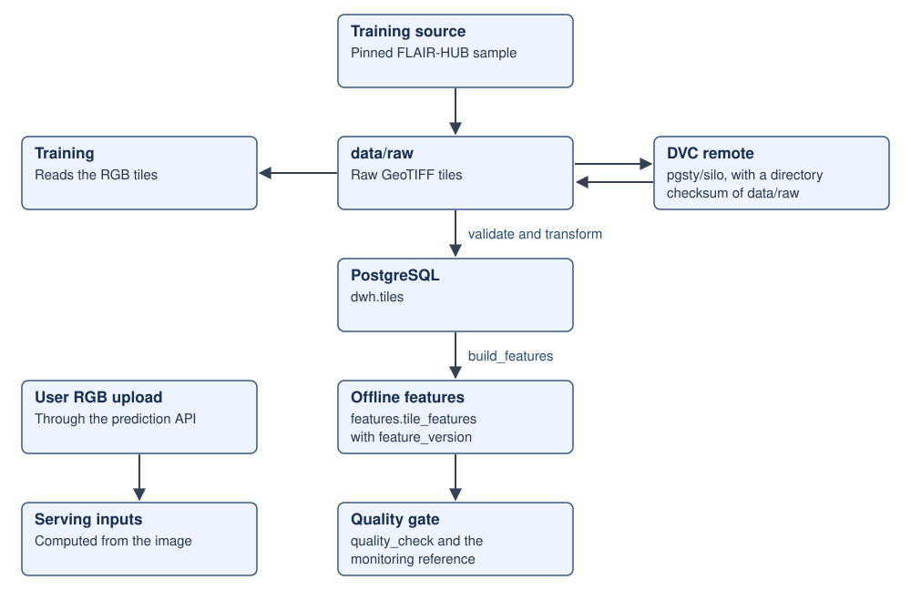
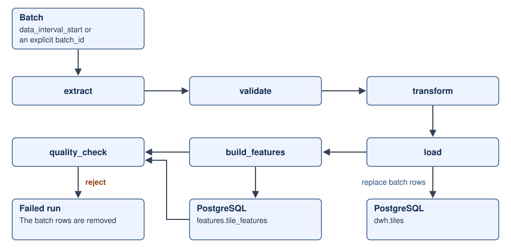
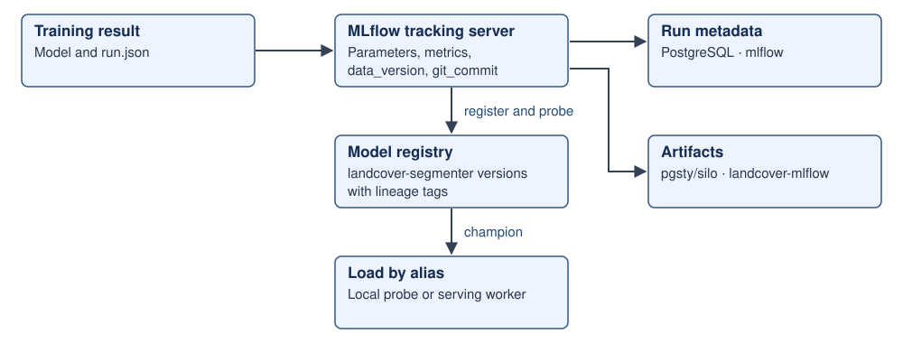

# Land-cover segmentation system design

This design follows the KSE MLOps Lab 1 assignment.

## 1 Overview

GIS specialists need a first land-cover layer for new aerial imagery, which they then check and edit in QGIS. The service turns an 8-bit RGB aerial image into an eight-class OpenEarthMap (OEM) mask and returns a colour overlay and legend; for a georeferenced GeoTIFF, it also creates a GeoTIFF mask on the same pixel grid as the input image. Authenticated users submit images of different sizes, within fixed upload limits, as asynchronous jobs, and CPU workers scale with the queue. The model is trained on OEM and fine-tuned on expert-labelled batches in acquisition-year order; an operator approves each new version before it serves. The desired outcome is GIS exports that open without manual repair, and model updates that are reproducible, monitored and reversible.
## 2 Motivation

A GIS specialist needs a land-cover layer when preparing a map from new aerial imagery. Creating this layer by hand means marking areas and assigning classes such as roads, buildings, water and vegetation. The project provides a starting layer: the user uploads an image, receives a segmentation mask and supporting files, then checks and edits the layer in QGIS. The aim is to make these results usable in the specialist's mapping workflow.

The system has two roles:

- **GIS user** (consumer): a cartographer or GIS specialist who uploads new imagery of a project area, waits for the result, imports the package into QGIS and edits the layer there.
- **Operator**: the ML engineer responsible for the system. They add training batches, review alerts and candidate models, approve or block model versions, and roll back to an earlier approved version when needed. In the course, the project author is the operator. Operator and GIS-user permissions remain separate.

A GIS user asks, “Make a QGIS mask from my GeoTIFF and explain what 255 means.” The assistant calls `predict` with the user's authorized upload and reports the queued job ID. While a worker makes the map, `retrieve` finds the taxonomy in the project documentation. On success the assistant returns the caller's package, the model version recorded by the worker and a cited explanation. A value of 255 marks an invalid input pixel. A value of 0 means valid bareland (`export-contract`, §5.1). In QGIS the user displays 255 as NoData and keeps bareland visible.

If the user asks only “What does 0 mean in the legend?”, the assistant calls the Lab 3 retriever once and cites the same taxonomy entry. A legend question needs no upload or job.

Assumption: 20 active GIS users together submit 1000 images and run 1000 assistant tasks a month. The product scenario assumes that the service runs in AWS. For the course, the same components run locally under the constraints in Sections 4 and 6.2. A shared service gives users a common way to submit work and receive results, while the operator can track jobs and manage model updates.

Errors affect the usefulness of the map. A wrong class takes time to correct in QGIS. A wrong grid or invented georeferencing makes the export unusable. If a new model stops recognising a class, such as roads, the error can appear in every later map created with that model.

The service therefore records the model version in each result's metadata, so the operator can identify which model produced the mask. Before an update, the operator compares the candidate with the approved model on the same labelled control data and reviews the results before approving it. This comparison can be repeated using the recorded data and training settings. User uploads have no reference masks, so the service monitors failures, processing time, input statistics and predicted class shares. These signals help the operator notice changes that need investigation; model accuracy is measured separately on labelled data.

## 3 Success metrics

We check success at three levels: the GIS user's workflow, model quality and system operation.

IoU measures overlap between the predicted and reference areas of one class. It divides the shared pixel count by the number of pixels in either area, counting each pixel once. mIoU is the mean IoU across the classes being evaluated. Higher values mean better overlap.

| Level | Metric and target | How it is checked |
|---|---|---|
| Decision / workflow | At least 9 of 10 predefined valid test images produce a complete package. The package opens in QGIS on the correct grid without manual format or georeferencing repair | A fixed test set includes PNG, JPEG, georeferenced GeoTIFF and three image sizes. This checks whether the export is usable; it does not measure cartographic accuracy |
| Model | The first neural model exceeds the random forest in OEM-8 mIoU. Each later update must meet the promotion rule (Section 5.4) | Control sets for development; final holdouts are evaluated once |
| System | Job acknowledgement p95 ≤ 1 s after upload; completion p95 ≤ 5 min for a 4096×4096 image at the assumed load. At most 1% of valid jobs fail for system reasons per week | Load test (Section 6.3) and monitoring (Section 6.6) |

Here, p95 is a time limit met by at least 95% of the relevant measurements. Acknowledgement means that the service returns a job ID after upload. Completion means that the result is ready.

mIoU is the **optimization** metric: the score we try to improve. Export validity, p95 latency and resource limits are **satisficing** metrics: each has a required limit that the system must meet. A higher mIoU does not replace meeting these limits.
## 4 Requirements and constraints

**Functional requirements:**

- An authenticated GIS user uploads one 8-bit RGB PNG, JPEG or GeoTIFF and immediately receives a job ID; uploading an image again creates a new job.
- The GIS user reads the status of their own jobs (`queued`, `running`, `succeeded`, `failed`, `expired`) and downloads their own results: a uint8 class mask (0–7, 255 for invalid input pixels), a colour overlay, a legend and JSON metadata with model and taxonomy versions.
- A GeoTIFF with a valid CRS and affine transform also yields a GeoTIFF mask on the same grid; otherwise the mask uses the pixel grid. Coordinates are never invented.
- Images of different sizes and aspect ratios, within the ceilings below, are processed in overlapping tiles and stitched back to the source pixel grid.
- The operator ingests a labelled batch, trains a candidate from the approved model, compares them, approves or blocks the candidate, and rolls back to an earlier approved version.
- The GIS assistant answers questions about the export from the project documentation with cited sources, through the Lab 3 retriever and submits authorized images to the Lab 4 prediction service. It takes questions in English and answers in English. Only these two tools are allowed, with four attempts per task across retries and resumes. Workers decode, segment, check the grid and export the package.

**Non-functional requirements:**

| Category | Requirement |
|---|---|
| Freshness | Lab 2 selects the batch by data interval or an explicit batch ID. A missing batch fails. A rerun of an accepted interval writes the same rows. The planned source discovery scan reports stale input when an expected new checksum is missing. Assume at most one newly labelled batch a month |
| Latency and throughput | This requirement concerns the speed of processing user uploads. The API returns a job ID with p95 ≤ 1 s after upload. For a 4096×4096 image, the result is ready with p95 ≤ 5 min at the assumed load (Section 6.3). Jobs run on 1–4 workers; queue wait is also measured separately |
| Availability and fallback | The cloud service runs continuously. Job state is stored in PostgreSQL and files in object storage, so this data survives a host failure. A lease is the period during which a worker has the right to run a job. Once it expires, an interrupted job is retried, with up to 3 attempts in total. If the approved model cannot be loaded, jobs remain in the queue and the service does not produce a mask without a model. During an LLM outage, chat reports unavailability and preserves the pending job ID and attempt count until expiry. Direct upload, status and download continue through the ML API |
| Reproducibility | This covers two requirements: repeating training and ingesting a batch again without duplicate data. Every training run records data version, code commit, configuration, preprocessing, taxonomy version, parent model and seeds. The target is to repeat the build of any registered model version with one command from a clean clone, using those data and settings. Ingesting the same batch again replaces its rows without duplicates. Bit-identical GPU weights are not required. For user images, uploading again creates a new job; files are deleted after 24 hours. This requirement does not promise to return a saved mask |
| Adaptability | This requirement concerns how model updates are tested. For a new batch, the operator trains a candidate model from the approved model (Section 5.3). A new architecture is also tested as a candidate first. Assumption: old OEM training tiles make up 50% of the training mix in the first experiments. This keeps either source from dominating. The operator chooses the final share based on results on the development controls |
| Observability without ground truth | Count invalid uploads separately. A valid dark image receives a warning with its package and still contributes to the input window. Compare per-image brightness, RGB means and predicted class fractions with matching training references (§6.6). Measure IoU only against independent reference masks |
| Cost and resource ceilings | The hypothetical cloud estimate at the dated rates is about $302/month, or $338 in a training month (Section 6.7). For one job, the uploaded file is limited to 128 MiB and the decoded image to 64 megapixels. One worker with 1 vCPU and 4 GiB RAM runs the job. The job has a 15-minute deadline, which must not run past the upload's expiry. These limits bound disk space, decoding memory and work time |

**Course constraint.** The reviewer path uses a local CPU for training and prediction, Minikube for the services and a configurable host-native text model. On the course Mac (M4 Pro, 24 GiB), the cluster and model share that memory budget. All graded demonstrations must run with zero additional paid spend. Existing Colab access is optional for larger neural experiments.

**In scope:** eight-class land-cover rasters, the GIS package, supervised model updates with operator approval, monitoring and the GIS assistant. **Out of scope:** object detection and building counting, guaranteed accuracy in other geographies, area statistics in square metres, simulator terrain, high availability or an uptime percentage, and training on user uploads.

**Conflicts:** a correct grid wins over a faster export. The cost ceiling wins over burst latency: beyond four workers, jobs wait in the queue. The 24-hour privacy limit wins over inference reproducibility: an expired upload must be uploaded again.

## 5.1 Problem statement

The task is multiclass semantic segmentation: each valid RGB pixel receives one of the eight OEM classes. The taxonomy below is product-contract version 1; ID 255 marks pixels ignored in training and invalid input pixels in the output.

| ID | OEM raw ID | Class |
|---:|---:|---|
| 0 | 1 | bareland |
| 1 | 2 | rangeland |
| 2 | 3 | developed space |
| 3 | 4 | road |
| 4 | 5 | tree |
| 5 | 6 | water |
| 6 | 7 | agriculture land |
| 7 | 8 | building |
| 255 | 0 | ignore / invalid |

Examples of `developed space` are sidewalks and parking lots. OEM labels the lanes between parking lots as `road` ([class definitions](https://openaccess.thecvf.com/content/WACV2023/supplemental/Xia_OpenEarthMap_A_Benchmark_WACV_2023_supplemental.pdf)).

**Rejected framing:** building-only (binary) segmentation. It is simpler and well studied, but the GIS layer must also separate roads, vegetation, water and agricultural land.

**LLM component.** The LLM has an auxiliary job over a document corpus; it does not make the mask. The GIS assistant answers questions about the export package, such as what a class ID or the value 255 means, which bands and resolution an input has, or how to display the mask in QGIS, from the documents, and cites the passage it used. The corpus has five public documents: the OpenEarthMap and FLAIR-HUB papers from arXiv, with the FLAIR-HUB label configuration from GitHub; the USGS NAIP data dictionary; the QGIS 3.44 raster properties page; and `export-contract`, which is this section and Section 6.8. The four external documents are cleaned Markdown copies in `corpus/` of the repository; `export-contract` is read from this file when the index is built (Section 5.2). The first build, index version `25fcac866b12`, had 572 chunks.

## 5.2 Data

**Image resolution.** Ground sampling distance (GSD) is the size of the ground area represented by one image pixel. A GSD of 0.25–0.5 m means that one pixel covers roughly 25–50 cm on each side; it does not describe height.

| Source | Content | Role |
|---|---|---|
| [OpenEarthMap](https://arxiv.org/html/2210.10732) ([release](https://zenodo.org/records/7223446)) | RGB aerial images with GSD 0.25–0.5 m and masks for the eight classes, annotated by people; 9.1 GB, plus separately downloaded xBD images | Initial training; development and final controls |
| [FLAIR-HUB](https://huggingface.co/datasets/IGNF/FLAIR-HUB) ([paper](https://arxiv.org/html/2506.07080v1)), IGN France | Aerial RGB and NIR images with GSD 0.2 m and CoSIA masks drawn by expert photo-interpreters; one archive per département and year | Supervised update batches; regional controls |
| [Utah NAIP](https://gis.utah.gov/products/sgid/aerial-photography/naip/) 2018, 2021, 2024 | Public-domain images with GSD 0.6 m, without masks | Optional drift-monitoring stream |
| GIS user uploads | RGB images without masks | Serving only |

We also considered NAIP images for Utah back to 2003 (with coarser resolution before 2018) and the Chesapeake states for 2010–2023 ([Planetary Computer](https://planetarycomputer.microsoft.com/api/stac/v1/collections/naip)). None of these datasets has OEM-8 masks annotated by people, so NAIP supplies no training update batches. We keep only the Utah images with GSD 0.6 m for optional drift monitoring, because their resolution is closest to OEM's.

**Update timeline.** We use six FLAIR-HUB datasets, each for a different département (an administrative region of France) and acquisition year. FLAIR-HUB calls such a dataset a domain. We download only the RGB images and CoSIA masks: 4.88 GB of compressed archives in total. Each whole domain has one role: model updates, development checks or final evaluation. This prevents the same region from being used for both training updates and controls.

| Order | Data | Role |
|---|---|---|
| 0 | OEM training regions | Initial training |
| 1 | D080-2017 | Update |
| 2 | D033-2018 | Update |
| 3 | D065-2019 | Update |
| 4 | D045-2020 | Update |
| — | OEM development regions; D017-2021 | Development controls (Section 5.4) |
| — | OEM final regions; D073-2022 | Final holdouts (Section 5.4) |

**Lab 1 data checklist:**

1. **Time axis.** The operator downloads one FLAIR-HUB domain per batch into the training pipeline, in order of the actual acquisition years. OEM is used for initial training and has no usable time axis.
2. **History and holdout.** The 2017–2020 batches provide four successive updates; the 2021 dataset is used only to choose settings and check candidates. The 2022 dataset is reserved for a single final evaluation (table above).
3. **Labels and delay.** When the operator downloads a FLAIR-HUB batch into the pipeline, its reference masks are already available with the images, so there is no wait between image availability and mask availability for that run. This zero delay does not apply to user uploads, which have no reference masks.
4. **Corpus.** The GIS assistant uses a retrieval corpus of five documents: saved copies of the OEM and FLAIR-HUB papers, the NAIP dictionary and the QGIS raster properties page, committed in `corpus/`, and two sections of this design. The exact sources are listed below.

The FLAIR sequence changes both year and region, so its scores measure transfer to later images of other places. They do not measure change at one place or what a model available in 2017 could have achieved: OEM and the ImageNet encoder were published later. The zero label delay above describes access to an existing image-and-mask pair, not the time from image acquisition or the time needed to create a mask. A Lab 4 exercise may withhold one batch's labels as a declared simulation.

**Course sample.** The course runs the same pipeline at a smaller scale: 16 image–label pairs from each of the six domains, 192 unmodified GeoTIFFs (98 MB). For each domain, the patches present in both its `AERIAL_RGBI` and `AERIAL_LABEL-COSIA` archives at a pinned Hugging Face commit are sorted by tile ID and every k-th is kept, so every retrieval selects the same files. OEM is not ingested in the course yet. A batch is one acquisition year, which is one FLAIR-HUB domain; its masks arrive with its images, so the label delay is zero (item 3 above). The raw data has a single version identifier: the DVC hash of the tracked `data/raw` directory in the committed pointer file `data/raw.dvc`.

**Label mapping.** Before training, we replace the numeric IDs of pixels in each original OEM mask with the service's internal IDs: 1–8 → 0–7 and 0 → 255 ([OEM class codes](https://raw.githubusercontent.com/bao18/open_earth_map/main/open_earth_map/utils.py)). For example, OEM ID `1` (bareland) becomes internal ID `0`; the class itself stays the same. The code `255` means `ignore`: these pixels are excluded from training and evaluation. In service outputs, `255` also marks invalid input pixels (Section 5.1).

FLAIR-HUB uses its own IDs 0–18, which differ from FLAIR-1/2 ([label configuration](https://github.com/IGNF/FLAIR-HUB/blob/main/configs/train/config_supervision.yaml)). Crosswalk version 1 replaces these with the corresponding internal OEM-8 IDs only for unambiguous classes:

| FLAIR-HUB class (ID) | Internal OEM-8 ID |
|---|---:|
| building (0) | 7 |
| bare soil (5) | 0 |
| water (6), swimming pool (2) | 5 |
| coniferous (13), deciduous (12) | 4 |
| herbaceous vegetation (8) | 1 |
| agricultural land (9), vineyard (11) | 6 |
| all other IDs, including pervious and impervious surfaces, brushwood and plowed land | 255 |

FLAIR masks therefore provide training labels for six classes: 0, 1, 4, 5, 6 and 7. The FLAIR impervious class combines roads, parking and construction, so road (3) and developed space (2) are learned and checked only on OEM. The model always keeps eight outputs.

**Dates.** The fields `acquisition_start`, `acquisition_end`, `date_precision`, `label_reference_period`, `source_published_at` and `ingested_at` may be null. A missing date stays null and processing continues. If only a year is known, we do not use 1 January in place of the unknown exact date. Inference needs no date. In the course, the warehouse tables store only the acquisition year of each batch.

**Batch selection and rerun, by example.** Each pipeline run processes exactly one batch: the one named by the run's `batch_id` parameter, or otherwise the batch registered for the year of the run's data interval start. The current time never chooses the batch.

1. The operator runs the pipeline for 2019. The run selects D065-2019, validates it, writes one tile row and one feature row per image–label pair and passes the quality gate.
2. The operator runs 2019 again. The run deletes D065-2019's rows and writes them again, so each table holds the same number of rows for that batch as before, and other batches' rows are unchanged. No flag or manual cleanup is needed.
3. A run for a year with no registered batch, or for a batch without files, fails before loading anything.

A batch that fails structural validation is not loaded: the run stops before `load`, and the rows of an earlier successful run of that batch stay. A batch that fails the quality gate has its rows removed by `quality_check`. Between `load` and the end of `quality_check` the rows are visible to other readers of the database, so a reader uses a batch only after its run has succeeded. The Git history of `data/raw.dvc` is the history of the raw data.

The product design adds a frozen manifest and a watermark for accepted batches. Discovery handles expected new arrivals separately from an operator replay of the same interval.

**Storage and versioning:**

| Artifact | Format | Local | Cloud | Versioned by |
|---|---|---|---|---|
| Raw archives, images and masks | Original ZIP, TIFF, PNG; the course keeps only the sampled TIFFs | pgsty/silo (S3 API) | Amazon S3 | DVC content hashes; one `.dvc` pointer |
| Clean tiles and remapped masks | GeoTIFF or PNG; uint8 masks | Not stored in the course: labels are remapped in memory | S3 | DVC; one `.dvc` pointer per dataset version |
| Tile rows and tile features | PostgreSQL tables `dwh.tiles` and `features.tile_features` | PostgreSQL 16 | RDS | SQL schema file in Git; `feature_version` column |
| Splits and taxonomy | JSON | Git | Git | Git commit |
| Crosswalk | Constants in the pipeline code | Git | Git | Git commit |
| Jobs, users, monitoring statistics | PostgreSQL tables | PostgreSQL 16 | RDS | Migrations in Git |
| Runs, metrics, model versions, alias | MLflow: metadata in PostgreSQL, files in object storage | MLflow | MLflow on EC2 with RDS and S3 | MLflow model versions |
| Uploads and results | Original file; GeoTIFF, PNG, JSON | Temporary bucket | Temporary S3 bucket, no versioning | Not versioned; expire after 24 h (Section 6.5) |
| Retrieval corpus | Cleaned Markdown copies with a manifest; chunks with pgvector embeddings | Git (`corpus/`), PostgreSQL schema `retrieval` | S3, RDS | Copy SHA-256 in the manifest, `doc_version`, index version |

Images and masks stay in raster formats. Converting them to CSV or Parquet would add an unnecessary step.

**Git, DVC and Git LFS.** Git stores code, configuration, documentation, `uv.lock`, the SQL schema file and DVC pointers.

DVC stores rasters and checkpoints under content hashes in object storage; `dvc pull` restores the data version a commit names.

Git LFS only stores and fetches large files. DVC also gives a whole directory one content hash, which serves as the data version, and verifies pulled files against it, so Git LFS is not used. DVC pipeline stages are not used: Airflow runs the pipeline, and its outputs are PostgreSQL rows rather than files.

**Retrieval corpus:**

| `doc_id` | Document | Copy |
|---|---|---|
| `oem-paper` | [OpenEarthMap paper](https://arxiv.org/html/2210.10732): class definitions (S1), data and splits (2.2) | `corpus/oem-paper.md` |
| `flair-hub` | [FLAIR-HUB paper](https://arxiv.org/html/2506.07080v1) and the pinned [label configuration](https://github.com/IGNF/FLAIR-HUB/blob/a0c47d5ffcd4792b84eea213a68485c200065d43/configs/train/config_supervision.yaml) | `corpus/flair-hub.md` |
| `naip-dictionary` | [USGS NAIP data dictionary](https://www.usgs.gov/centers/eros/science/national-agriculture-imagery-program-naip-data-dictionary): dates, bands, resolution | `corpus/naip-dictionary.md` |
| `qgis-raster` | [QGIS 3.44 raster properties](https://docs.qgis.org/3.44/en/docs/user_manual/working_with_raster/raster_properties.html) | `corpus/qgis-raster.md` |
| `export-contract` | Sections 5.1 and 6.8 of this document | None: read from this file when the index is built |

A saved copy is cleaned Markdown: the source's headings and tables, without navigation, figures, acknowledgements or reference lists. The sources have no address that pins their bytes, so the copies are committed to Git, made once by hand and replaced only deliberately. [corpus/manifest.toml](../corpus/manifest.toml) records each copy's source URLs, access date and SHA-256; the hash is of the committed file, so it shows that a copy was not edited afterwards, not that it equals the source. Every document's `doc_version` is derived from its indexed text: the first 12 hexadecimal digits of its SHA-256. For each chunk, we record `doc_id`, `doc_version` and a locator, the heading path of the section it lies in.

In Lab 3, one versioned retrieval configuration, [retrieval.toml](../retrieval.toml), holds `chunk_size`, `chunk_overlap`, `embedding_model`, `embedding_revision` and `top_k` for evaluation and serving; the corpus revision is the Git commit. `make retrieval-index` rebuilds the index from the committed corpus and prints its document and chunk counts and its index version. The plain answer prompt, the retrieval-augmented prompt and the judge prompt are files in [prompts/](../prompts/), each identified by the first 12 hex digits of its SHA-256. `make answer-eval` answers the evaluation set with the plain prompt through the text model of `[llm]` in `retrieval.toml`, judges each answer against its reference answer, and logs both prompt hashes with the model, tokens, shadow cost and p50/p95 latency to MLflow; Section 7.2 gives the baseline. `make answer-eval TOP_K=<n>` retrieves n passages per question, answers with [prompts/rag.md](../prompts/rag.md), judges the answers with the same judge prompt, and logs the hash of `rag.md` with the index version and the retrieval settings. The evaluation set [eval/questions.toml](../eval/questions.toml) holds 32 paraphrased English questions with reference answers and their source sections. `make retrieval-eval` reports retrieval hit@k and mean reciprocal rank (MRR) at top-k 3, 5 and 10 (Section 5.4), and Section 7.2 gives the results. The retrieval-augmented runs at top-k 3, 5 and 10 are compared with the plain-prompt baseline on the same questions, each recording tokens, shadow cost and p50/p95 latency over its 32 answer calls; the comparison chose `top_k` 10 (Section 5.4). Lab 4 will deploy the selected configuration unchanged.

## 5.3 Techniques

**Baseline: majority class.** The rule assigns every pixel the class with the most labelled pixels in the training batches. It has no free choice that could be tuned on a control, so it is the floor every trained model must beat. In the course sample the class is agriculture land.

**First trained model: random forest on RGB texture features.** Each pixel is classified from intensity, edge and texture features, producing an eight-class mask on CPU without pretrained weights.

For the planned OEM baseline, count valid pixels on the source grids before tiling or sampling. The lowest ID breaks ties, and export retains 255 for invalid input pixels.

- [`multiscale_basic_features`](https://scikit-image.org/docs/stable/api/skimage.feature.html#skimage.feature.multiscale_basic_features) at scales 1, 2, 4 and 8 px.
- scikit-learn [`RandomForestClassifier`](https://scikit-learn.org/stable/modules/generated/sklearn.ensemble.RandomForestClassifier.html): 100 trees, depth 12, fixed seed.
- At most 10,000 valid pixels per class, drawn with the run's seed from the training batches; ID 255 is never drawn. The cap keeps the forest from learning mostly class frequencies.

Fit directly, without [`fit_segmenter`](https://scikit-image.org/docs/stable/api/skimage.future.html#skimage.future.fit_segmenter): label 0 (bareland) is a valid class.

The forest is deterministic on a CPU: the same commit, data version and seed give the same scores, which makes it the reference for reproduction (Section 5.4). It could remain in production if its per-class IoU and users' correction effort were acceptable. It will likely confuse context-dependent classes: road and developed space, or agriculture and rangeland.

**Candidate: U-Net with an EfficientNet-B4 encoder** ([segmentation_models_pytorch](https://github.com/qubvel-org/segmentation_models.pytorch) 0.5.0):

```python
smp.Unet(encoder_name="tu-tf_efficientnet_b4.in1k", encoder_weights="imagenet",
         in_channels=3, classes=8, activation=None)
```

For the first training run, we load the encoder weights from the [timm ImageNet checkpoint](https://huggingface.co/timm/tf_efficientnet_b4.in1k) (Apache-2.0).

Preprocessing divides the pixel values in each RGB channel by 255. It then normalizes each channel using mean (0.485, 0.456, 0.406) and standard deviation (0.229, 0.224, 0.225), in red, green and blue order. Training and serving use 512×512 tiles with the same overlap and padding. Course settings: full 512×512 tiles, batch size 8, random flips and quarter turns applied to image and mask together, cross-entropy that ignores 255, AdamW, 40 epochs keeping the last weights, and mixed precision on CUDA only. Each run records the Hugging Face revision of the encoder weights it downloaded.

On the [OEM benchmark, Tables 3 and 5](https://arxiv.org/html/2210.10732), this architecture reached 68.20 mIoU with 20.3 M parameters. It also led the comparison that used 10% of labels. These published results support the architecture choice. We still need to measure our model's accuracy and CPU speed.

ImageNet weights initialize only the first OEM training run. For each update, we resume training from the full approved checkpoint, including the decoder and head. **OEM replay** means mixing old OEM training tiles with the new batch. This helps retain the learned classes. Rerunning the Lab 2 Airflow interval reprocesses the pinned dataset snapshot. OEM training replay changes the examples used to fit the next neural candidate.

**Course training.** OEM is not ingested in the course (Section 5.2). Each model is trained once, by `python -m landcover.train`, on the four pooled 2017–2020 FLAIR-HUB batches, with the six classes their labels contain; road and developed space are neither trained nor scored. The U-Net keeps eight outputs, and the two without FLAIR labels receive no positive target. The sequential updates from the approved checkpoint and OEM replay described above are product behaviour that the course does not run.

**Model inputs and features, with their serving-time sources.** Every model is stored in MLflow as one wrapper whose `predict` takes an RGB array and returns a class mask; the forest's feature computation and the U-Net's scaling, normalisation and padding run inside the wrapper, and the `landcover` package is stored with the model version.

| Value | Training source | Serving source | Read by |
|---|---|---|---|
| RGB pixels, 8-bit | Raw tile, first three bands; FLAIR's NIR is dropped | The uploaded image, same channel order | Forest, U-Net |
| Pixel texture features | Computed from the tile by the packaged code | Computed from the upload by the same code, loaded with the model version | Forest |
| Scaling, normalisation, padding to a multiple of 32 | Packaged code and constants | Same code, loaded with the model version | U-Net |
| Labels | Raw label after crosswalk v1 | None: uploads have no masks | Training targets and scoring only |
| `channel_mean` | `features.tile_features`, from the image | Computed from the upload | Input-drift monitoring (Lab 4); no model |
| `class_share`, `ignored_share` | `features.tile_features`, from the labels | None: a label statistic that exists only for labelled batches; its serving counterpart is the predicted class share of the output mask | Quality gate and monitoring reference; no model |
| `batch_id`, `tile_id`, `feature_version` | `features.tile_features` keys and version | None: identifiers, not values; an upload is identified by its job ID | No model |

No feature is read from the warehouse at training or serving time: training reads the raw files, and the warehouse tables serve the quality gate and monitoring.

Serving accepts only 8-bit RGB. A future adapter will convert known 16-bit and other containers to 8-bit RGB. An image with unknown band meanings is rejected unless the user identifies its red, green and blue bands.

**Model alternatives, revisited after the first implementation:**

| Model | Evidence | Trade-off for this system |
|---|---|---|
| [FT-UNetFormer / Swin-B](https://arxiv.org/abs/2109.08937) ([GeoSeg code](https://github.com/WangLibo1995/GeoSeg), [backbone weights](https://drive.google.com/drive/folders/1ELpFKONJZbXmwB5WCXG7w42eHtrXzyPn)) | 69.13 OEM mIoU, same benchmark | +0.93 points for about 4.7× the parameters; GPL-3.0 research code pinned to Python 3.8; backbone weights only, without stated terms |
| [SatlasPretrain Aerial Swin-v2-Base](https://arxiv.org/abs/2211.15660) ([package](https://github.com/allenai/satlaspretrain_models), [`aerial_swinb_si.pth`](https://huggingface.co/allenai/satlas-pretrain/blob/main/aerial_swinb_si.pth)) | Pretrained on NAIP aerial imagery; includes a segmentation head | No OEM-8 result or checkpoint; larger backbone; ODC-BY weights; documented for 0.5–2 m imagery, coarser than FLAIR's 0.2 m |

**LLM component (Lab 3).** The assistant's answer to a documentation question comes from Gemma 4 12B QAT Q4_0 (Section 6.2).

- **Baseline.** The plain prompt [prompts/plain.md](../prompts/plain.md), zero-shot, with no retrieved passage: what the model knows by itself.
- **Technique.** Retrieval-augmented generation. The question is embedded with multilingual-e5-small and the top-k section-bounded chunks (600 characters, overlap 100) are found by exact cosine search in pgvector (Section 6.2); [prompts/rag.md](../prompts/rag.md) puts the numbered passages, each headed by its document and section, before the question. Fine-tuning is not used (Section 7.1).
- **Grounding rule.** The model answers from a passage that states the answer and prefers it to its own memory; when no passage does, it may answer from its own knowledge if it is confident and otherwise says that it does not know. Every answer ends with `Sources: [n]` or `Sources: none`, so an answer either cites a passage or reports that none supports it, as Sections 5.1 and 6.8 require. The prompt also says that a passage about a public dataset does not describe this service's export, because the OpenEarthMap paper numbers bareland 1 and the export numbers it 0. In the runs the model did not use the permission: no answer without a cited passage was correct (Section 5.4).
- **At serving time** the model receives one user message: the instruction of `rag.md`, the 10 passages `retrieve` returns for the question at `top_k` 10 of `retrieval.toml`, and the question; temperature 0 and at most 256 output tokens, from the table `[llm]`. The service shows the cited passages with their `doc_id`, `doc_version` and locator.

## 5.4 Experimentation and validation

A random split could place neighbouring tiles from the same scene in both training and evaluation. This would overstate accuracy. We therefore split data by region and, for FLAIR, by acquisition year.

1. **Split.** Before cropping images into tiles, assign whole OEM regions to training, development and final evaluation. Assumption: 70/15/15% of regions, stratified so that every class appears in each role. Assign FLAIR domains the roles listed in Section 5.2. Version the scene assignments with the sampled manifest. Freeze the final holdout lists for OEM and D073-2022 before scoring any model.
2. **Train.** Fit the majority rule and CPU random forest on the same OEM training regions, then score both on the same development scenes. The first neural candidate uses those same splits. For updates, follow Section 5.3. The operator chooses the replay share and learning rate using results on development controls only.
3. **Compute the metric.** For each control, accumulate one 8×8 confusion matrix. Stitch predictions onto each source grid before counting. A bareland reference (OEM 1 → internal 0) predicted as 0 adds one to cell [0,0], even where two tiles cover it. A reference of 255 or a padded or invalid pixel contributes nothing. Count every other eligible source pixel exactly once.

   Class IoU = TP / (TP + FP + FN). TP (true positives) counts correctly predicted pixels of the class. FP (false positives) counts pixels wrongly assigned to the class. FN (false negatives) counts reference pixels of the class that the model missed.

   A road prediction on a FLAIR tree pixel is a false negative for tree and a false positive for road. Each report lists the scored class IDs, the support (reference pixels per class), the ignored fraction and the number of classes in the mean. If a required class has no reference pixels, the evaluation is incomplete. Do not take a decision from an incomplete evaluation. Report OEM-8 mIoU and six-class regional mIoU separately. Never average them together.
4. **First neural approval.** Evaluate the U-Net and random forest on the same OEM development control. The U-Net is eligible for approval when its OEM-8 mIoU exceeds the random forest's and it passes the export and resource checks. Include its regional score in the report; that score is not an approval condition.
5. **Update approval.** Compare each candidate with the approved model, not the random forest. Use the same frozen development manifests for both models. Under the **selected policy** it is eligible when:
   1. OEM-8 mIoU is at least the approved model's.
   2. Regional mIoU is higher than the approved model's.
   3. No OEM class loses more than **2 percentage points** of IoU; exactly 2 is allowed, and the difference is absolute IoU, not relative.
   4. Class coverage, export validity and resource checks pass.
6. **Final evaluation.** After the last update, evaluate the approved model once on the OEM final regions and D073-2022. Never use final holdouts for tuning, replay selection or promotion.

**Course experiment (Lab 2).** The course runs a reduced version of these steps on FLAIR-HUB alone.

- **Split.** Whole batches: D080-2017, D033-2018, D065-2019 and D045-2020 are pooled for training; D017-2021 is the development control; D073-2022 stays the final holdout and is opened by no training or scoring code. A batch is one département in one year, so every control tile is from a later year and a different region than every training tile, and no neighbouring patch of one flight can fall on both sides.
- **No inner validation.** The U-Net trains a fixed number of epochs and keeps the last weights, so nothing is selected on held-out training tiles. Its per-epoch development score is recorded as history and selects nothing. The development control is the only data the operator may use to change settings.
- **Metric.** The six-class mIoU of step 3 over classes 0, 1, 4, 5, 6 and 7 on the development control, reported with pixel accuracy, the ignored share and the labelled pixels of each class. The control has 16 tiles, and building rests on about 15,000 pixels in 2 of them, so small differences between models are not evidence. OEM-8 mIoU is not computed in the course.
- **Champion.** The forest and the U-Net are registered, and `champion` points at the one with the higher development mIoU. The majority-class rule is the floor and is not registered.
- **Approval rules not exercised.** Steps 4 and 5 compare OEM-8 scores and per-class OEM losses, which need OEM, and the course has no sequential update; these rules stay the product description. Step 6 is not run in Lab 2.
- **Reproduction.** `make reproduce VERSION=<n>` retrains a registered version from its commit, data version and logged parameters, including the encoder revision for U-Net. The forest and rule use a 0.01 development mIoU tolerance. U-Net uses CUDA with `GPU=L4` available for a Colab run. Section 7.2 records the measurements and tolerance.

**Course experiment (Lab 3): retrieval.** The evaluation set [eval/questions.toml](../eval/questions.toml) has 32 English questions that a GIS user could ask: 6 on `export-contract`, 8 on the QGIS page, 8 on the OpenEarthMap paper, 6 on FLAIR-HUB and 4 on the NAIP dictionary. Claude drafted each question from one section of the corpus, without the document's name or the passage's wording, with a reference answer and a verbatim evidence quote of at most 100 characters; the author read every row against its section. The tests check that every cited section exists in the chunked corpus, that one of its chunks holds the quote, and that no question names its document or shares four consecutive words with its passage.

- **Relevant chunk.** A retrieved chunk is relevant when its `doc_id` and locator are those of a source and its text contains that source's quote, whitespace runs ignored. A section alone would count any of the 74 chunks of the largest FLAIR-HUB section; a chunk number would break with the chunk size. A chunk that states the same fact elsewhere counts as a miss, so the measure is conservative.
- **Metrics.** Hit rate at k is the share of questions with a relevant chunk among the first k retrieved. MRR at k is the mean over all questions of 1 / rank of the first relevant chunk among the first k, and 0 when there is none.
- **Values.** `make retrieval-eval` runs at top-k 3, 5 and 10 (the value in `retrieval.toml`, chosen by the answer experiment below), one MLflow run each in the experiment `landcover-retrieval`, tagged with `git_commit`, `index_version` and `eval_set`, the hash of the question file. The search is exact, so the three runs are cuts of one ranking and cannot fall as k grows; the comparison shows what a larger k buys and does not choose k.
- **Limit.** One question is 3.1 points of hit rate, so a difference of one or two questions decides nothing.

**Course experiment (Lab 3): answers.** `make answer-eval` sends the 32 questions to Gemma 4 12B QAT Q4_0 (Section 6.2) with [prompts/plain.md](../prompts/plain.md), which holds no retrieved passage, and logs one run `answer-plain` to the MLflow experiment `landcover-answers` with the model, the server build, `top_k` 0, the hashes of both prompt files, `eval_set`, the answer metric, tokens in and out, compute seconds, a shadow cost at the Sonnet 5.5 rates of Section 6.7, p50 and p95 latency, and each answer with its verdict. The evaluation set was revised after the first run: questions describe their subject by its properties, and each reference answer is one sentence with the direct answer. It was revised again after the review of Lab 3: a question accepts every way the corpus documents, questions about a public dataset say that they ask about its published experiments, and a question may cite every passage that states its answer.

- **Rubric.** Binary. An answer is `correct` when it states the key fact of the reference answer, the direct answer to the question, and does not contradict it; another name for the same setting counts. A different value, a missing key fact, a refusal or "I do not know" is `incorrect`, and so is the key fact with a false statement added about what the question asks. The answer metric is the share of `correct` answers.
- **Judge.** The same model on the same server, with [prompts/judge.md](../prompts/judge.md), at temperature 0 and with the verdict constrained to the two values by a JSON schema. Its tokens are logged apart and are not in the cost.
- **Check.** Claude (`claude-opus-5-5`) labelled the 32 answers of the baseline run by the same rubric before reading the run's verdicts, having seen the reviewed labels of the earlier baseline, whose answers differ only in q25 and q26; the author reviewed every label. The judge agreed on 30 of 32, above the 29 required before the check; the README gives the table.
- **Limit.** Most baseline answers are wrong, many of them refusals, so the check says more about rejecting than about accepting an answer; it was repeated on a retrieval-augmented run (below).

**Course experiment (Lab 3): retrieval-augmented answers.** `make answer-eval TOP_K=<n>` retrieves n passages per question through `retrieve`, numbers them in order of distance with their document and section, and answers with [prompts/rag.md](../prompts/rag.md): the model answers from a passage that states the answer, may otherwise answer from its own knowledge if it is confident, and ends every answer with `Sources: [n]` or `Sources: none`. The judge, the model and the evaluation set are those of the baseline. One run, `answer-rag-k<n>` in `landcover-answers`, logs the index version, the retrieval settings, hit rate and MRR of the passages the answers were given, the answer metric, tokens, shadow cost, latency as retrieval plus the answer call, and how many answers name a retrieved passage.

- **Values.** Three runs at top-k 3, 5 and 10 with one server build, question set and judge prompt, beside the baseline; Section 7.2 gives the table. Hit rate and MRR equal those of `make retrieval-eval` at the same k. The answer metric is 15, 21 and 25 of 32, against 16 for the plain prompt.
- **Rule.** Fixed before the runs: the smallest of 3, 5 and 10 whose answer metric is no more than two questions below the best of the three, because a difference of one or two questions decides nothing on 32 questions and each added passage adds prompt tokens and latency. The best is 25 at k = 10 and k = 5 is four below, so `top_k` is 10 in `retrieval.toml`.
- **Second check of the judge.** Claude labelled the 32 answers of the run at k = 10 by the rubric before any per-question verdict of a run on this set was read; Claude had seen each run's printed answer metric and the reviewed labels of the earlier run, whose answers differ only in q25 and q26. The author reviewed every label. The judge agreed on 31 of 32, with 25 answers it accepts, so the check covers accepting as well as rejecting. The disagreement, q03, names the right class and adds a false statement about roads; the judge accepts it although its prompt calls such an answer incorrect, because it sees only the reference answer and not the source. By the labels the run has 24 correct answers, and the choice of k is the same.
- **Grounding in practice.** No answer that names no passage was judged correct: given passages that do not state the answer, the model says it does not know rather than use its own knowledge. Retrieval therefore loses answers the plain prompt had right on the documents the model knows, 4 at k = 10.
- **Limit.** 32 questions, one run per value of k, and one judge that is the answering model itself.

## 5.5 Human in the loop

In the MLflow registry, the alias `champion` is a name that points to an approved model version. The service uses this name to find the model to load. **Promotion** means changing `champion` to point to a newly approved version. Only the operator can approve this change.

- **Drift and failure alerts.** A single dark image gets a user-facing QA warning. A population threshold crossing emails the operator, who reviews the affected feature or class, source mix and permitted sample overlays. The current model continues serving. The operator may record no action, investigate a fault or request a labelled batch through ingestion. Evidence from labelled controls informs a decision to block promotion or roll back. In the course (Lab 4) the operator's mailbox is `operator@landcover.local` in Mailpit inside the cluster; every rule of Section 6.6 emails it through Alertmanager.
- **First ten minutes after a drift email.** The operator opens the report window the email names on the dashboard and checks which column crossed, by how much, and the source mix of the window (in the course, the `shift/`, `replay/` and `bench/` prefixes of the request log). They check `insufficient_data` and the data age, so that a thin or stale window is not read as drift. The model keeps serving: no alert changes the alias. The operator then records the decision: no action with the reason, a fault to investigate (a camera or upload problem), or a request for labelled controls or a labelled batch from the affected source. The README section "Lab 4: drift alert" keeps these steps next to the demonstration.
- **Retraining trigger.** Retraining is started by the operator, after labels for the drifted source arrive and pass the gates of Section 5.4. A schedule would retrain on the same labels every time, and a continuous or drift-triggered run would train on a window that has no labels; a drift alert says that the inputs changed, not that the model got worse. A steady supply of expert labels would justify a trigger per labelled batch, still gated and approved.
- **Candidate review.** The operator receives the Section 5.4 report and up to five example overlays. If the operator approves the candidate, they change `champion` to point to it. A blocked candidate stays a run artifact and never becomes the base of the next update.
- **Override.** The operator can block a candidate even if it passes every gate, for example when overlays show tiling seams. The operator can also roll back by changing `champion` to point to any earlier approved version.
- **Rollout.** At start-up, each worker reads which model version `champion` points to and loads that immutable version. The worker records the version ID in every job's metadata. After changing the alias, the operator starts a rolling restart. Old workers finish their current jobs; new workers load the new version. In the course (Lab 4) the operator runs `make champion VERSION=<n>` against the cluster's registry and `kubectl rollout restart deployment/ml`; the old pod serves until the new one is ready and reports the new version.
- **Assistant decisions.** A request to promote a model is refused before any tool runs. Only the operator can change the alias. For a queued or running prediction, the controller checks status on the accepted job ID without another LLM call or submission. On failure it reports the reason without a package. On expiry it reports `expired` and denies access to previous result references.
- **GIS edits** stay in the user's own maps (Section 6.5).

Lifecycle: training run → registered candidate → `champion` alias → monitoring reports → next candidate. Every approved version stays in the registry for audit and rollback.
## 6.1 High-level design


*Figure 1. System context.*


*Figure 2. The assistant retrieves citations from the Lab 3 corpus and submits predictions through the same ML API as a direct upload. The Lab 2 training lane uses pinned DVC data, Airflow quality checks and an MLflow registry. Training reads the raw files at the version point. Drift can prompt the operator to schedule another labelled batch.*


*Figure 3. The deployed course system on Minikube (Lab 4). Images are built in Minikube's Docker daemon and tagged with the commit; the text model runs on the host. Section 6.2 describes the hypothetical cloud deployment.*

### Lab 2 data layers



*Figure 4. Lab 2 data layers. Training reads the raw files that DVC versions; Airflow builds the PostgreSQL tiles and features that the quality gate and the monitoring reference use. Serving computes its inputs from the uploaded image.*

### Lab 2 Airflow DAG



*Figure 5. The Lab 2 Airflow DAG for one batch. A rejected batch has its rows removed and the run fails.*

### Lab 2 tracking and registry



*Figure 6. Lab 2 tracking and registry. The champion alias selects the registered version that is loaded.*

### Lab 3 retrieval pipeline

`make retrieval-index` runs the top row. `retrieve` is built: `make retrieval-eval` sends it the questions of `eval/questions.toml` and scores the passages it returns (Section 5.4). `make answer-eval TOP_K=<n>` passes the n retrieved passages to Gemma 4 12B with `prompts/rag.md`, which asks for the numbers of the passages that state the answer, and judges the answer; without `TOP_K` the command is the plain-prompt baseline with `prompts/plain.md` (Section 5.4). Figure 8 shows the evaluation loop that compares the settings.


*Figure 7. Lab 3 retrieval pipeline. Every edge is built; `prompts/rag.md` carries the retrieved passages to the model, and `prompts/plain.md` is the baseline without them.*


*Figure 8. Lab 3 evaluation loop. One MLflow run per value of top-k; the rule of Section 5.4 chooses the value that `retrieval.toml` holds for Lab 4.*

### Lab 4 drift-to-action loop


*Figure 9. Lab 4 drift-to-action loop. Every solid edge runs on its own; the dashed edges are the operator's commands. No alert trains, promotes or rolls back.*

## 6.2 Infra

The local column is the course deployment. The cloud columns describe the hypothetical AWS workload costed in §6.7.

| Component | Local (course) | Selected cloud | Managed equivalent | Reason for the cloud choice |
|---|---|---|---|---|
| Segmentation service: API, web UI, workers | FastAPI and worker containers in Minikube | ECS on EC2: core host plus burst group | EKS | EKS adds a $73/month control plane without more availability |
| GIS assistant | Thin text service and project retriever in Minikube | ECS on EC2, core host | EKS | Same host as the API |
| Object storage | pgsty/silo `RELEASE.2026-09-16T00-00-00Z` (S3 API) | Amazon S3 | Amazon S3 | Cheaper per GB than a disk, with managed durability |
| Data versioning | DVC 3.67.1 with dvc-s3 3.3.0; S3 remote on pgsty/silo | DVC with S3 remote | S3 remote | Same tool in both places |
| PostgreSQL + pgvector | PostgreSQL 16 with pgvector 0.8.7 (`pgvector/pgvector:0.8.7-pg16-trixie`) | RDS for PostgreSQL db.t4g.small, Single-AZ, with pgvector | RDS for PostgreSQL; OpenSearch Serverless for vectors | Managed backups and patching for $23.60/month more than self-hosting |
| Airflow (orchestrator) | Airflow 3.3.1, LocalExecutor | Self-hosted on the core host | Amazon MWAA | A few scheduled DAGs do not justify $358/month |
| MLflow (tracking and registry) | MLflow 3.16.1 in Compose for Labs 2 and 3: runs in the PostgreSQL database `mlflow`, files in the silo bucket `landcover-mlflow`, served on `127.0.0.1:5001`. From Lab 4 a second server in Minikube: runs in the cluster's PostgreSQL, files on a persistent volume. Neither has authentication (Section 6.4) | Self-hosted on the core host, with authentication | SageMaker AI serverless MLflow App | Keeps the course's pinned version and alias permissions |
| Monitoring | Prometheus, Pushgateway, Grafana, Alertmanager, Evidently job | Same, self-hosted; CloudWatch alarms and SNS for host and health-check alerts | CloudWatch; SageMaker Model Monitor | Model Monitor is closed to new customers and is designed for tabular data; a monitor cannot report a failure of the host it runs on |
| LLM and embeddings | Host-native llama-server (Metal): Gemma 4 12B QAT Q4_0; multilingual-e5-small in process on the CPU | Bedrock: Claude Sonnet 5.5; Titan Text Embeddings V2 | Amazon Bedrock | An always-on GPU costs $587.50/month before disks; the API costs $124.82 at the assumed load |
| Identity | Pre-provisioned per-user tokens with roles | Amazon Cognito | Amazon Cognito | A self-hosted identity server adds a database and patching |
| Minikube and container registry | Minikube with its registry | ECS on EC2; Amazon ECR | EKS; ECR | As above |
| Training resource | Local CPU for review, optional existing Colab for neural experiments | EC2 g6.xlarge on demand, 40 h budget | SageMaker Training | Pay only for training hours |
| Feature store | Feature table `features.tile_features` in PostgreSQL; Feast is not used | Same table in RDS | SageMaker Feature Store | No entity features to look up online; tensors come from the image with versioned preprocessing |

**Equivalents on the other clouds.** AWS is the selected cloud. The lab's reference table names the managed service for the same job on each cloud:

| Component | AWS | GCP | Azure |
|---|---|---|---|
| Object storage | Amazon S3 | Cloud Storage | Blob Storage |
| Data versioning remote | DVC S3 remote | DVC GCS remote | DVC Azure Blob remote |
| PostgreSQL warehouse | Amazon RDS | Cloud SQL | Azure Database for PostgreSQL |
| Orchestrator | Amazon MWAA | Cloud Composer | Azure Data Factory |
| Experiment tracking and model registry | SageMaker with MLflow | Vertex AI Experiments and Model Registry | Azure ML with MLflow |
| Feature store | SageMaker Feature Store | Vertex AI Feature Store | Azure ML managed feature store |
| Container registry | Amazon ECR | Artifact Registry | Azure Container Registry |
| Kubernetes cluster | Amazon EKS | GKE | AKS |
| Model and data monitoring | SageMaker Model Monitor | Vertex AI Model Monitoring | Azure ML model monitoring |
| Metrics store and dashboards | Amazon CloudWatch | Cloud Monitoring | Azure Monitor |
| Vector store | OpenSearch Serverless vector search | Vertex AI Vector Search | Azure AI Search |
| LLM inference | Amazon Bedrock | Vertex AI generative AI | Azure OpenAI |

**Local S3 development.** [pgsty/silo](https://hub.docker.com/r/pgsty/silo), the course's reference S3-compatible store, provides the S3 API locally; in Lab 2 it holds the DVC remote `s3://landcover-dvc` on a named volume. The application uses the same standard S3 operations in both environments: a local endpoint and credentials from `.env` locally, the S3 endpoint and the task's IAM role in AWS. Passing local checks does not establish AWS IAM permissions, networking, durability or scaling; these need checks in AWS before migration. The storage checks run in Lab 2 are listed in Section 7.4.

**Lab 2 stack.** Lab 2 runs PostgreSQL, Airflow, pgsty/silo and the MLflow server with Docker Compose on the Mac, with the pipeline code mounted from the repository. MLflow keeps its runs in its own database on the same PostgreSQL server and proxies model files to and from the bucket `landcover-mlflow`, so a client needs only the tracking address. Host port 5001 is used because macOS holds port 5000. In Lab 4 the serving path moves to Minikube; Airflow and the DVC remote stay in Compose (Lab 4 cluster, below).

**Lab 3 index.** The retrieval index is the schema `retrieval` of the database `landcover` on the same PostgreSQL server, which uses the pgvector image and is published on `127.0.0.1:5433` because port 5432 is taken on the course Mac. `make retrieval-index` runs on the host, like `make train`, creates the extension and the schema it needs and replaces the schema in one transaction, so it works on the Lab 2 volume and on a new one. Search is an exact scan by cosine distance: for several hundred rows an approximate index would add recall loss and a build parameter for no gain.

**Lab 3 text model.** `make llm-server` downloads `gemma-4-12b-it-qat-q4_0.gguf` from the Hugging Face revision `29d097773436b69ff9feafd636ab4cf873786537` into the ignored directory `models/`, refuses it on every start unless its SHA-256 equals the one in the `Makefile`, and runs `llama-server` (llama.cpp built by the same command from release `b12359`, commit `b1b770d90`) in the foreground on `127.0.0.1:8081` under the name `gemma-4-12b-it-qat-q4_0`, with a context of 8,192 tokens and one slot. The server runs on the host because Docker on this Mac has no GPU access, and on port 8081 because Airflow holds 8080. The address and the model name are the table `[llm]` of `retrieval.toml`.

**Lab 4 services.** `make images` builds two images from `git archive HEAD`, each tagged with the full commit SHA and refused for a tree with uncommitted changes:

- **`landcover-ml`** serves `POST /predict`.
- **`landcover-llm`** serves `POST /ask` over the Lab 3 index and prompt. It calls the host llama-server over HTTP, so the text model stays outside the container. The model name, top-k and prompt come from `retrieval.toml` and `prompts/` as committed.

Both services listen on port 8000 and expose `/health/live`, `/health/ready` and `/metrics`. The registry address, the alias, the database and the text model server address come from the environment. Both images use the CPU-only torch build. The ML service records every served request in `serving.predictions` of the database `landcover`, the current window of the drift job (Section 6.6). `make cluster` deploys them to Minikube (Lab 4 cluster, below).

The segmentation service resolves `champion` to a version number once at start-up, loads that version and reports it in every response; a background loader retries until the load succeeds. Liveness checks only the process. Readiness holds back traffic until the model is loaded and the request log is reachable; an alias absent from the registry keeps the service not ready and `/predict` answers 503. Promotion is the alias and a restart, without a rebuild. The assistant is ready only when its LLM endpoint serves the configured model and the corpus index matches the image's corpus and settings.

**Lab 4 cluster.** `make cluster` brings the serving path up on Minikube 1.33.1 (Kubernetes 1.30.0, docker driver and runtime, 6 GB and 4 CPUs by default) from a clean clone. The cluster runs PostgreSQL with pgvector (databases `landcover` and `mlflow`), a second MLflow 3.16.1 server with one worker that proxies model files to a persistent volume, and the two services, each a Deployment with a ClusterIP Service. It does not depend on Compose. Airflow, the DVC remote and the Lab 2 and 3 registry stay there: they serve batch work and the author's history, and Airflow alone would take 1.3 GiB of the node. Minikube's own Docker daemon builds the images with the same `make images`. The tracking address, model name, alias and text-model address are a ConfigMap; the database credentials and the connection string are a Secret built from `.env`. A Job per commit builds the retrieval index in the cluster from the LLM image's own corpus, settings and embedding model. An empty registry is seeded with the majority-class rule (version 1) and the random forest (version 2, `champion`); the author's U-Net is imported as version 3. The LLM service reaches the host's llama-server at `host.minikube.internal:8081`, Docker Desktop's gateway to the host, while the server keeps listening on `127.0.0.1` only. The host reaches the services through `kubectl port-forward` on `127.0.0.1` (5002 MLflow, 8000 ML, 8002 LLM), because the node is not routable from macOS with the docker driver.

**Training exchange (course).** `make train-remote` requests a Colab L4 by default and sends the launcher `scripts/remote_train.py` with the public repository URL, commit and training arguments. The runtime installs the locked dependencies, fetches the pinned sample, checks it against `data/raw.dvc` and confirms the allocated GPU before training. The host verifies the returned model and record, releases the Colab session and logs the result to local MLflow.

Logging is the only way a result enters MLflow, for local and remote runs alike. It verifies the SHA-256 of the model file, loads the model through the wrapper stored with the run, scores it again on the development control on the Mac and refuses a result whose score differs from the recorded one by more than 0.005. The U-Net's weights are loaded as a state dictionary with `weights_only=True`, so no pickle from a remote machine is executed. Registration is a separate operator command.

MLflow stores runs, the per-epoch training history, versions and the `champion` alias.

**LLM choices.** [Gemma 4 12B QAT Q4_0](https://huggingface.co/google/gemma-4-12B-it-qat-q4_0-gguf) runs through [llama.cpp](https://github.com/ggml-org/llama.cpp) with Metal on the Mac host, because Docker on this Mac has no GPU access.

The initial local choice assumed the 6.98 GB weights, context cache and Minikube fit in 24 GiB. Lab 3 measured the text model next to the Compose stack, after the answer run at top-k 10: llama-server had a physical footprint of 8,638 MB (peak 11 GB) plus 6,014 MB of clean memory-mapped pages of the model file, the Compose stack used 3.69 GiB, and the answer command with the embedding model 999 MiB, about 13 GiB besides the clean pages. Most of the server's footprint is its prompt cache, up to 8,192 MiB by default and capped by `--cache-ram`. Lab 4 caps the cache at 2 GiB (`--cache-ram 2048`), which only reuses evaluated prefixes and does not change the answers, and measured the server next to the cluster with Compose stopped: a footprint of 1,725 MB (peak 1,811 MB) after one answer, the Minikube container at 3.59 of its 6 GiB, and 30% of the Mac's memory free (README, Lab 4: cluster).

The hypothetical cloud deployment uses [Claude Sonnet 5.5 on Bedrock](https://platform.claude.com/docs/en/models/overview). Using [GPT-6.1 Sol](https://developers.openai.com/api/docs/models/gpt-6.1-sol) requires separate integration and evaluation. The service does not switch to it automatically.

[multilingual-e5-small](https://huggingface.co/intfloat/multilingual-e5-small) (118 M parameters, 384 dimensions, 471 MB of weights) creates embeddings locally, in process on the CPU at a pinned revision: the index build loads it, and in Lab 4 the text service will embed the question itself within its budget of under 1 GB. [Qwen3-Embedding-0.6B](https://huggingface.co/Qwen/Qwen3-Embedding-0.6B) in a host-native llama-server was the first choice; it is five times larger and would make a reviewer start a second server before the one index command. The cloud uses [Titan Text Embeddings V2](https://docs.aws.amazon.com/bedrock/latest/userguide/titan-embedding-models.html) if it passes the evaluation for finding English documents with Ukrainian queries. After the embedding model changes, the corpus index is rebuilt and saved under a new version.

**Cloud placement.** The always-on m6a.xlarge core host (4 vCPU, 16 GiB) runs the HTTPS proxy, both APIs, Airflow, MLflow, Prometheus, Grafana and one worker. A burst Auto Scaling group of 0–1 identical hosts adds up to three workers.

Hosts use a public subnet without a NAT gateway. S3 traffic uses a free gateway endpoint. Route 53 points to an Elastic IP. When a replacement core host boots, it re-associates that address and restores its TLS certificate from a backup.

Each job retry gets a new attempt ID. A worker with an expired lease cannot publish the result of the previous attempt over the result of the new attempt.

## 6.3 Performance

**Batch versus online.** Each upload is an asynchronous online job. A nightly batch would make the GIS user wait a day. A synchronous request would keep an HTTP connection open for minutes. The API stores the job and returns its ID. Workers claim jobs from a PostgreSQL table with `FOR UPDATE SKIP LOCKED`, so adding workers increases throughput.

| Item | Assumption and reason |
|---|---|
| Load | Section 2; 20% of a day's jobs arrive in the peak hour |
| Reference image | 4096×4096 RGB; 50 MB upload and 50 MB results on average |
| Service time | 60 s per reference image on one worker (decode, tiling, inference, stitching, export); an initial assumption for calculating the required worker count until measurements are available |
| Worker | One CPU thread, 512×512 tiles, batch size 1, within the Section 4 ceilings |

**Worker count.** Peak arrivals are 1000 / 22 working days × 0.2 = 9.09 jobs per hour. At utilization 0.6, ceil(9.09 × 60 / (3600 × 0.6)) = 1 worker covers the mean load.

During bursts, the system scales to four workers. The queue target is at most 2 waiting jobs per worker. The system waits 10 minutes before reducing the worker count (scale-in cooldown). The core services and one worker reserve 3.25 of 4 vCPU and 12.125 of 16 GiB; a burst host fits three workers.

The mean-load formula does not determine p95 completion time. A load test measures it.

**Measurement method.** Limit a worker to 1 vCPU and 4 GiB. Measure cold start separately. For each image size, 1024×1024 and 4096×4096, perform 5 warm-up runs followed by 30 measured runs. Record the time spent at each stage and peak memory use.

Replay twice the peak arrival rate for an hour. Record p95 completion time and queue wait. If the measured p95 completion time exceeds 5 minutes, first try ONNX Runtime or larger tiles. Then try more workers within the cost ceiling and the four-worker limit. Consider relaxing the target only after these steps.
**Course service (Lab 4).** The course serves synchronous single-image requests: `POST /predict` takes one image of at most 1024×1024 pixels and 16 MiB and returns its mask in the same response. Without tiling, a larger image is refused. One process serves one request at a time; more throughput means more replicas.

In the container (`OMP_NUM_THREADS=1`), the first 512×512 tile after start-up took 1.6 s and a 1024×1024 image 6.8 s, at a container memory peak of 969 MiB and 1,145 MiB. A warm U-Net takes 0.32 s per 512×512 tile on the Mac's CPU.

The queue, workers, leases, retries, tiling and stitching above remain the product design and are not built in the course.

**Text model (Lab 3 measurements).** Gemma 4 12B, quantisation-aware trained and stored as Q4_0 GGUF (6.98 GB), runs in llama-server with Metal on the M4 Pro (24 GiB unified memory), with a context of 8,192 tokens and one slot, so answers are sequential. Latency per answer, retrieval included, over the 32 questions:

| Prompt | p50 | p95 | Prompt tokens per answer |
|---|---|---|---|
| Plain, no retrieval | 1.76 s | 2.88 s | 119 |
| Retrieval-augmented, top-k 5 | 6.86 s | 9.11 s | 1,124 |
| Retrieval-augmented, top-k 10 (chosen) | 10.72 s | 12.95 s | 2,059 |

Retrieval itself takes about 60 ms per question within an answer run (1.91 s for 32 at top-k 10) and about 11 ms in `make retrieval-eval`; the rest is the model, which evaluates the prompt at about 275 tokens per second before the first output token, so the latency grows with top-k. The prompt cache does not help: Gemma 4 uses sliding-window attention in part of its layers, llama.cpp by default keeps only that window, and a prompt that shares only a prefix with the previous one is evaluated again from its second token. Only the shortest prompts with passages, at top-k 3, reused 162 to 180 tokens of their shared start. With `--swa-full` the shared instruction is reused, which saved about 0.4 s per call for 61 MB more memory in a measurement on the same build; it is the first latency lever for Lab 4. The server command stays unchanged until then so that all Lab 3 rows come from one configuration. An API model would move the prompt evaluation off the Mac and free its memory, at the cost per token of Section 6.7.

## 6.4 Security

- **Authentication.** Cloud users sign in with Cognito; the API checks the token's issuer, audience, signature and expiry. Locally, pre-provisioned per-user tokens map to the `gis_user` and `operator` roles.
- **Authorization.** A GIS user creates jobs and reads only their own jobs and results. Only the operator ingests batches, starts training and changes the registry. In the course, MLflow has no authentication. The Compose server binds to `127.0.0.1`. The cluster server of Lab 4 is a ClusterIP Service: the ML pods reach it by its cluster name, the host only through a port-forward on `127.0.0.1`, and it refuses other host names. Only the operator can reach either. The cloud deployment adds authentication with the first client on another host: changing the `champion` reference requires operator credentials, and workers have read-only access to the registry. The remote training launcher sends no credentials: the runtime clones the public repository and fetches the data from Hugging Face.
- **Secrets.** Locally, an ignored `.env` file holds the PostgreSQL and object-store credentials; `.env.example` lists only the variable names, and the committed DVC remote configuration names only the bucket and endpoint. Locally published ports bind to `127.0.0.1`. In the cloud, secrets are stored as SSM Parameter Store SecureString with KMS; tasks read them through their own IAM roles. Secrets never enter Git, images or logs.
- **Network.** Only the HTTPS proxy is public; PostgreSQL, Airflow, MLflow and Grafana are private and reached through SSM.
- **Input checks.** Before decoding the whole image, the API enforces the size bounds (Section 4) and the 8-bit RGB rule (Section 5.3); it generates object keys itself and rejects archives.
- **Assistant permissions.** The controller treats retrieved text and prompts as untrusted data, validates structured tool arguments, and allows only `predict` and `retrieve`. At submission, resume and download the API checks the authenticated owner and original expiry. A foreign job yields no data or usable link. The assistant has no operator credentials.
- **Attempts and retries.** Four tool attempts are available across the whole task, including failures. The combined request uses two, leaving two for transient failures. Persist the remaining count and submission request ID across resume. After a timeout with unknown outcome, reconcile that ID with the ML API before retrying: follow an existing job, retry only a confirmed unaccepted submission under the same ID, or stop if the outcome cannot be established. An explicit re-upload starts a new job.
- **Termination.** Record success after all requested outputs are available, inability for a failed or expired job or missing evidence, and refusal for an unauthorized action. If the task needs another tool call after four attempts, stop and record budget exhaustion. Following an already accepted job uses ordinary status reads and can still complete after the fourth attempt.

## 6.5 Data privacy

Uploads may show private property, people and vehicles. A georeferenced GeoTIFF contains the coordinates of the area shown. Each upload is therefore visible only to its owner and the operator.

- **Uploads and results** are kept until `expires_at = accepted_at + 24 h`, which is 24 hours after the upload is accepted. At `expires_at`, access is denied. An authenticated download checks the owner even for a previously issued link. Any internal signed URL expires no later than `expires_at`. A queued job does not start, and a running job is cancelled. Any late output is discarded without extending the expiry. Files must be deleted at `expires_at`, and deletion is monitored (Section 6.6). The temporary bucket has no object versioning, so no old copies remain.
- **Logs and metrics** are kept for 30 days with user and job IDs, sizes, timings and errors, but no image bytes, file names, coordinates or secrets.
- **Assistant traces** record ordered attempts, redacted inputs and results, elapsed time or tokens, cost and stop reason. Durable traces retain no private imagery, filenames, coordinates, access tokens or usable artifact links. Conversation history stores an opaque job ID for authenticated lookup. Resume and previously issued links inherit the source upload's original 24-hour expiry. Public evaluation fixtures let reviewers inspect tool inputs and results.
- **Training data** comes only from the public datasets in Section 5.2 and is kept for the project's life with attribution. The course sample is fetched from the source and kept on the author's machine and in the local object store. OEM labels default to CC BY-NC-SA 4.0 and FLAIR-HUB uses Etalab Open Licence 2.0; the project redistributes neither.
- **No user feedback** enters training in the first version: user images and QGIS corrections are never training data.

## 6.6 Monitoring and alarms

The operator receives all alerts by email. Alertmanager sends alerts for application rules. CloudWatch and SNS send alerts for rules that must still work when the host is down. Each alert has an event key, which allows the alerting system to send one email per incident.

Measure each source image once, before model normalization. Compute its three channel means over valid 8-bit pixels. Brightness is the average of those means, on a 0–255 scale. Compute each predicted class fraction on the finished source grid as its pixel count divided by all valid pixels in that image. On both sides exclude invalid pixels, padding and duplicate tile overlap. Average class fractions across completed images so that a large image carries the same weight as a small one.

| Signal | Observation and reference | Rule | Action |
|---|---|---|---|
| Invalid input | One upload against the input contract | Unsupported format or depth, decode failure or zero valid pixels | Reject at acceptance or fail the job with its reason. Count validation failures separately. Produce no mask or drift observation |
| Unusually dark image | One valid image against training brightness | Below the training first percentile | Finish the job, attach a QA warning and include the observation in the input window |
| Input drift | Per-image brightness and each RGB mean of served images against reference observations of the training images | Daily, over the last seven days, brightness has a normed Wasserstein distance ≥ 0.5 reference standard deviations; the channel means are reported against the same value | Record the feature and its distance, publish the report and email the operator |
| Prediction drift | Per-image fraction of each class the labels can score against predictions from the same model version and taxonomy on the training images | Daily, over the last seven days, a class has a normed Wasserstein distance ≥ 0.5 | Record the class, both mean fractions and the distance and publish the report; no email, because unchanged new regions already reach 0.53 (below) |
| Suspected quality loss | Predictions paired with independent labelled control masks | Evaluate eligible controls under §5.4 | Report per-class IoU and mIoU to the operator for a promotion or rollback decision |

Freeze a reference from the **training split** for each dataset, preprocessing configuration, taxonomy and immutable model version: the per-image observations, the four input features and the predicted class fractions, that this model version produces when the training images go through the prediction endpoint. Save the training brightness percentiles for the dark-image warning. Build current observations from actual prediction endpoint traffic with the same feature definitions. During a rollout, group by the recorded worker version and compare each group to its own reference. The distance is normed Wasserstein, in reference standard deviations; it does not depend on the sample size, unlike a Kolmogorov–Smirnov p-value, and needs no bins, unlike the Population Stability Index (see the Lab 4 paragraph below).

Each population comparison needs at least 50 eligible images on **each** side. A missing reference or too few observations yields `insufficient_data` for that signal and version. Each report identifies the signal, measured value, threshold, window, both sample counts, immutable model version and reference version.

**Lab 4 monitoring (course).** A Kubernetes CronJob runs every 5 minutes and reports on the 5 minutes before its start, rounded down; windows do not overlap. The observation unit is a 256×256 quadrant of a sample tile sent to `/predict`. The reference of a model version is the request-log rows of the 256 quadrants of the four training batches, sent through the service by `make reference` with `reference/…` source IDs; `make cluster` builds it for the served version, and the operator runs it once after each promotion. Until then that version's report gives `insufficient_data` with reason `no_reference`. Evidently's `DataDriftPreset` with normed Wasserstein covers ten columns: the three channel means, brightness, and the fractions of the six classes the FLAIR labels can score (`developed` and `road` have no reference variance). Quality is the mean IoU of those six classes, as in Section 5.4, on the window's rows whose source ID has a label. The labels are the crosswalked masks of the 64 development quadrants (D017-2021) in `serving.labels`. The final batch D073-2022 is replayed without labels, a declared simulation of labels that have not arrived. Fewer than 50 observations on either side gives `insufficient_data` with reason `few_observations`. The minimum also applies to labelled rows for quality.

A probe on the sample without any shift chose the test: 384 quadrants, the random forest and the U-Net, training tiles split in half by tile and batch 300 times. The probe found:

- The Kolmogorov–Smirnov test flagged at least one feature at p < 0.05 in 34–42% of those no-shift splits, because quadrants of one tile and tiles of one batch are correlated.
- PSI exceeded 0.25 in 65%.
- The worst normed Wasserstein distance had a median of 0.23 and a 95th percentile of 0.45.

Between the training and the held-out quadrants, the input features lie 0.32–0.35 apart. The U-Net's bareland, rangeland and building fractions lie 0.52–0.53 apart, because the held-out batches are other regions and years.

**Threshold (Lab 4, final).** The alert compares the brightness distance of a version's report with 0.5 reference standard deviations. `DRIFT_THRESHOLD` sets that value once in `k8s/landcover.yaml`; the report publishes it, and the drifted-column count, the dashboard line and the alert all use it. The consumer is the course operator, who reads the email and spends the first ten minutes of Section 5.5 on it; no GIS user sees the alert. A false alarm costs those ten minutes and a recorded "no action". A missed darkening costs worse masks for a whole source until users notice their QGIS edits growing, and a labelled batch requested late. A miss is the dearer error, but an operator who gets an email every few days stops reading them, so the threshold accepts 1.9% false alarms per report on unchanged data: 2,000 no-shift splits of the training tiles gave a median brightness distance of 0.22, a 95th percentile of 0.435, P(≥ 0.5) = 1.9% and P(≥ 0.6) = 0.3%. With the daily product report that is about seven false emails a year. Unchanged held-out traffic gives 0.322 on both models. Darkening half of the held-out quadrants by 0.5 gave 0.574–0.62 over 50 seeds, and 0.631 in the cluster with seed 0, so the documented shift crosses on every seed. A whole new region can cross on purpose: batch D033 against the other three training batches gives 0.70 and D065 1.59, and a new region deserves the operator's look. The blind spot is a partial darkening: ×0.7 or ×0.8 of 30% of a window gives 0.14–0.22, below the unchanged value, because the held-out mean brightness is 0.24 standard deviations above the reference (132.6 against 123.0) and a partial darkening first cancels that offset; brightening ×1.5 of 30% gives 0.62–0.66 and is seen. Brightness is the only column that alerts. It does not depend on the model, so the rule behaves the same on the random forest and the U-Net, while the class shares of unchanged held-out traffic already reach 0.53 and the share of drifted columns is 0.3 before any shift.

**Which drift the monitoring sees.** The injected darkening is covariate shift: the distribution of the images changes while the correct mask of each image does not. Label shift, a change in how much of each class the images hold, shows only as prediction drift in the class-share columns, which the report records without an email. Concept drift, the same image with a different correct mask (for example a changed crosswalk or a new building style), is invisible without labels; only mean IoU on labelled controls sees it. When labels arrive two weeks late, the dashboard shows the drift columns, the data age and `insufficient_data` for quality; without labels the operator can keep the model serving, look for a fault and request labelled controls, but cannot conclude that the model got worse or approve a candidate. A crossing every Monday is a pattern of the traffic, not drift: the reference lacks the images that arrive on Mondays (for example one region's weekly delivery). The fix is a reference that contains that source, or a comparison per source, not a higher threshold. Of the three tests, the Kolmogorov–Smirnov p-value depends on the sample size and flagged a third of no-shift splits, and PSI needs bins that 50 to 128 observations fill unevenly; normed Wasserstein has neither problem. It fails on zero-variance columns, which is why `developed` and `road` are excluded, and on offsets that cancel, the blind spot above.

**Channel and rules (Lab 4).** Prometheus evaluates `k8s/alerts.yml` every 15 s and sends firing alerts to Alertmanager, which emails each to `operator@landcover.local` in Mailpit inside the cluster, once per incident and again after 4 hours if it still fires; no resolved email is sent. The path needs no secret, so a reviewer's `make cluster` delivers mail as well.

| Rule | Fires when | `for` |
|---|---|---|
| `BrightnessDrift` | brightness distance ≥ the published threshold, per model version | 0 s |
| `DataStale` | the latest served request is more than 1 h old while the job pushes | 0 s |
| `DriftReportStale` | no push for 15 minutes, or no report group for 10 minutes | 10 min |
| `MLServiceUnavailable` | the `ml` Service has no ready pod, for example without its model | 5 min |
| `PredictErrors` | `/predict` answered `error` 3 or more times in the last hour | 0 s |

Readiness checks that the model is loaded, not that a prediction succeeds; a service that loads its model and then fails every image stays ready, and `PredictErrors` catches it from the request counter. `invalid` uploads are the client's input and do not count. When the job runs but nothing was served, `DataStale` fires and `DriftReportStale` does not. No rule trains, changes an alias or restarts a service. The example in Section 6.8, a brightness PSI of 0.31, predates this rule; the deployed system uses the normed Wasserstein distance above.

**Demonstration.** `make drift-demo` sends the 128 held-out quadrants unchanged into one 5-minute window and the next window's 128 with 64 of them (seed 0) darkened by 0.5 on the red, green and blue bands; the fourth band, which carries validity, is unchanged. The reports gave brightness 0.322 and then 0.631; `BrightnessDrift` fired 15 s after the second report and resolved after the next one, and the served model version did not change (README, Lab 4: drift alert).

Prometheus scrapes the services' `/metrics` and the Pushgateway, which holds one group per report. The group has:

- the distance per column and model version;
- the count and share of drifted columns, and the threshold;
- the observation counts per side;
- `insufficient_data` per signal with its reason;
- the mean IoU;
- the window end;
- the receive time of the latest served request.

Data age, the time since that request, is a separate signal from job age, the Pushgateway's `push_time_seconds`: a job that keeps running while nothing is served shows a growing data age. Grafana shows both windows of the demonstration from a dashboard file in Git (README, Lab 4: monitoring). For each request we keep the timestamp, safe input summaries, predicted class fractions, outcome and versions under §6.5.

| Operational signal | Window and threshold | Reason | Action |
|---|---|---|---|
| Job failures | Over the last 1 h: ≥ 3 system failures, or > 1% of valid jobs per week | 1% is the Section 3 target; 3 failures in an hour indicate a fault rather than an isolated failure | The operator reads job errors and worker logs |
| Latency | Over the last 15 min: completion p95 > 5 min, or the oldest queued job waits > 10 min while 4 workers run | Completion exceeds the p95 target; a long queue with all 4 workers running indicates that the capacity limit is too low | The operator checks worker health and limits |
| Service health | The external HTTPS check, run once per minute, fails 3 times in a row, or a worker cannot load `champion` | Host or model loss stops all jobs | The operator replaces the host or rolls back the alias |
| Training batch gate | Every run: an empty batch or any invalid file (unreadable, not 8-bit with at least three bands, unpaired, image–mask grid mismatch, unknown class ID) before loading; after loading, an ignored-pixel share above 0.90 | Structural checks stop broken files before they reach the warehouse; the ignored share stops a batch whose labels carry almost no trainable class | The run fails and the refused batch leaves no rows; the operator fixes or replaces the batch |
| Expiry cleanup | Hourly: any upload or result remains after `expires_at` + 1 h | The 24-hour privacy guarantee requires deletion at `expires_at`. The extra 1 h is only the alert threshold and does not extend the storage period | The operator runs the cleanup and checks the job |
## 6.7 Cost

The course reviewer path adds $0 in paid services. The figures below describe only the hypothetical AWS deployment. Prices are AWS us-east-1 On-Demand USD rates read on 2026-10-23, for a 730-hour month, before tax and operator time. Sources: [EC2](https://aws.amazon.com/ec2/pricing/on-demand/), [RDS](https://aws.amazon.com/rds/postgresql/pricing/), [S3 and internet transfer](https://aws.amazon.com/s3/pricing/), [VPC IPv4](https://aws.amazon.com/vpc/pricing/), [ECR](https://aws.amazon.com/ecr/pricing/), [Route 53](https://aws.amazon.com/route53/pricing/), [CloudWatch](https://aws.amazon.com/cloudwatch/pricing/), [SNS](https://aws.amazon.com/sns/pricing/), [SES](https://aws.amazon.com/ses/pricing/), [Cognito](https://aws.amazon.com/cognito/pricing/), [KMS](https://aws.amazon.com/kms/pricing/), [Bedrock](https://aws.amazon.com/bedrock/pricing/).

**Workload assumptions** (load from Section 2):

- For each image and its results, we allow 0.1 GB of storage for one day out of thirty: ceil(1000 × 0.1 GB × 1/30) = 4 GB on average. With 100 GB of persistent data (archives, extracted copies, tiles, checkpoints, reports) S3 holds 104 GB.
- 60 GB internet output (50 GB results, 10 GB API traffic); 10,000 S3 PUT and 100,000 GET requests.
- The hypothetical AWS workload budgets five model calls per assistant task for costing. Tool use follows the user's request and the separate four-attempt budget in §6.4. The five-call workload allowance totals 32,000 input and 4,000 output tokens. With 20% for retries and evaluation, the monthly estimate is 38.4 M input and 4.8 M output tokens, plus 1.1 M Titan embedding tokens.
- For a month with training, we also budget 20 burst CPU-host hours and 40 g6.xlarge GPU hours. These are time allowances, not measured runtimes.

| Component | Basis | USD/month |
|---|---|---:|
| Core EC2 host, disk, public IPv4 | m6a.xlarge 730 h × $0.1728; 50 GB gp3 × $0.08; IPv4 730 h × $0.005 | 133.794 |
| RDS for PostgreSQL | db.t4g.small Single-AZ 730 h × $0.032; 20 GB gp3 × $0.115 | 25.660 |
| S3 | 104 GB × $0.023; requests | 2.482 |
| ECR | 5 GB × $0.10 | 0.500 |
| DNS, domain, health check | Hosted zone and 0.1 M queries; .com $16/year; HTTPS check | 3.373 |
| CloudWatch, SNS, SES | 5 GB logs; 5 custom metrics; 7 alarms; 100 SNS and 1000 SES emails | 5.390 |
| Cognito, KMS | 20 MAU; 10,000 requests | 0.330 |
| Internet output | 60 GB × $0.09 | 5.400 |
| Sonnet 5.5 and Titan V2 | 38.4 M × $2 + 4.8 M × $10 per million; 1.1 M × $0.02 | 124.822 |
| **Steady month** | | **301.75** |
| Burst CPU host, training month | 20 h × (m6a.xlarge + IPv4 + 50 GB disk share) | 3.666 |
| GPU training, training month | 40 h × (g6.xlarge $0.8048 + IPv4 + 100 GB disk share) | 32.830 |
| **Training month** | | **338.25** |

Unused recurring free allowances cover $12.52: the first 100 GB of internet output, the CloudWatch volumes above, Cognito MAU, the health check, KMS requests and SNS emails.

| Scenario | Steady | Steady with allowances | Training month | Training month with allowances |
|---|---:|---:|---:|---:|
| 1000 images and tasks | $301.75 | **$289.23** | $338.25 | **$325.73** |
| 2200 images and tasks | $460.29 | $444.17 | $496.79 | $480.67 |

The 2200 case uses 108 GB storage, 22,000 PUT and 220,000 GET requests, 120 GB internet output, 11 GB each of ingested and stored logs, and $274.58 of LLM calls. All other quantities stay fixed.

In this estimate, LLM calls account for 41% of steady-month costs. If the agent uses a different number of tokens, actual costs may differ from the estimate. Token use is therefore the main assumption that could make the estimate inaccurate.

[Saved AWS Pricing Calculator estimate](https://calculator.aws/#/estimate?id=5149b216245db885ab6f9aa1f752302f6d636b13), verified on 2026-10-25: $299.48 for the base group and $36.17 for training, or $335.65 together per month.

The calculator is $2.27 below the listed-rate steady-month total because it omits the domain charge, applies some allowances, and uses different log-storage and rounding assumptions. Its training increment is $0.33 lower because of temporary IPv4, disk prorating and rounding.

**Measured in Lab 3.** The course runs spent $0: the text model runs on the Mac. Per answer over the 32 questions, with the shadow cost at the Sonnet 5.5 rates above (Gemma's tokenizer counts differently from Claude's):

| Run | Tokens in | Tokens out | Shadow cost | Compute |
|---|---|---|---|---|
| Plain, no retrieval | 119 | 42 | $0.0007 | 1.8 s |
| Top-k 3 | 751 | 41 | $0.0019 | 3.5 s |
| Top-k 5 | 1,124 | 45 | $0.0027 | 6.8 s |
| Top-k 10 (chosen) | 2,059 | 49 | $0.0046 | 10.5 s |

One answer at the chosen top-k uses about a third of the 6,400 input tokens and a sixteenth of the 800 output tokens budgeted per model call above, so the assistant task of five calls has room for its conversation and tool results; the monthly totals are left unchanged. Local inference costs no money, keeps the questions on the Mac and needs no account, but takes about 11 s per answer and a server footprint of 8,638 MB on the Mac; an API moves the prompt evaluation to the provider and offers a stronger model for about half a cent per answer here, and sends the question to the provider, which matters little for questions about a public corpus. The course keeps local inference; the cloud design keeps Bedrock (Section 6.2).

**Lab 4 serving.** The text model stays outside the cluster on the Mac host, so the course serving path still costs $0 per request; the LLM service in Minikube calls it over HTTP. On the 24 GiB Mac the cluster gets priority: Minikube receives 6 GB (more than the lab's 4 GB, leaving room for the monitoring of Lab 4), the server's prompt cache is capped at 2 GiB, and the Compose stack is stopped while the cluster runs. The consequences are a smaller cache for repeated prompts, which the Lab 3 runs barely reused, and pages of the model file that macOS may drop and read again under pressure. A GPU machine or an API would free the server's 2–8 GB of the Mac at the per-token price above.

## 6.8 Integration points

Public data providers do not guarantee that their data stays up to date or remains available. We therefore pin each source's revision, record file checksums and set our own rules for accepting data.

| Boundary | Payload and format | Timing | Responsibility and failure behaviour |
|---|---|---|---|
| OEM authors → training-data ingestion pipeline | Zenodo release: images, masks, metadata; xBD images from xview2.org | Once, for the initial batch; not ingested in the course yet | We record the release ID and checksums, remap labels, and reject the whole batch if grids do not match or IDs are unknown |
| IGN (FLAIR-HUB) → training-data ingestion pipeline | Each batch is one domain's `AERIAL_RGBI` and `AERIAL_LABEL-COSIA` files at a pinned Hugging Face commit; the course fetches 16 pairs per domain from the ZIPs (Section 5.2) | When the operator starts an update | Retrieval fails unless the fetched files hash to the DVC identifier in `data/raw.dvc`. The pipeline applies the structural checks and the quality gate (Section 6.6); a refused batch leaves no rows |
| USGS / UGRC (NAIP) → monitoring | 4-band GeoTIFF tiles; the adapter keeps RGB | Optional, separately for each imagery vintage (Section 5.2) | We record tile IDs and checksums; the tiles are used only in drift reports |
| Documentation authors → corpus | Cleaned Markdown copies of the pages and papers listed in Section 5.2, committed in `corpus/` with a manifest | Copies are made once by hand and replaced deliberately | `make retrieval-index` stops unless every copy hashes to its SHA-256 in the manifest and Sections 5.1 and 6.8 exist; a failed build keeps the earlier index. A replaced copy gets a new `doc_version`; a saved copy is not edited |
| GIS user → API | One image per request, in the Section 4 formats and bounds | Any time | We return a job ID, or a validation error that explains the problem |
| API → GIS user | Job status and the result package (Section 4) | Completion p95 as in Section 3; available until `accepted_at` + 24 h, including queue and processing time | A failed job returns its reason and no partial package |
| Assistant → Lab 3 retriever (`retrieve`) | Question text → relevant passages with `doc_id`, `doc_version` and section locator | Once for a legend question or the explanation in a combined request | Cite the passage supporting the answer. If no source supports it, report that limitation |
| Assistant → Lab 4 ML endpoint (`predict`) | Caller-scoped image reference and submission request ID → job ID and state | On an explicit prediction request | The API checks ownership and accepts the job into the queue. The controller follows that job under the caller's identity. The worker decodes, tiles, predicts, stitches, checks the grid and exports |
| Service ↔ operator | Alerts and candidate reports (Section 6.6); commands to add a batch, approve a candidate or roll back | Alerts when a rule fires; a review for each candidate | Each alert names the batch, run or model and the rule that fired |

For the request in §2, suppose a 4096×4096 georeferenced GeoTIFF is accepted as job J17. The assistant shows `queued`, then `running` while the CPU worker processes it. When J17 succeeds, the owner gets a download link for the mask, overlay, legend and JSON metadata until the original upload expiry. The GeoTIFF mask preserves the source dimensions, CRS and affine transform. If the worker recorded model version 4 and taxonomy v1, the answer reports version 4 even if the alias has since moved. The accompanying citation identifies the retrieved revision of `export-contract`, §5.1, for the meanings of 255 and 0.

Suppose J17 has valid pixels but falls below the training brightness percentile in §6.6. Its package carries a warning and its brightness counts toward version 4’s window. If the seven-day window later has 60 images and brightness PSI reaches 0.31 against an eligible version 4 reference, the operator receives a drift email. The operator can keep version 4 serving and request labelled controls to check IoU. These numbers illustrate the defense walkthrough. Lab 4 will collect the measurements.

Lab 5 will exercise the same two tools on a versioned set of at least ten tasks, each with explicit pass criteria, including a legend question, a combined prediction, an operator-only refusal and retry failures. Run every task at least twice. Report pass rate, mean tool attempts and mean cost per run, explain differences between repeats, and retain an ordered public-fixture trace ending in budget exhaustion (§§6.4–6.5). For local evaluation, apply a declared shadow price of $0.01 per minute of elapsed run time to every run, including failures.

## 6.9 Risks and uncertainties

| Risk | Mitigation |
|---|---|
| FLAIR scores combine changes in year and region and cover 6 of 8 classes | Report OEM-8 and regional scores separately. Evaluate road and developed space on OEM (Section 5.4) |
| The crosswalk assigns the wrong class, for example herbaceous vegetation instead of grazed agriculture | Inspect image–mask pairs, class histograms and sample masks in the first data pilot before freezing crosswalk v1. Keep ambiguous classes at 255 |
| Evaluation images or neighbouring tiles enter training and make accuracy look better than it is | Split the data by region (Section 5.4) |
| Evaluation reuses images that were used in pretraining | Never use the official OEM lightweight weights, which were trained on train and validation data |
| An update reduces accuracy for road or developed space | Use OEM replay (Section 5.3). Allow a loss of no more than 2 percentage points of IoU for each OEM class (Section 5.4) |
| A dark region triggers a warning or a gradual shift goes undetected | Lab 4 declared the false-alarm rate (1.9% of no-shift reports) and the cost of a miss before fixing the threshold at 0.5 (§6.6). Unchanged held-out traffic gives 0.322; darkening half of a window by 0.5 gives 0.574–0.62 over 50 seeds and 0.631 in the cluster, and the alert fires. Darkening 30% of a window by 0.7–0.8 gives 0.14–0.22 and is not detected: a slow, partial darkening needs labelled controls or a per-source comparison. Inspect the source mix and use independent labelled controls before attributing an IoU loss |
| CPU inference is slower than the assumed 60 s | Measure inference time first, then use the fallback steps in Section 6.3 |
| A large or malformed raster exhausts worker memory | Check the limits before decoding (Section 6.4) and process one tile at a time. If processing fails, mark the job as failed and record the reason |
| The export appears in the wrong location on the map | Use georeferencing only from a valid input (Section 4). Check it with the QGIS test set (Section 3) |
| The core host or the RDS availability zone fails | Persist job state and use leases, which give a worker temporary ownership of a job (Section 4). Use the external health check (Section 6.6) |
| The agent uses more tokens than estimated | Limit turns and context per task, and record tokens per run in Lab 3. Claude Haiku 5.5 is the cheaper candidate if it passes the evaluation |
| The assistant follows instructions embedded in a document | Validate every tool argument in code (Section 6.4) |
| A Colab session ends during training | Start the run again: a course run takes minutes, the session is stopped on failure, and nothing is logged from an unfinished run. `make train MODEL=unet` on the Mac is the fallback |

## 7.1 Alternatives

| Alternative | Pros | Cons | Decision |
|---|---|---|---|
| Building-only segmentation | Simpler labels and model | Misses most GIS classes | Rejected framing (Section 5.1) |
| Synchronous HTTP inference | No job table or queue | HTTP requests that take minutes may exceed the timeout | Rejected; asynchronous jobs (Section 6.3) |
| Teacher pseudo-labels on unlabelled NAIP | Same-place image history | Agreement with a teacher does not measure accuracy; the model with official OEM weights was trained on data from our control sets | Rejected: every training batch has expert masks, so no teacher is needed |
| Chesapeake LULC with NAIP as the update source | Same places in three periods | Semi-automated labels revised in later editions; scripted access to the 2024 edition unverified | Alternative if same-place history matters more ([USGS](https://www.usgs.gov/data/chesapeake-bay-land-useland-cover-lulc-database-2024-edition)) |
| FT-UNetFormer or Satlas as the first candidate | Higher published score; aerial pretraining | Section 5.3 | Revisit after the first implementation |
| Richer taxonomy (e.g. FLAIR's coniferous and deciduous) or open-vocabulary segmentation | More classes; new concepts without a new head | A new taxonomy changes the head, legend, crosswalk and controls; a text prompt is not a validated class | Keep OEM-8; add classes when a concrete GIS need appears |
| W&B instead of MLflow | Provider-hosted dashboards that update during training | An account and a [5 GB free storage limit](https://coreweave.com/forge-pricing); Lab 2 names MLflow | Not used: MLflow records the per-epoch history |
| MWAA and a legacy managed MLflow server | No Airflow or MLflow operations | About $797/month together | Self-hosted (Section 6.2) |
| High availability: second host, RDS Multi-AZ, load balancer | Survives one host or zone failure | About +$190/month and failover tests | Not selected; continuous single-host service |
| Learning from GIS users' corrections | Real labels for new regions | Needs consent and image licences; an "OK" click confirms the model's own errors; needs a review interface | Not in the first version (Section 6.5) |
| An API model (Bedrock, Claude Sonnet 5.5) instead of local inference for the course | Prompt evaluation on the provider's hardware; a stronger model; no model in the Mac's memory | Paid, about $0.0046 per answer at top-k 10; an account and network access; the course requires zero paid spend | Local llama-server in the course; Bedrock in the cloud design (Section 6.2) |
| vLLM on this Mac | Continuous batching and prefix caching behind the same OpenAI protocol | Built for CUDA GPUs; its macOS support is a CPU backend, without Metal | llama.cpp with Metal; vLLM belongs on a GPU host |
| Fine-tuning the model on the corpus instead of retrieval | No retrieval at request time; shorter prompts | Needs training pairs and a GPU, has to be repeated whenever a document changes, and cannot cite the passage that Section 5.1 requires | Rejected |
| The whole corpus in every prompt | No retrieval to tune | About 62,000 tokens: more than the local context of 8,192, and about $0.12 per question at the Sonnet 5.5 rate | Rejected |
| A strict prompt: answer only from the passages | Follows Section 5.1 most literally | Turns answers the model knows into refusals | Not run; the permissive prompt with `Sources: none` was chosen, and in practice it already answered only from passages (Section 5.4) |
| Qdrant instead of pgvector | A dedicated vector database with filtering and approximate search at scale | Another service; 575 chunks need no approximate index, and PostgreSQL is already in the stack | pgvector (Section 6.2) |

## 7.2 Lab 2 model results

MLflow recorded the following results on the 16 tiles of development batch D017-2021, with 9.73% of pixels ignored. The six class columns show IoU and labelled pixel counts. All three runs used data version `6a0c8cc2708d6616c0bfb9f3f5095708.dir`.

| Model | MLflow run ID | Git commit | mIoU | Pixel accuracy | Bareland | Rangeland | Tree | Water | Agriculture | Building |
|---|---|---|---|---|---|---|---|---|---|---|
| Majority class | `901302cb1dfe4cafa6fc85236091a459` | `07c41af971fd4d29cf6f51d1f17dae126eaf3eef` | 0.0456 | 0.2735 | 0.0000 (660,088) | 0.0000 (688,132) | 0.0000 (330,408) | 0.0000 (1,057,240) | 0.2735 (1,035,380) | 0.0000 (14,896) |
| Random forest | `4565bb91a82c40de8c83dea560aee462` | `07c41af971fd4d29cf6f51d1f17dae126eaf3eef` | 0.1478 | 0.2558 | 0.2133 (660,088) | 0.2523 (688,132) | 0.3025 (330,408) | 0.0269 (1,057,240) | 0.0658 (1,035,380) | 0.0258 (14,896) |
| U-Net (Colab L4, 40 epochs) | `d8c2abf763d5438d93df7dc3dfdda42a` | `c1f77a319a1a25d6164d01703b89f318ce3174e9` | 0.3355 | 0.4340 | 0.1823 (660,088) | 0.2031 (688,132) | 0.4748 (330,408) | 0.1615 (1,057,240) | 0.3413 (1,035,380) | 0.6502 (14,896) |

The majority-class rule beat the forest on pixel accuracy. Both trained models beat the rule on mIoU, the promotion metric. The forest is version 1 of `landcover-segmenter`. The U-Net has the highest mIoU and is version 2 with the `champion` alias. Both versions returned valid 512×512 class masks on a development tile, and the U-Net also loaded and predicted by alias.

The commits share the same model and training code, lockfile and DVC pointer. The historical Random Forest v1 repeated on CPU at **0.1478 mIoU**, matching the original score to four decimals with a tolerance of 0.01. Its reproduction is MLflow run `77375bfa9d574a74884c68213713593c`. Both Colab L4 repeats of historical U-Net v2 used the pinned EfficientNet-B4 encoder revision `c474abe5a8689bd017e9a50b41aa72ac253a63e1` and matched the original **0.3355 mIoU**. With zero observed difference, the tolerance is the minimum of 0.02. [Reproduction run IDs](../README.md#reproduction)

### Lab 3 retrieval results

Index `5570e99ba60e`, evaluation set `5e2556f998a1` (32 questions), commit `c472b1a1301f18cf228d868ced02d02570c5310f`. Definitions are in Section 5.4. A search includes the embedding of the question on the CPU.

| top-k | Hit rate | MRR | Search p50 | Search p95 | Run ID |
|---|---|---|---|---|---|
| 3 | 0.531 | 0.422 | 0.011 s | 0.013 s | `f01baf6f55854c988c732d28f60d762a` |
| 5 | 0.656 | 0.450 | 0.011 s | 0.013 s | `1bbbd66dfd6343f18be0cc4cc9bc2f21` |
| 10 | 0.844 | 0.473 | 0.011 s | 0.013 s | `c50f9644767e43a0b5b47e243cfeb380` |

At k = 5, the NAIP dictionary misses 3 of 4 questions, FLAIR-HUB 3 of 6 and the QGIS page 3 of 8; `export-contract` has none. The choice of k was made on the answer metric of the retrieval-augmented runs below: k = 10. The rows replace runs `1405ba4d9eba46a88121bb6cb7ea97c9`, `c001c9b19cee4abb9b9761b9a655e100` and `a11718188dd549dc8542bd70f145d6f2` (hit rate 0.469, 0.594 and 0.750) on set `d06b7a39c631` and index `56be0057b30e`. After the review of Lab 3 the set was revised a second time, mostly by citing further passages that state the answers, and the index version now includes the version of the chunking and embedding code; the chunks are the same.

### Lab 3 answer results

Model `gemma-4-12b-it-qat-q4_0`, llama-server build `b12359-b1b770d90`, answer prompt `e88db3af2e2d`, judge prompt `a11f648cb1f0`, evaluation set `5e2556f998a1`, commit `c472b1a1301f18cf228d868ced02d02570c5310f`. The answer metric and the judge are defined in Section 5.4.

| Prompt | Answer correct | Tokens in | Tokens out | Shadow cost | Compute | p50 | p95 | Run ID |
|---|---|---|---|---|---|---|---|---|
| plain, no retrieval | 0.500 (16 of 32) | 3,822 | 1,346 | $0.0211 | 58.1 s | 1.76 s | 2.88 s | `e6d9e1d6e94b414f998e2c4862da704d` |

Without passages the model answered 2 of the 6 `export-contract` questions correctly. The row replaces run `8fe988ff4fa94f2d956a189fb9015b8d` (0.469) on set `d06b7a39c631`, which replaced run `736634076b744485a8c19f690101c03c` (0.312) on the first set `0174445a4974`. The extra answer judged correct is q25, which the reviewed labels reject. The shadow cost prices the answer tokens at the Sonnet 5.5 rates of Section 6.7; the run cost no money. The retrieval-augmented runs below are compared with this row.

### Lab 3 retrieval-augmented answer results

Model `gemma-4-12b-it-qat-q4_0`, llama-server build `b12359-b1b770d90`, plain prompt `e88db3af2e2d`, retrieval-augmented prompt `4be4e95ed4e7` (`prompts/rag.md`), judge prompt `a11f648cb1f0`, index `5570e99ba60e`, evaluation set `5e2556f998a1`; the plain row is the baseline above, the runs at top-k 3 and 5 on commit `c472b1a1301f18cf228d868ced02d02570c5310f` and the run at top-k 10 on commit `feb483bb18ab2c7a5829a4fc1056380f3cd463cf`, which adds only the labels of the judge checks. Latency adds each question's retrieval to its answer call (Section 5.4).

| top-k | Hit rate | MRR | Answer correct | Tokens in | Tokens out | Shadow cost | Compute | p50 | p95 | Run ID |
|---|---|---|---|---|---|---|---|---|---|---|
| 0, plain | – | – | 0.500 (16 of 32) | 3,822 | 1,346 | $0.0211 | 58.1 s | 1.76 s | 2.88 s | `e6d9e1d6e94b414f998e2c4862da704d` |
| 3 | 0.531 | 0.422 | 0.469 (15 of 32) | 24,047 | 1,303 | $0.0611 | 111.0 s | 3.49 s | 4.56 s | `3163de3f58e54a45bf846d0f74b30c43` |
| 5 | 0.656 | 0.450 | 0.656 (21 of 32) | 35,956 | 1,455 | $0.0865 | 218.2 s | 6.86 s | 9.11 s | `7fdebd8f4a974e50835fcf6d9dd6b3f1` |
| 10 | 0.844 | 0.473 | 0.781 (25 of 32) | 65,900 | 1,564 | $0.1474 | 336.5 s | 10.72 s | 12.95 s | `af9dc5b71a6e4ba7a6a598ef8f4636b9` |

By the rule of Section 5.4, the smallest k within two questions of the best, the chosen top-k is 10: 25 of 32 against 21 at k = 5 and 15 at k = 3. It is the value in `retrieval.toml` that Lab 4 serves, at the cost of a p50 of 10.7 s against 6.9 s at k = 5. Every answer that names no passage was judged incorrect. The four rows replace runs `8fe988ff4fa94f2d956a189fb9015b8d`, `1d13c9db9d0c46b29ef62243f770290d`, `1591a97b45fc4e6c910919598a964051` and `01551e9c8bdf43fc956a149c57f773c3` (15, 15, 19 and 25 of 32) on set `d06b7a39c631` with judge prompt `5b291def62c3`. The first run at top-k 10 on the revised set, `31c7400e856a49a8a85baaf4bb802cc2`, gave the same answers and verdicts; it was repeated because the Mac was swapping during it, which put its p95 at 27.70 s.

## 7.3 Placeholder

Lab 4 fills this section with deployed throughput, p50 and p95 latency and resource measurements.

## 7.4 Milestones

- **Lab 2** adds versioned data pulls, idempotent batch ingestion with a check that stops the run for a deliberately invalid batch, the majority-class baseline, the random forest and the U-Net trained on a split by whole batch, an MLflow server with a PostgreSQL backend and an object-store artifact store, runs and registered versions tagged with the data version and commit, the `champion` alias, and one command that reproduces a registered version.
- **Lab 3** rebuilt and counted the corpus index, compared plain and retrieval-augmented answers at top-k 3, 5 and 10 with a checked judge, and published the chosen configuration for serving: index `5570e99ba60e`, top-k 10, `prompts/rag.md` `4be4e95ed4e7` and `prompts/judge.md` `a11f648cb1f0`.
- **Lab 4** deployed the ML and LLM services, MLflow, PostgreSQL and the monitoring and alerting components on Minikube with one command, checked alias loading, readiness on a missing model and a versioned smoke prediction, showed two replay windows on the dashboard, and delivered a drift email for an injected darkening (README, Lab 4).
- **Lab 5** will run at least ten versioned tasks twice against the Lab 3 retriever and Lab 4 prediction endpoint, reporting pass rate, steps, cost and traces for refusal and budget exhaustion.

**Storage checks (Lab 2).** The DVC check ran against pgsty/silo from the Mac: with the workspace copy and the local DVC cache deleted, `make data` fetched the sample, matched it to `data/raw.dvc` and pushed it; with both deleted again, `dvc pull` restored the data with hash verification and `dvc status` reported no changes. The MLflow artifact check ran against the same store from the Mac: `make train` uploaded each run's `run.json` and model through the MLflow server to the bucket `landcover-mlflow`, and `make register` downloaded the registered version through the server, with `MLFLOW_ENABLE_PROXY_MULTIPART_DOWNLOAD=false`, and predicted a 512×512 mask. Loading the version by `champion` also succeeded with the store credentials unset, so clients need only the tracking address. The upload and signed-URL checks, including a 128 MiB file, multipart uploads, objects after a restart and endpoint access from Minikube, move to Lab 4.
