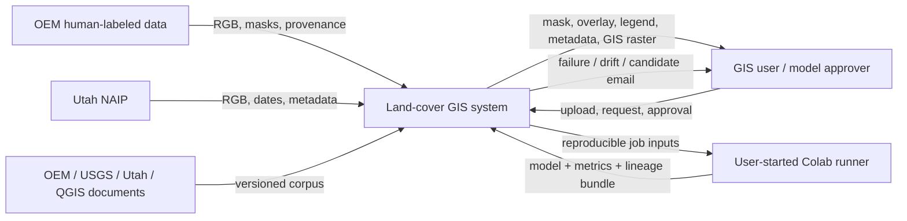
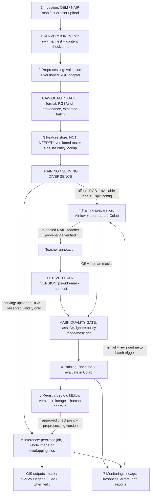
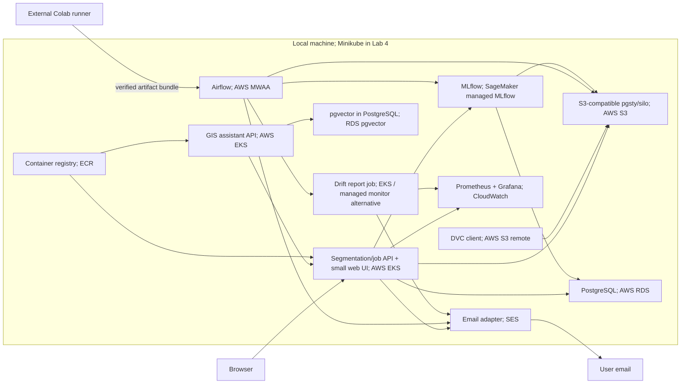

# Design

## Context

Мотивація та межа change наведені в [proposal.md](proposal.md). Цей документ є planning artifact OpenSpec; `docs/design.md` та каркас Lab 1 будуть створені лише під час окремого apply.

Головне джерело вимог — [docs/lab-1.pdf](../../../docs/lab-1.pdf), с. 2–5, додатки 2–3. SHA-256 перевіреного PDF: `f0d245992c4bb3813da0f9dacb05d8c14307587d70741ab6d570d508ceaf2279`. Вихідний commit — `d2b0800`; перед propose working tree був чистим. README порожній; Python constraint — `>=3.12`; залежностей немає; uv.lock містить лише початковий проєкт. Design, Makefile, pre-commit та CI відсутні; активних changes і capability specs до цієї роботи не було.

### Факти, прочитані з машини 2026-10-22

| Параметр | Фактичне значення | Метод / межа перевірки |
|---|---|---|
| Host | Apple M4 Pro, Mac16,7, arm64 | `sysctl`, `uname -m` |
| CPU | 14 доступних CPU-ядер | `hw.ncpu`; завантаження й швидкість inference не виміряні |
| RAM | 25 769 803 776 bytes = 24 GiB | `hw.memsize`; це RAM host, не Docker VM allocation |
| OS | macOS 26.6.2, build 25G83 | `sw_vers` |
| Доступний диск volume | приблизно 204.18 GiB | `df -k .`; моментальний стан, не квота проєкту |
| Системний Python | 3.14.6 | `python3 --version`; не прийнятий автоматично як ML runtime |
| uv | 0.11.21 | `uv --version` |
| Docker CLI | 29.5.2 | `docker --version`; daemon і ліміти Docker VM не перевірені |
| Minikube | команда не знайдена в PATH | кластер не запускався |
| Модель / дані / corpus snapshots | не завантажені й не запускалися | немає замірів mIoU, inference latency, peak RAM або GPU time |

Позначення нижче: **погоджено** — рішення користувача; **припущення** — запропонований параметр дизайну; **не перевірено** — потрібні bytes, запуск або зовнішнє підтвердження. Показники 1 хв / 5 хв з раннього обговорення відкликані та не є вимогами.

## Goals / Non-Goals

**Goals:**

- Підготувати завершений Lab 1 design з перевірюваними джерелами, прозорими припущеннями, контрактами та трьома узгодженими схемами.
- Залишити в apply конкретні, обмежені задачі з документації та мінімального reproducible tooling.
- Описати майбутні компоненти так, щоб одна система поступово проходила Labs 2–5.

**Non-Goals:**

- Реалізація ML/runtime/UI/LLM, завантаження датасетів або checkpoints, створення cloud resources, платні API та надсилання email у цьому change.
- Перевибір погодженої теми, повернення видалених research-чернеток або розширення до building instances, повного 3D, висот, engine integration чи operational miltech-рішень.
- Видавання catalog metadata, ручної арифметики або плану benchmark за результати виконаного експерименту.

## Decisions

### D1. Межа Lab 1 і формат артефактів

Apply створює лише `README.md`, `docs/design.md`, `.python-version`, `Makefile`, `.pre-commit-config.yaml`, `.github/workflows/lint.yml` та змінює `pyproject.toml`/`uv.lock` для dev tooling. Поточний propose пише лише в цей change. Для документації й tooling встановлено `skip_specs: true`: runtime specs вводитимуться у changes реалізації відповідних labs.

Зміст розділів 1–7.4 нижче є основою майбутнього `docs/design.md`. Під час apply його слід оформити з точною нумерацією PDF, без OpenSpec-службових розділів Context/Goals/Migration. Наявні припущення та незавершена calculator verification зберігаються видимими.

### D2. Мінімальне середовище Lab 1

Запропонований Python для проєкту — 3.12.13 у `.python-version`, узгоджений із задокументованим Colab runtime 2026.07; це вибір майбутнього середовища, не встановлений зараз interpreter. Зберігається погоджена вимога Python >=3.12. Початкові dev pins: Ruff 0.17.2 та pre-commit 4.7.0; релізи перевірені на PyPI, але install/lock compatibility буде перевірено в apply. Джерела: [Colab runtime versions](https://research.google.com/colaboratory/runtime-version-faq.html), [Ruff](https://pypi.org/project/ruff/), [pre-commit](https://pypi.org/project/pre-commit/).

`make setup` виконує `uv sync --locked`; `make lint` — `uv run --locked ruff check .`. Local pre-commit hook викликає ту саму команду Ruff через uv з того самого lock. CI виконує setup/lint на push і pull_request, використовуючи Python pin та явну версію uv. Torch, GDAL, Airflow, MLflow та LLM-пакети на етапі Lab 1 не додаються. Відсутність Python source не є підставою створювати штучний app або тести заради lint.

### 1 Overview

GIS-фахівцю потрібна початкова тематична карта покриття території зі знімка зверху. Система приймає RGB-зображення різних розмірів і повертає піксельну маску восьми класів OpenEarthMap, кольорову візуалізацію, overlay та легенду. Для GeoTIFF із придатною геоприв'язкою вона також готує геоприв'язаний raster-шар. Нові визначені партії даних проходять перевірку, автоматичну розмітку, донавчання від чинної моделі та оцінювання з ручним затвердженням активації. Мета курсового проєкту — відтворюваний, інтегрований і спостережуваний процес підготовки GIS-результату та оновлення моделі.

Ці п'ять речень утворюють погоджений зміст anchor overview; після затвердження фінального документа його не переписують під кожну наступну lab.

### 2 Motivation

Основний споживач — GIS-фахівець / картограф, який отримує новий знімок і готує тематичні raster-шари. Використання відбувається за потреби; припущення для першої версії — один користувач та одне активне inference-завдання. Помилки класів можуть спричинити ручну корекцію або непридатність карти для конкретної роботи, тому результат має показувати taxonomy, версію моделі й обмеження.

Другорядне потенційне застосування — маски як вхід до підготовки території для симулятора. Висоти, матеріали, прохідність, 3D та інтеграція з рушієм не випливають із семантичного класу й не включені до першого результату.

### 3 Success metrics

| Рівень | Метрика / правило | Статус і перевірка |
|---|---|---|
| Decision/workflow | Не менше 9 із 10 заздалегідь визначених коректних входів дають повний пакет, який можна відкрити в GIS без виправлення формату, grid або геоприв'язки | Погоджена попередня ціль, не виміряна. Набір охоплює PNG/JPEG, affine GeoTIFF та різні dimensions; pixel-only входи не зобов'язані мати CRS |
| Model | Initial candidate mIoU вище trivial baseline; після донавчання mIoU на фіксованій незалежній OEM validation не нижчий за чинну версію | Погоджена відносна ціль; тільки після provenance gate. Показувати IoU/support кожного з 8 класів |
| System | Completion/failure rate, end-to-end p50/p95, queue wait, peak RAM і throughput за 1 active job | Числові latency/RAM targets невідомі до benchmark; припущення — асинхронна робота на зафіксованій локальній конфігурації |
| New-domain diagnostic | Згода з псевдомасками NAIP + до 5 прев'ю на кандидата | Діагностика teacher agreement і очевидних помилок; не незалежна temporal accuracy |

Для захисту: mIoU є optimization metric; format validity, ресурсні межі й completion є satisficing checks. 9/10 не означає достатню картографічну точність чи підтверджене заощадження робочого часу.

### 4 Requirements and constraints

Функціонально: один файл → persisted job → original/class-ID mask/color mask/overlay/legend/metadata; adaptive whole-image або overlapping tile inference; результат у початковій pixel grid; georeferenced export за наявності коректних CRS/affine; окремий batch lifecycle для навчання; ручний promotion і rollback; GIS-помічник для запиту, перевірок та експорту.

| Категорія NFR | Рішення, число або явне припущення |
|---|---|
| Freshness | Для кожної явно доданої партії перевіряється очікуваний raw manifest/version. 0 нових source scenes у режимі expected-new при отриманні старої версії означає stale-input failure. Добова «свіжість знімання» для NAIP не вимагається |
| Latency / throughput | 1 користувач, 1 active inference job; решта queued. p95/throughput ще не виміряні; метод benchmark у 6.3. Черга та власне обчислення обліковуються окремо |
| Availability / fallback | Працює, коли запущене середовище; SLA 24/7 не заявлено. Помилкове завдання має terminal reason і повторний запуск. Недоступна модель дає readiness failure; сервіс не видає фальшиву маску |
| Reproducibility | Training data version + code commit + config/preprocessing/taxonomy versions + checkpoint digest + seeds фіксуються для run. Повтор тієї самої партії не дублює дані. Після expiry inference input повтор потребує повторного надання того самого файла; metadata не відновлює bytes. Byte-identical GPU weights між різним hardware не обіцяються |
| Adaptability | Початкова OEM-модель → донавчання з останнього approved checkpoint на новій визначеній партії; частка старих даних у replay ще є параметром експерименту. Promotion тільки людиною |
| Observability без GT | Errors, durations, watermark, channel/GSD metadata, image statistics та predicted class fractions. Drift не є доказом зміни IoU. Reference/version і threshold policy входять до report |
| Cost / resource ceilings | Фактичні платні витрати $0. Host 24 GiB RAM не дорівнює quota сервісу. Upload bytes, decoded pixels, tile/batch size, timeout і Docker/Minikube RAM мають бути bounded config; значення встановлюються за resource probe до запуску runtime |

**Припущення щодо входів:** перший adapter підтримує 8-bit RGB PNG/JPEG і GeoTIFF із визначеним RGB band mapping. Інші bit depths або невідомі bands повертають пояснену відмову до додавання явного adapter. Це початковий compatibility contract, а не перевірена властивість усіх зовнішніх зображень. Dimensions довільних пропорцій; тестові 1024/4096 та внутрішні tile sizes не є користувацькими межами.

In scope: semantic land-cover raster, початковий GIS-пакет, відтворюване оновлення та описаний roadmap. Out of scope: detection/instances, підрахунок споруд, автоматичне розділення суміжних будівель, гарантована якість іншої географії, геоприв'язка з нічого, м² без придатного масштабу/методу, 3D, постійний production cloud.

Пріоритети конфліктних вимог: правильна source grid і валідний результат важливіші за швидкий, але некоректний export; бюджет $0 і запуск за потреби мають пріоритет над 24/7 availability. Retention training artifacts забезпечує відтворюваність навчання, тоді як одноденне зберігання приватних inference inputs свідомо обмежує їхній пізніший replay.

### 5.1 Problem statement

Багатокласова semantic segmentation: кожен валідний RGB-піксель отримує один із восьми взаємовиключних OEM-класів. Відхилений framing — building-only segmentation: він дає менше змістовних типів покриття, ніж бажана GIS-карта.

### 5.2 Data

**Погоджений часовий план:**

| Дані | Роль |
|---|---|
| OEM | Початкове supervised навчання та human-labeled development control за умови незалежності weights |
| Utah NAIP 2018 | Перша зовнішня партія псевдорозмітки та донавчання |
| Utah NAIP 2021 | Наступне оновлення від останньої затвердженої моделі |
| Utah NAIP 2024 | Фінальне порівняння; не для train, threshold tuning або регулярного promotion |

OEM має 8 класів, RGB та GSD приблизно 0.25–0.5 m; стандартний split виконується всередині регіонів. Utah NAIP 2018+ заявлено 0.6 m, тому це також зміна масштабу. Першоджерела: [OEM paper, 2.2/S1](https://arxiv.org/html/2210.10732), [Utah NAIP](https://gis.utah.gov/products/sgid/aerial-photography/naip/). Конкретні AOI, bytes tiles, наявність усіх класів і scene overlap ще не перевірено; спочатку потрібен малий міський/сільський піднабір. OEM ZIP не є гарантовано повним комплектом RGB: xBD imagery може потребувати окремого отримання.

**Чотири пункти checklist Lab 1:**

1. **Time axis:** використовуємо справжній acquisition year/date/interval NAIP і окремий ingestion replay архівних партій; OEM-2022+ з NAIP-2018 є ретроспективним відтворенням надходження, а не історичним backtest доступної у 2018 моделі.
2. **History/holdout:** 2018/2021 для оновлень та development; 2024 тримаємо закритим до фінального порівняння. Scene/AOI groups і просторове перекриття перевіряємо до crops; temporal і geographical transfer розрізняємо.
3. **Labels/delay:** OEM labels надходять із dataset release; NAIP pseudo labels доступні після завершення annotation job, без вигаданого фіксованого delay. Регулярне незалежне human ground truth для нових NAIP не планується; operational delay для нього — «не надходить».
4. **Text corpus:** конкретний corpus у 6.8: OEM paper/code mapping, USGS NAIP dictionary, Utah flight-date documentation, QGIS 3.44 raster documentation і власний export contract. Snapshot/versioning — наступний етап, corpus ще не індексовано.

Компенсація для Lab 1: явно описати відсутність незалежних temporal masks і оцінювати teacher agreement разом із незалежним OEM-контролем, якщо його незалежність підтверджена. Це не доводить temporal generalization і не гарантує виконання ще невідомих повних вимог Lab 2.

**Часові поля:** `acquisition_start/end`, `date_precision`, `source_published_at` nullable, `ingested_at`, `processed_at`, `pseudo_labeled_at`. Невідома дата залишається unknown; рік не стає вигаданим 1 січня. USGS розрізняє Acquisition Date і Date Entered; Utah індекси використовують SrcImgDate для 2018/2021 і DATE для 2024. [USGS dictionary](https://www.usgs.gov/centers/eros/science/national-agriculture-imagery-program-naip-data-dictionary).

**Version/freshness:** стабільний raw manifest включає source IDs, checksums, acquisition metadata та adapter version, але виключає змінні ingestion/run timestamps із content digest. Похідні annotation/training manifests додатково посилаються на teacher/checkpoint/config/split versions. Режим expected-new звіряє очікуваний source period/scene set і raw content; повтор старої партії дає freshness failure. Навмисний replay тієї самої версії дає no-op/відтворюваний результат без дублювання. Watermark оновлюється після commit валідного набору, а не після будь-якого успішного DAG.

**Формати й розміщення:**

| Шар | Формат / зберігання |
|---|---|
| Raw | Незмінні source PNG/JPEG/GeoTIFF у object storage, versioned через DVC |
| Clean / labels | Канонічний RGB і integer masks PNG/GeoTIFF з manifest; crop/tile artifacts відтворюються після split із config |
| Features | Тензори RGB/normalization під час run; окремої persisted feature table немає |
| Manifests / metadata | Versioned JSON/JSONL зі стабільним порядком; PostgreSQL для operational job/run state |
| Models / reports | Checkpoint + manifest + JSON metrics/previews у artifact storage, посилання в MLflow |
| Corpus у Lab 3 | Source snapshots + extraction config/digests; index посилається на точну doc_version |

Git зберігає код, конфігурацію, документацію, lock і DVC pointers/manifests; великі raster/checkpoint bytes залишаються у DVC/object storage. Git LFS не вводиться, бо цю роль вже виконує обраний DVC remote; CSV/Parquet не замінюють raster images, а для малого manifest достатньо JSON.

### 5.3 Techniques

**Baseline:** кожен піксель прогнозується як найчастіший клас, визначений лише за train labels після ignore filtering. Це контрольна точка, не робоча карта.

**Candidate:** U-Net / ResNet18 із ImageNet encoder та 8 вихідними класами через segmentation_models_pytorch; це початковий кандидат, не твердження про найкращу модель. Перше OEM навчання створює робочу версію, подальші NAIP runs ініціалізуються останнім approved checkpoint. [SMP Unet](https://smp.readthedocs.io/en/latest/models.html), [encoder weights](https://smp.readthedocs.io/en/latest/encoders.html).

**Annotator:** окреме готове рішення з сумісною taxonomy; checkpoint ще не затверджений. Для кожного pseudo dataset потрібні teacher source, digest, training splits, mapping та annotation config. Офіційні lightweight OEM weights бачили train і validation; новий власний split із тих самих знімків не виправляє залежність. [OEM code](https://open-earth-map.org/code.html). GeoSeg-OV публікує інший готовий варіант, але його repacked split IDs та сумісність ще треба звірити; це кандидат дослідження, не підтверджений teacher. [GeoSeg-OV](https://github.com/zzaiyan/GeoSeg-OV).

| Вхід / властивість | Train-time source | Serving-time source / правило |
|---|---|---|
| RGB pixels | OEM / NAIP adapter | Завантажений файл; той самий channel order і versioned normalization |
| Masks | OEM human labels / versioned teacher output | Відсутні й не потрібні для inference |
| GSD | Source metadata, якщо є | Metadata файла або явно наданий параметр; unknown не вгадується |
| CRS / affine / validity | Source raster metadata | Metadata вхідного raster; не є прихованою ознакою з labels |
| Preprocessing | Config разом із checkpoint | Точна відповідна версія з model manifest |
| Augmentation | Лише train, синхронно для image/mask | Не застосовується як випадкове train augmentation |

Для NAIP RGBNIR вибираємо відомі RGB bands через adapter; модель не починає використовувати NIR неявно. Resize class masks — nearest-neighbor. Whole/tiled inference і stitching мають використовувати однакові model/preprocessing versions.

### 5.4 Experimentation and validation

- Резервуємо OEM train/validation groups до crops/augmentation; перевіряємо source-scene overlap, суміжні tiles і повторне використання benchmark imagery.
- До включення готових weights перевіряємо, що модель/teacher не навчалися на зарезервованому контролі. Невідоме provenance блокує заяву про незалежність; teacher train+val не проходить цей gate.
- Якщо незалежність не підтверджується, відповідний teacher не використовується для такого promotion protocol; пошук сумісного checkpoint продовжується. Lab 1 фіксує цю залежність відкрито, а не позначає її виконаною.
- Development scene groups 2018/2021 відокремлюємо від update groups наперед; 2024 відкриваємо для фінального порівняння після фіксації конфігурації.
- IoU для класу = TP/(TP+FP+FN). Рахуємо aggregate confusion matrix на valid GT pixels, а не середнє patch IoU; показуємо support. Клас із нульовим denominator позначаємо undefined із явною averaging policy, не підміняємо IoU=1.
- Порівнюємо candidate/current на тому самому незалежному control та config. Gate mIoU ≥ current не замінює перегляд per-class IoU; помітна class regression пояснюється перед ручним рішенням.
- NAIP-2024 оцінює agreement, якщо еталоном є pseudo labels; до 5 preview — sanity check, не доказ справжнього IoU.
- Готові official OEM test labels або працездатний evaluation server не припускаються без фактичної перевірки.

### 5.5 Human in the loop

Користувач отримує email про pipeline failure/drift та готового кандидата, переглядає метрики, lineage і до 5 preview та явно затверджує activation. Автоматичного promotion немає. Відхилений кандидат залишається run artifact, чинний alias не змінюється. Override/rollback повертає alias до конкретної попередньої approved version; той самий job завжди фіксує фактично завантажений checkpoint digest.

Lifecycle artifacts: experiment config/run → candidate checkpoint + data/code lineage → registered model version → approved serving alias → monitoring report → next update candidate; попередня retired version зберігається для audit/rollback протягом проєкту.

Colab запускається людиною; усі кроки всередині виконуються командами/конфігурацією репозиторію. Обмін із локальним стеком — перевірюваний artifact bundle: model, metrics, config, source/data versions, commit і checksums; імпорт реєструє run/model у локальному MLflow. Відкривати PostgreSQL або MLflow в інтернет для Colab не потрібно. Доступність ресурсів Colab не гарантується. [Colab FAQ](https://research.google.com/colaboratory/faq.html).

### 6.1 High-level design

Схеми описують цільовий розвиток системи; запуск цих компонентів не входить до apply Lab 1.

**Context:**



**Seven-layer data flow:**



Versioned files виконують offline artifact роль без окремого feature store. Raw gate не вимагає masks для inference або нових NAIP: mask checks застосовуються лише за наявності labels, а донавчання потребує окремого mask gate після annotation. Teacher provenance перевіряється до запуску annotator; похідні маски мають власний version point. На serving-гілку не переходять GT masks. Завантаження теж має input digest/job metadata; це не автоматичне додавання до training dataset.

**Deployment draft:**



### 6.2 Infra

Погоджений local stack: DVC, S3-compatible storage, Airflow, MLflow, PostgreSQL. Нижче уточнено design-level topology; додані framework/monitoring варіанти є припущеннями для наступних labs.

| Функція | Local / external | Умовний cloud equivalent | Етап |
|---|---|---|---|
| Raw data, masks, models, reports | MinIO-compatible pgsty/silo з reference PDF; ARM image compatibility ще pending | [Amazon S3](https://docs.aws.amazon.com/AmazonS3/latest/userguide/Welcome.html) | Lab 2 |
| Версії raster artifacts | DVC + S3 remote | Той самий DVC, remote у S3 | Lab 2 |
| Batch orchestration | Airflow | [Amazon MWAA](https://docs.aws.amazon.com/mwaa/latest/userguide/what-is-mwaa.html) | Lab 2 |
| Jobs / metadata | PostgreSQL | [RDS PostgreSQL](https://docs.aws.amazon.com/AmazonRDS/latest/UserGuide/CHAP_PostgreSQL.html) | Labs 2/4 |
| Tracking / registry | MLflow + PostgreSQL backend + S3 artifacts | [SageMaker managed MLflow](https://docs.aws.amazon.com/sagemaker/latest/dg/mlflow.html); artifact bucket у S3 | Lab 2 |
| Training / annotation | Людиною запущений Colab | GPU compute рахується окремо; у цьому hybrid scenario залишається Colab | Lab 2 |
| Segmentation/job API + UI | Попередньо FastAPI + проста HTML-сторінка, model worker | EKS containers | Lab 4 |
| GIS assistant API | Окремий сервіс, попередньо FastAPI | EKS containers; LLM backend ще не обраний | Labs 3/4 |
| Runtime deployment | Docker / Minikube | [Amazon EKS](https://docs.aws.amazon.com/eks/latest/userguide/what-is-eks.html) | Lab 4 |
| Container registry | Minikube registry | ECR | Lab 4 |
| Drift reports | Попередньо Evidently job | У кошторисі job на EKS; managed alternative — SageMaker Model Monitor, не включений як окрема послуга | Lab 4 |
| Metrics / dashboard | Попередньо Prometheus/Grafana | CloudWatch | Lab 4 |
| Retrieval index | Попередньо pgvector у тій самій PostgreSQL | Обраний сценарій: RDS з pgvector; managed alternative з таблиці курсу: OpenSearch Serverless vector search, не включений у кошторис | Lab 3 |
| Email adapter | SMTP credentials у local secrets | SES | Lab 4 |
| Feature store | Not needed: raster artifacts, без online entity features | Окремий managed feature store не замовляється | Усі |

Два containerized application services — segmentation/job API та GIS assistant API. У кожного власний readiness contract: segmentation вимагає валідного checkpoint/preprocessing manifest; assistant — model backend/embedding configuration і доступного corpus index. Відсутній required model artifact має робити probe неуспішним. HTTP liveness саме по собі не підтверджує readiness.

[FastAPI](https://fastapi.tiangolo.com/) — запропонований framework, не встановлена залежність. Номери версій reference stack у PDF — вимоги/орієнтири курсу; їхню ARM/Python сумісність ще не перевірено, тому всі runtime dependencies зараз не додаються.

### 6.3 Performance

Погоджено job-based asynchronous delivery з persisted status. Async не прискорює модель; whole-image і tiling — окреме рішення за розміром та memory budget. Початковий benchmark reference — CPU-serving на зафіксованому Docker/Minikube allocation цього host; наявність прискорення в контейнері не припускається.

**План вимірювання, не результат:** зафіксувати commit/data/model/preprocessing versions, CPU/RAM limits, dtype і threads; провести окремий cold-start та 5 warm-up запусків, потім по 30 запусків для 1024×1024 і 4096×4096 та одного обраного великого raster case. Виміряти decode/preprocess/inference/stitch/export, peak RSS, p50/p95 завершення від кінця upload при порожній черзі, queue wait і images/hour. Тестові dimensions не є upload limits.

До runtime launch обов'язкові конфігуровані максимуми upload bytes, decoded pixels, in-flight jobs, tile/batch memory, job deadline і temporary disk. У Lab 1 вони явно unknown до resource probe; не можна підміняти їх host RAM чи заявляти необмежений upload. Якщо candidate не проходить бюджет, змінюємо внутрішній tile/batch size або кандидат після вимірювання.

### 6.4 Security

Local single-user: host ports публікуються на loopback; внутрішній container bind не дорівнює дозволу public ingress. Auth/публічний multi-user service зараз не реалізуються. Secrets передаються environment/local ignored config; чинний .gitignore вже виключає .env/.env.*. Логи й corpus не містять credentials.

Trust boundaries: перевіряємо фактично декодований формат, channels/dtype, positive dimensions, bounded decoded size, corrupt/TIFF expansion, class domain та grid. Сервер генерує власні object names, забороняє client-controlled paths і не розпаковує довільні архіви через upload API. Downloads/databundles перевіряються checksum. Документи retrieval і тексти запиту є даними: їхні інструкції не можуть змінити дозволи агента чи ініціювати promotion. Tool calls проходять ті самі deterministic validators.

### 6.5 Data privacy

Погоджено inference inputs/results зберігати 1 добу. **Припущення точного відліку:** expires_at = accepted_at + 24h; після expiry доступ закритий, queued job не стартує, bytes видаляються cleanup. Deadline running job не пізніше expires_at: прострочене виконання скасовується, пізні outputs не публікуються й також видаляються. Якщо локальне середовище вимкнене, фізичне видалення виконується при наступному старті; ця межа on-demand сервісу описується користувачу.

**Нове припущення:** технічні логи й агреговані метрики зберігаються до 30 днів без image bytes, повних назв файлів, точних координат чи secrets; навчальні manifests, дозволені dataset versions, model artifacts і experiment lineage — протягом проєкту. Uploads не стають training data автоматично. Overhead imagery не оголошується гарантовано позбавленою персональних/чутливих даних. Ліцензійні обмеження й атрибуцію джерел фіксуємо стисло; dataset redistribution не є deliverable Lab 1.

### 6.6 Monitoring and alarms

| Сигнал | Поріг / правило | Реакція |
|---|---|---|
| Непридатна training batch | ≥1 blocking format/mask/grid/checksum/class error | Failed gate, report і email; жодного нового training commit |
| Expected-new freshness | Невідповідний очікуваний raw version/period або 0 new scenes при повторі старого набору | Stale-input failure/email; watermark не просувається |
| Навмисний replay | Той самий manifest/config/seed, явний replay mode | No-op або відтворюваний output; без помилкового stale alert |
| Runtime job failure / required model missing | ≥1 terminal failure; model readiness=false | Причина користувачу; email за deduplicated event; чинна версія не змінюється |
| Input/prediction drift | Нове припущення: alert, коли обрана статистика перевищує 95-й перцентиль reference-vs-reference window comparisons | Щоденний report/email, ручна перевірка; reference/version і достатність samples мають бути зафіксовані |
| Недостатній monitoring sample | Менше каліброваного мінімального window size; розмір ще unknown | Insufficient-data status; не заявляємо «drift немає» |
| Performance/resources | Зафіксований configured limit/deadline перевищено; числа після benchmark | Failure/report; p50/p95 і peak RAM видимі |

95-й перцентиль — нове калібрувальне припущення, не доведена якість drift detector; метод, sample unit та корекцію множинних сигналів уточнюємо за reference windows. Повідомлення не надсилається для кожного пікселя/показника: event key запобігає повторному email про ту саму подію. Моніторинг запускається раз на добу, коли середовище працює; Lab 4 має показати dashboard щонайменше за 2 windows та injected drift, email про який реально отримав користувач.

Класові частки inference рахуються лише на observed-valid input domain. Без GT не обчислюємо «поточний IoU» та не використовуємо приховану GT ignore mask.

### 6.7 Cost

Фактичний погоджений бюджет — **$0 платних сервісів**, локальне виконання + доступний Colab. Електрика/власне обладнання не оцінюються як cloud bill.

Параметрична модель:

```text
C_month = sum(H_service * rate_hour)
        + V_persistent * rate_GB_month
        + V_temporary_avg * rate_GB_month
        + request_cost + network_cost + logs_metrics_email_cost
        + H_GPU_training * rate_GPU + C_LLM_backend
V_temporary_avg ≈ uploads_per_day * average_input_and_output_GB * retention_days
```

Не слід додавати C_LLM_backend вдруге, якщо його CPU/RAM уже оплачено shared worker. Кількість GPU runs і час annotation/fine-tuning невідомі, тому full cloud training не оцінено як нуль: цей доданок винесений за межу наведеного hybrid scenario.

**Попередній числовий scenario:** AWS us-east-1, 730 h/month, 24/7 managed cloud equivalent для serving/operations, без discounts/credits, USD до податків. Це розрахункова альтернатива, не зміна погодженої on-demand доступності та не рекомендація платного deployment. Один CPU worker 4 vCPU/16 GiB є capacity assumption, не benchmark segmentation+LLM.

| Стаття | Вхід / ставка | USD/month | Доказовість ставки |
|---|---|---:|---|
| EKS standard control plane | 730 × 0.10 | 73.00 | [EKS pricing](https://aws.amazon.com/eks/pricing/) |
| EC2 worker m5.xlarge | 730 × 0.192 | 140.16 | [AWS sample snapshot June 2026](https://aws-samples.github.io/sample-apex-skills/docs/skills/eks/eks-cost-intelligence/references/cost-estimation-fallback/); повторна регіональна перевірка потрібна |
| Worker EBS gp3 | 50 GB × 0.08 | 4.00 | [EBS](https://aws.amazon.com/ebs/volume-types/) |
| MWAA small | 730 × 0.49 | 357.70 | [MWAA pricing example](https://aws.amazon.com/managed-workflows-for-apache-airflow/pricing/) |
| MWAA metadata storage | 10 GB × 0.10 | 1.00 | Те саме джерело; не дублює RDS jobs DB |
| Managed MLflow small + metadata | 730 × 0.60 + 1 GB × 0.10 | 438.10 | [SageMaker pricing, MLflow example](https://aws.amazon.com/sagemaker/ai/pricing/); арифметику перераховано самостійно, регіональну ставку ще підтвердити в calculator |
| RDS PostgreSQL jobs/index | 730 × 0.016 + 20 GB × 0.115 | 13.98 | **Тарифне припущення**, числа ще не підтверджені calculator; [RDS pricing](https://aws.amazon.com/rds/postgresql/pricing/) |
| S3 | 100 GB × 0.023 + 10k PUT × 0.005/1k + 100k GET × 0.0004/1k | 2.39 | [S3 pricing](https://aws.amazon.com/s3/pricing/); регіональне підтвердження в calculator |
| ECR | 5 GB × 0.10 | 0.50 | [ECR pricing](https://aws.amazon.com/ecr/pricing/) |
| CloudWatch | 5 GB ingest × 0.50 + 5 GB stored × 0.03 + 10 metrics × 0.30 | 5.65 | [CloudWatch examples](https://aws.amazon.com/cloudwatch/pricing/) |
| Network | 2 NAT × 730 × 0.045 + 10 GB × 0.045 + 2 IPv4 × 730 × 0.005 | 73.45 | [VPC pricing](https://aws.amazon.com/vpc/pricing/); NAT regional rate — припущення до calculator |
| SES | 100 email × 0.10/1000 | 0.01 | [SES pricing](https://aws.amazon.com/ses/pricing/) |
| **Проміжний підсумок scenario** | Ручна арифметика, включаючи непідтверджені тарифи | **1109.94** | **Не calculator-validated quote** |

Мережеве припущення: 2 AZ для MWAA, 2 NAT, private administrative access без public ALB; S3 того самого регіону, загальний internet egress <100 GB/month у межах доступного account-level allowance. Якщо потрібні interface endpoints, додається їхній ENI-hour/data cost: приклад 4 endpoints × 2 AZ × 730 × $0.01 + 10 GB × $0.01 = $58.50. Кількість endpoints, cross-AZ traffic, backups, публічний ingress і точний routing ще не визначені; не додаємо взаємозамінні мережеві шляхи автоматично. Standard EKS control plane уже врахований; додаткові EKS capabilities та CloudWatch dashboard/alarm charges додаються лише за обраною конфігурацією. [MWAA VPC](https://docs.aws.amazon.com/mwaa/latest/userguide/vpc-create.html), [PrivateLink](https://aws.amazon.com/privatelink/pricing/).

Worker оплачує segmentation API, GIS assistant API, CPU model backend та drift-report jobs у межах припущеної capacity. Managed MLflow має власний backend; RDS у кошторисі — jobs/retrieval, а не повторна оплата його metadata. Придатність такого worker і RDS для обраної майбутньої LLM ще не підтверджена. Full cloud GPU training, API LLM, додатковий GPU-serving, support, податки та перевищення allowances не включені.

**Стан вимоги calculator:** [AWS Pricing Calculator](https://calculator.aws/) у доступному web-reader відкрився як JavaScript app без придатної форми. Збережений estimate/export не створений. До завершення Lab 1 apply потрібно відтворити зазначені inputs у provider calculator, перевірити EC2/RDS/managed MLflow/NAT/network topology, dashboard/alarm selection та зафіксувати дату, посилання/estimate ID і total у 6.7. Поточну таблицю не можна позначати як завершений calculator-backed estimate. Це конкретний delivery gate, а не прихований виконаний пункт.

### 6.8 Integration points

**Upstream:** OEM authors/source imagery та Utah UGRC/NAIP; зберігаємо source URL/entity ID, license note, scene/AOI ID, acquisition metadata, checksums і adapter version. Невалідна training batch відхиляється повністю з report; inference upload без labels є нормальним входом.

**Власний mask contract — taxonomy v1:**

| Internal ID | OEM raw ID | Канонічний клас |
|---:|---:|---|
| 0 | 1 | bareland |
| 1 | 2 | rangeland |
| 2 | 3 | developed space |
| 3 | 4 | road |
| 4 | 5 | tree |
| 5 | 6 | water |
| 6 | 7 | agriculture land |
| 7 | 8 | building |
| 255 | 0 | ignore/unknown у training; observed NoData у export за окремою policy |

Raw mapping підтверджено [OEM utils.py](https://raw.githubusercontent.com/bao18/open_earth_map/main/open_earth_map/utils.py); кодові aliases Grass/Pavement/Cropland узгоджуємо з назвами paper taxonomy, а не вводимо додаткові класи. Офіційний [dataset loader](https://raw.githubusercontent.com/bao18/open_earth_map/main/open_earth_map/dataset.py) не є готовим нашим remap: перетворення 1–8→0–7 і 0→255 робимо явно; unsigned underflow при mask−1 заборонений.

Ignore=255 виключається з loss/confusion matrix. На inference 255 дозволено лише за observed alpha/NoData/validity; padding обрізається, низька confidence сама не стає NoData. На валідному RGB кожен піксель має ID 0–7.

**Downstream GIS:** source-grid class-ID mask, palette/legend, colored preview/overlay і JSON metadata. GeoTIFF output — uint8 single band з тими самими width/height, CRS та affine, коли вони придатні. Відсутня affine або RPC/GCP-only input дає pixel mask і діагностику, без вигаданої геоприв'язки. QGIS round-trip перевіряє grid, class domain, NoData та palette. [QGIS 3.44 Raster Properties](https://docs.qgis.org/3.44/en/docs/user_manual/working_with_raster/raster_properties.html). Перший scope не потребує площ у м².

**Job/result contract:** server-generated job_id, input digest, accepted_at/expires_at, status `queued/running/succeeded/failed/expired`, versioned model/preprocessing/taxonomy, actual checkpoint digest, pixel dimensions, CRS/affine availability, valid-domain policy, file references і machine-readable validation reasons. Повтор після failure створює пов'язаний новий run; model promotion під час job не змінює його вже обраний checkpoint.

**Colab bundle:** dataset manifest digest, code commit, config/seed/environment, teacher/current-model IDs, checkpoint digest, metrics, preview references і validation report. Bundle не містить SMTP/cloud secrets; імпорт перевіряє hashes/schema/target dataset version перед logging у локальний MLflow.

**Конкретний retrieval corpus:**

| doc_id | Документ / вибрані розділи | Версія / стан |
|---|---|---|
| oem-paper | [OpenEarthMap paper](https://arxiv.org/html/2210.10732): 2.2, S1 class definitions, S5 attribution | arXiv 2210.10732v1; metadata перевірено 2026-10-22 |
| oem-mask-codes | [OEM utils.py](https://raw.githubusercontent.com/bao18/open_earth_map/main/open_earth_map/utils.py): class dictionaries | mutable main; exact commit і bytes hash ще pending |
| naip-dictionary | [USGS NAIP Data Dictionary](https://www.usgs.gov/centers/eros/science/national-agriculture-imagery-program-naip-data-dictionary): Acquisition Date, Date Entered, bands, resolution, datum/projection | Published 2021-07-19; direct open нестабільний, текст перевірено search |
| utah-naip | [UGRC NAIP](https://gis.utah.gov/products/sgid/aerial-photography/naip/): RGB/NIR, resolution, Finding flight dates | Last update 2024; metadata перевірено 2026-10-22 |
| qgis-raster | [QGIS 3.44](https://docs.qgis.org/3.44/en/docs/user_manual/working_with_raster/raster_properties.html): 13.1.1, 13.1.2, 13.1.3.1, 13.1.4 | Документована version 3.44 |
| project-export-contract | Цей погоджуваний розділ 6.8 майбутнього docs/design.md | planned; digest/commit з'явиться після фактичного запису |

Corpus manifest поля: doc_id/title/publisher/source_url/source_revision/accessed_at/selected_sections/snapshot_path/snapshot_sha256/extraction_version/doc_version/reuse_note. Chunks посилаються на doc_id + doc_version + section/page/line locator; відповіді цитують конкретні джерела. SHA256 обчислюється з фактичних snapshot bytes; зараз null/pending, фальшиві hashes не створюються. Lab 1 називає корпус; ingestion/indexing та versioned prompts належать Lab 3.

LLM сценарій: запит «підготуй GeoTIFF для QGIS» + metadata/validation → grounded план, пояснення відсутніх даних і дозволені кроки експорту. Lab 3 порівнює plain LLM та retrieval. Lab 5 надає inspect/segment/validate/export tools; числові обчислення/CRS-перевірки робить код, activation моделі залишається за користувачем.

### 6.9 Risks and uncertainties

| Ризик | Mitigation / gate |
|---|---|
| Teacher бачив OEM control | Перевірити training scene IDs/checkpoint provenance до pseudo-label stage; незалежність не заявляти без підтвердження |
| NAIP pseudo labels відтворюють помилки teacher | Agreement називати agreement; preview ≤5 є sanity check; не заявляти незалежний temporal IoU |
| Utah 0.6 m / інші регіони змінюють domain | Малий pilot, GSD metadata, per-class diagnostic; перенесення на Україну не гарантувати |
| Немає перевірених NAIP tiles / класового покриття | До Lab 2 вибрати малий конкретний міський/сільський AOI та перевірити dates, access, overlap і class support |
| Забування OEM після update | Фіксований незалежний development control, old-data replay як експериментальний параметр, human gate, rollback |
| Colab reset / нестача GPU | Repro command/config, збереження bundle/checkpoints, повторний запуск; сесія не є production worker |
| Великий/пошкоджений upload вичерпує RAM/disk | Bounded decoding, limits до runtime, tiling/streaming, failure reason |
| Train/serve skew | Спільний versioned RGB preprocessing, checkpoint manifest і ті самі channel/grid правила |
| Помилкові GIS coordinates | Лише перевірені CRS/affine, round-trip; pixel result за відсутності georeferencing |
| LLM помиляється / виконує інструкції документа | Retrieval citations, deterministic tool validators, обмежені tools, evaluation; promotion не делегується |
| Email не доходить / помилковий drift | Dedup, явний insufficient-data, Lab 4 injected shift із реально отриманим email |
| Cloud estimate неповний / capacity недостатня | Calculator gate, окремі unknown costs, benchmark; $0 фактичних витрат зберігається |
| Source imagery reuse / licensing | Вести provenance/attribution, overlap audit; стисло фіксувати явні обмеження, не поширювати dataset без підстав |

### 7.1 Alternatives

| Альтернатива | Плюси | Мінуси | Рішення |
|---|---|---|---|
| Building-only segmentation | Простіша taxonomy, фокус на будівлях | Втрачає дороги, рослинність, воду й інші бажані типи покриття | Відхилено на користь 8 класів OEM |
| Синхронний HTTP запит до повного завершення | Менше job-state логіки | Довгі jobs, timeout, слабка видимість прогресу | Відхилено; один файл → persisted asynchronous job |
| Зменшення кожного знімка до одного fixed input | Простий memory profile | Втрата дрібних об'єктів при великому raster | Не обираємо як єдину стратегію; whole/tiled за бюджетом |
| Full managed cloud 24/7 | Керовані сервіси, cloud topology | Сотні/тисяча USD при малому навчальному workload; суперечить $0 actual budget | Лише розрахунковий equivalent; фактичний запуск локально/Colab |
| Окремий feature store | Online entity-feature lookups | Для поточних raster inputs потреби не визначено | Not needed із поясненням у layer 3 |

### 7.2 Placeholder

Placeholder відповідно до Lab 1; буде заповнено за повними умовами Lab 2. Офіційну назву розділу не вигадуємо.

### 7.3 Placeholder

Placeholder відповідно до Lab 1; буде заповнено за повними умовами Lab 4. Офіційну назву розділу не вигадуємо.

### 7.4 Milestones

- **Lab 2:** versioned data pull, idempotent interval replay, deliberately failed bad-batch gate, baseline/candidate і MLflow run/model lineage з data version та commit.
- **Lab 3:** versioned corpus/prompts і plain-vs-retrieval evaluation з retrieval/answer metrics, tokens/compute/cost та p50/p95.
- **Lab 4:** два commit-tagged containerized services у Minikube з health contracts, scheduled reports/dashboard за ≥2 windows, injected drift із реально отриманим email та one-command startup/smoke.
- **Lab 5:** GIS agent з inspect/segment/validate/export tools, persisted traces та десятьма evaluation tasks, виконаними двічі.

Повні умови Labs 2–5 відсутні; milestones ґрунтуються лише на overview/scorecard Lab 1. Перед реалізацією кожної lab потрібно прочитати її повні умови.

## Risks / Trade-offs

Системні ризики та mitigations визначені в 6.9. Ризик самого change — перетворити Lab 1 на передчасну реалізацію всього курсу; його стримує точний file scope і відсутність runtime implementation tasks. Інша межа — надмірні твердження про вимірювання: hardware snapshot і ручна арифметика є фактами перевірки, а latency, якість, capacity та calculator quote залишаються непідтвердженими.

## Migration Plan

1. Створити docs/design.md зі змісту 1–7.4, звірити всі NFR/checklist та три схеми; зберегти явні assumptions.
2. Завершити calculator gate для 6.7 без створення cloud resources; exact inputs/estimate link записати в design. Якщо доступ до calculator лишається неможливим, явно повідомити цю конкретну перешкоду й не оголошувати Lab 1 повністю готовою до здачі.
3. Заповнити README, додати тільки dev pins/Python pin, Makefile, pre-commit і CI; сформувати lock.
4. Перевірити make setup/lint та pre-commit у чистому тимчасовому clone, без штучних ML tests; lint CI має стати green після окремо виконаного push.
5. Підготувати submission checklist і перевірити 20 theoretical questions Appendix 2 через власний дизайн. Окремий файл відповідей не потрібен.
6. Submission commit/push/tag lab-1 не виконуються поточним propose. За наступної явної команди виконати відповідний git workflow; rollback документації/tooling — цільовий revert власного change без втрати інших змін.

## Open Questions

- Конкретний teacher checkpoint, його original scene splits та реальні NAIP AOI ще не перевірені; це gates майбутнього data/training change, не підстава для вигаданих metrics у Lab 1.
- Точні runtime RAM/upload/tile/deadline limits і p95 визначаються benchmark до запуску сервісу; зазначений host snapshot не замінює цього.
- Конкретні LLM/embedding weights, package compatibility та drift reference sample/window sizes уточнюються у відповідних labs без зміни погоджених ролей.
- Calculator regional inputs/RDS/network topology ще потребують зовнішньої перевірки; delivery gate у Migration/tasks конкретно охоплює цю роботу.
